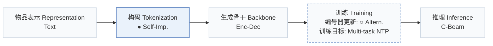
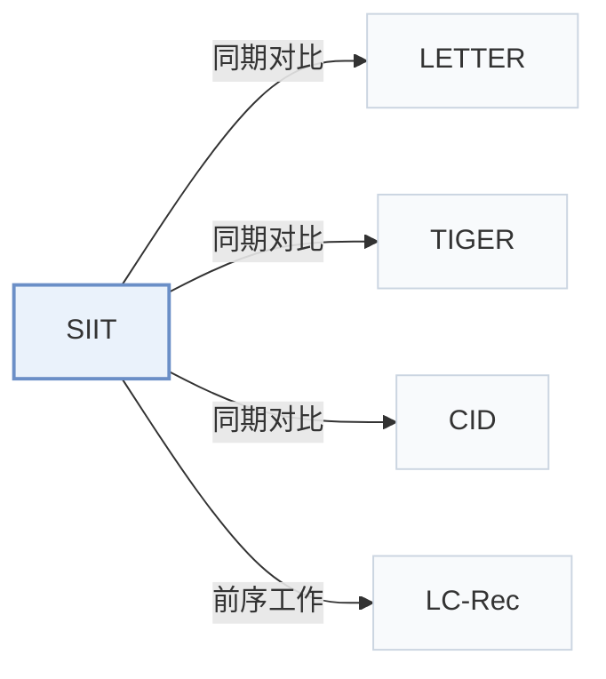

# SIIT

[← 问题 × 阶段矩阵](../../../README.zh.md#iii--tokenization) · [按阶段索引](../index/stages.md) · [按模态找论文](../index/modality.md) · [按领域找论文](../index/domain.md) · [English](../../papers/siit.md) | 中文

| **题目** | *Enhancing item tokenization for generative recommendation through self-improvement* |
| :-- | :-- |
| **作者** | Chen et al. |
| **发表** | arXiv’24 |
| **问题与阶段** | `III. SID 与模型对齐` · `构码（Tokenization）` |
| **改动** | ● 构码 · ○ 编号器更新 |
| **构码输入** | `Text` |
| **领域** | `电商` · `本地生活与 POI` |
| **应用场景** | `一般物品推荐`；`公开数据` |
| **链接** | [论文](https://arxiv.org/abs/2412.17171) |
| **阅读级别** | 概览（第 1 级） |

**本页目录**：[TL;DR](#tldr) · [3. 实验发现](#3-实验发现) · [5. 相关工作](#5-相关工作)

- `Text`：物品文本元数据（标题、描述、类目或提示词）。
- `Self-Imp.`：训练过程中根据生成模型内部表征周期性自优化的编号。
- `Enc-Dec`：编码器-解码器（Encoder-decoder）架构。
- `Altern.`：编号器与生成器在训练过程中交替迭代更新。
- `Multi-task NTP`：在多个对齐或推荐子任务上联合优化下一 token 预测损失。
- `C-Beam`：受合法物品集合约束的束搜索（Constrained beam search）。

### TL;DR

> [!NOTE]
> SIIT 从任意外部模型给出的物品编号出发，在训练过程中周期性地按 LLM 学到的模式调整编号，使物品编号匹配 LLM 内部的物品理解。

---

### 3. 实验发现

实验设置

- **数据集**：Amazon Instruments (24,772 users / 9,922 items), Amazon Beauty (22,363 / 12,101), and Yelp (30,431 / 20,033), as introduced by LETTER; users and items with fewer than 5 interactions removed.
  - 出处：Datasets and preprocessing following LETTER and LC-Rec: [S4.SS1.SSS1.p1](https://arxiv.org/html/2412.17171v1#S4.SS1.SSS1.p1); statistics: [S4.T1](https://arxiv.org/html/2412.17171v1#S4.T1).
- **切分**：Per-user leave-one-out (most recent item for test, second-to-last for validation, the rest for training); histories capped at the 10 most recent items.
  - 出处：Leave-one-out allocation and 10-item cap: [S4.SS1.SSS1.p2](https://arxiv.org/html/2412.17171v1#S4.SS1.SSS1.p2).
- **候选集**：full catalog (rank list generated from the entire item set without predefined candidate sets).
  - 出处：Rank list from the entire item set: [S4.SS1.SSS2.p1](https://arxiv.org/html/2412.17171v1#S4.SS1.SSS2.p1).
- **可见性**：warm; no unseen-item protocol is defined.
  - 出处：Standard split with no unseen-item protocol: [S4.SS1.SSS1.p2](https://arxiv.org/html/2412.17171v1#S4.SS1.SSS1.p2).
- **SID 规格**：Identifiers are initialized with CID, TIGER, or LETTER codes and then regenerated by the LLM itself over 2-5 iterations. Collisions: each item takes the first unused identifier among its top-20 beam candidates; any remaining duplicates get an appended token.
  - 出处：Self-improving identifiers initialized from CID, TIGER, or LETTER; diverse beam assignment k=20 and suffix fallback: [S3.SS3.p3](https://arxiv.org/html/2412.17171v1#S3.SS3.p3), [S3.SS3.p4](https://arxiv.org/html/2412.17171v1#S3.SS3.p4), [S4.I3.i3.p1](https://arxiv.org/html/2412.17171v1#S4.I3.i3.p1).
- **推理预算**：Constrained beam search over a prefix tree of all item identifiers, outputs ranked by perplexity; numerical beam width for recommendation: not reported. Flan-T5-Small backbone; experiments on 8 NVIDIA A100-40GB GPUs; inference batch size and latency: not reported.
  - 出处：Constrained beam search and perplexity ranking: [S3.SS4.p1](https://arxiv.org/html/2412.17171v1#S3.SS4.p1); hardware: [S4.SS1.SSS4.p1](https://arxiv.org/html/2412.17171v1#S4.SS1.SSS4.p1).
- **结果来源**：Table 2 (Instruments, Beauty, Yelp versus traditional and LLM-based baselines with simple and advanced tokenization); Table 3 (diverse generation and collision avoidance ablation on Yelp); Table 4 (identifier similarity before and after refinement).
  - 出处：Main: [S4.T2](https://arxiv.org/html/2412.17171v1#S4.T2); ablation: [S4.T3](https://arxiv.org/html/2412.17171v1#S4.T3); identifier similarity: [S4.T4](https://arxiv.org/html/2412.17171v1#S4.T4).

---

### 5. 相关工作

- **同期对比** · [LETTER](letter.md): LETTER fixes its regularized RQ-VAE identifiers before generator training; SIIT starts from such identifiers and lets the LLM regenerate them iteratively with alignment tasks.
  - 出处：SIIT v1, advanced-tokenization baselines and initializer: [S4.I3.i3.p1](https://arxiv.org/html/2412.17171v1#S4.I3.i3.p1); data from LETTER: [S4.SS1.SSS1.p1](https://arxiv.org/html/2412.17171v1#S4.SS1.SSS1.p1); Table 2: [S4.T2](https://arxiv.org/html/2412.17171v1#S4.T2).
- **同期对比** · [TIGER](tiger.md): TIGER's RQ-VAE codes are both a baseline and one of SIIT's initializations, which SIIT then refines.
  - 出处：SIIT v1, [S4.I3.i3.p1](https://arxiv.org/html/2412.17171v1#S4.I3.i3.p1); Tables 2 and 4: [S4.T2](https://arxiv.org/html/2412.17171v1#S4.T2) and [S4.T4](https://arxiv.org/html/2412.17171v1#S4.T4).
- **同期对比** · [CID](cid.md): CID's spectral-clustering IDs (and the simple TID/SID variants) are baselines and an initializer; SIIT replaces fixed IDs with model-generated ones.
  - 出处：SIIT v1, baselines: [S4.I3.i2.p1](https://arxiv.org/html/2412.17171v1#S4.I3.i2.p1) and [S4.I3.i3.p1](https://arxiv.org/html/2412.17171v1#S4.I3.i3.p1); Table 2: [S4.T2](https://arxiv.org/html/2412.17171v1#S4.T2).
- **前序工作** · [LC-Rec](lc-rec.md): SIIT follows LC-Rec's preprocessing and its idea of aligning LLMs to item identifiers through auxiliary tasks.
  - 出处：SIIT v1, Section 4.1.1 follows Zheng et al. (2024): [S4.SS1.SSS1.p1](https://arxiv.org/html/2412.17171v1#S4.SS1.SSS1.p1); Section 5.2 related work: [S5.SS2.p1](https://arxiv.org/html/2412.17171v1#S5.SS2.p1).

[查看同格全部论文](../../../README.zh.md#iii--tokenization)
