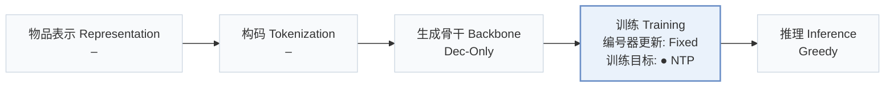
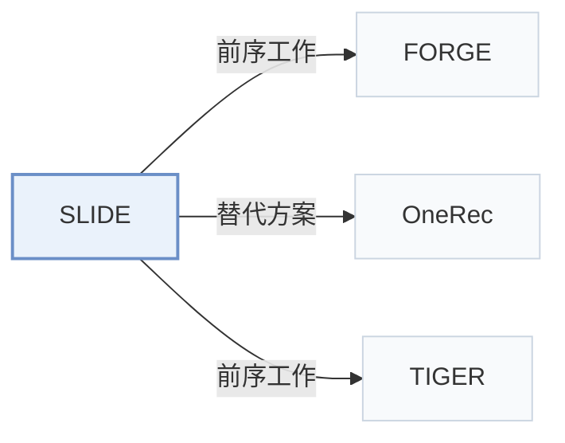

# SLIDE

[← 问题 × 阶段矩阵](../../../README.zh.md#iv--training) · [按阶段索引](../index/stages.md) · [按模态找论文](../index/modality.md) · [按领域找论文](../index/domain.md) · [English](../../papers/slide.md) | 中文

| **题目** | *Search-to-List Item Distillation for Single-Rollout Generative Retrieval* |
| :-- | :-- |
| **作者** | Zhan et al. |
| **发表** | arXiv’26 |
| **问题与阶段** | `IV. 实用目标` · `训练（Training）` |
| **改动** | ● 训练目标 |
| **构码输入** | `其他`（沿用编号；淘宝构码输入未写） |
| **领域** | `电商` · `搜索` |
| **链接** | [论文](https://arxiv.org/abs/2610.34764) |
| **阅读级别** | 概览（第 1 级） |

**本页目录**：[TL;DR](#tldr) · [3. 实验发现](#3-实验发现) · [5. 相关工作](#5-相关工作)

- `Dec-Only`：仅解码器（Decoder-only）自回归架构。
- `Fixed`：先独立训练并冻结编号器，生成器训练期间 SID 保持不变。
- `NTP`：标准下一 token 预测（Next-Token Prediction）交叉熵损失；基于预训练 LLM 的指令微调（SFT）亦归入此类。
- `Greedy`：每步直接选取概率最高 token 的贪心解码。

### TL;DR

> [!NOTE]
> SLIDE 将教师模型离线束搜索得到的候选拼接为列表级 SID 目标，使学生模型通过单次贪心解码生成完整 top-K 列表，替代逐物品束搜索。

---

### 3. 实验发现

实验设置

- **数据集**：FORGE Stage S3; industrial Taobao Search requests with about 12 training labels/request. Additional filtering rules not reported.
  - 出处：Section 5.1: [S5.SS1.SSS0.Px1.p1](https://arxiv.org/html/2610.34764v1#S5.SS1.SSS0.Px1.p1)
- **切分**：FORGE: retain provided S3 train/evaluation sets. Taobao: 10 consecutive training days, immediately following day test. Validation allocation not reported.
  - 出处：Section 5.1: [S5.SS1.SSS0.Px1.p1](https://arxiv.org/html/2610.34764v1#S5.SS1.SSS0.Px1.p1)
- **候选集**：not reported
  - 出处：Section 5.1 describes valid unique generated candidates, without evaluation negative-sampling details: [S5.SS1.SSS0.Px3.p1](https://arxiv.org/html/2610.34764v1#S5.SS1.SSS0.Px3.p1)
- **可见性**：warm; no unseen-item protocol is defined.
  - 出处：Section 5.1 defines no unseen-item holdout: [S5.SS1](https://arxiv.org/html/2610.34764v1#S5.SS1)
- **SID 规格**：Three tokens/item. FORGE uses provided SID vocabulary, sizes not restated; Taobao codebooks [32768,8192,8192]. Tokenizer algorithm and collision handling not reported.
  - 出处：Section 5.1/Appendix A.2: [S5.SS1.SSS0.Px4.p1](https://arxiv.org/html/2610.34764v1#S5.SS1.SSS0.Px4.p1) and [A1.SS2.p1](https://arxiv.org/html/2610.34764v1#A1.SS2.p1)
- **推理预算**：Qwen2.5-0.5B student; single greedy rollout to EOS or 1024 tokens; HR@1/5/10/20. Beam reference [20,20,200]; offline teacher distillation uses [20,20,20], 20-item targets. Serving hardware/batch/latency not reported; 32 H20 GPUs and global batch 8192 describe training.
  - 出处：Section 5.1: [S5.SS1.SSS0.Px4.p1](https://arxiv.org/html/2610.34764v1#S5.SS1.SSS0.Px4.p1)
- **结果来源**：Original Table 2: direct-training greedy/beam references versus distilled greedy students; teacher sizes 0.5B/3B/7B. Tables 3-6 analyze training, target construction, and supplementary RL.
  - 出处：Section 5.2 and Table 2: [S5.SS2.p1](https://arxiv.org/html/2610.34764v1#S5.SS2.p1) and [S5.T2](https://arxiv.org/html/2610.34764v1#S5.T2) and [S5.T3](https://arxiv.org/html/2610.34764v1#S5.T3) and [S5.T4](https://arxiv.org/html/2610.34764v1#S5.T4) and [S5.T5](https://arxiv.org/html/2610.34764v1#S5.T5) and [S5.T6](https://arxiv.org/html/2610.34764v1#S5.T6)

---

### 5. 相关工作

- **前序工作** · [FORGE](forge.md): SLIDE reuses FORGE's S3 split and SID vocabulary.
  - 出处：SLIDE v1, Section 5.1: [S5.SS1.SSS0.Px1.p1](https://arxiv.org/html/2610.34764v1#S5.SS1.SSS0.Px1.p1); [S5.SS1.SSS0.Px4.p1](https://arxiv.org/html/2610.34764v1#S5.SS1.SSS0.Px4.p1).
- **替代方案** · [OneRec](onerec.md): OneRec models session dependencies; SLIDE focuses on search-to-greedy list distillation.
  - 出处：SLIDE v1, Section 2.1 (Deng et al., 2025, arXiv:2502.18965): [S2.SS1.p2](https://arxiv.org/html/2610.34764v1#S2.SS1.p2).
- **前序工作** · [TIGER](tiger.md): SLIDE replaces the conventional item-level search interface with a distilled list rollout.
  - 出处：SLIDE v1, Introduction and Section 2.1: [S1.p1](https://arxiv.org/html/2610.34764v1#S1.p1); [S2.SS1.p1](https://arxiv.org/html/2610.34764v1#S2.SS1.p1).

[查看同格全部论文](../../../README.zh.md#iv--training)
