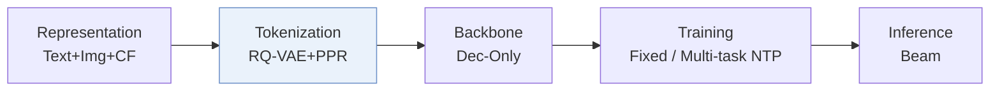
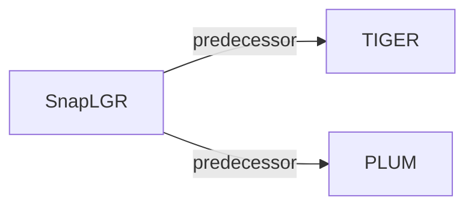

# SnapLGR

| **题目** | *LLM-Based Generative Retrieval for Snapchat Content Recommendation* |
| :-- | :-- |
| **作者** | Collins et al. |
| **会议** | arXiv’26 |
| **问题与阶段** | `II. 唯一性与合法性` · `Tokenization` |
| **链接** | [论文](https://arxiv.org/abs/2607.28895) · [矩阵](../../../README.zh.md#ii--tokenization) · [English](../../papers/snaplgr.md) |
| **阅读级别** | 概览（第 1 级） |

本页目录：[TL;DR](#tldr) · [速览](#速览) · [3. 实验发现](#3-实验发现) · [5. 相关工作](#5-相关工作)

- `RQ-VAE+PPR`: Residual-quantized variational codes informed by Personalized PageRank signals.
- `Dec-Only`: Decoder-only.
- `Fixed`: SIDs are built first and not changed while the generator trains.
- `Multi-task NTP`: The same NTP loss over several tasks.

### TL;DR

> [!NOTE]
> SnapLGR 用个性化 PageRank 对比学习从多模态嵌入构建 SID，经持续预训练奠定表示后再微调 LLM，并用 TensorRT-LLM 部署束搜索。

---

### 速览

| 维度 | 摘要 |
| :-- | :-- |
| 研究问题 | II. 唯一性与合法性：Does every item get its own SID, every generated SID name a real item, and the codebook get used evenly? |
| 核心贡献 | SnapLGR 用个性化 PageRank 对比学习从多模态嵌入构建 SID，经持续预训练奠定表示后再微调 LLM，并用 TensorRT-LLM 部署束搜索。 |
| 主要改动阶段 | Tokenization |

---

### 3. 实验发现

实验设置

- **数据集**：Internal Snapchat short-video engagement logs and multimodal video corpus; dataset size and filtering rules not reported. Up to 10 future items/request supply evaluation targets.
  - 出处：Sections 2.1/4.1: [S2.SS1.p3](https://arxiv.org/html/2607.28895v4#S2.SS1.p3) and [S4.SS1.p1](https://arxiv.org/html/2607.28895v4#S4.SS1.p1)
- **切分**：SFT uses one day; evaluation uses the immediately following hour. CPT uses one month ending one week before SFT; validation allocation not reported.
  - 出处：Section 4.1: [S4.SS1.p1](https://arxiv.org/html/2607.28895v4#S4.SS1.p1)
- **候选集**：not reported; primary offline metrics match generated SID clusters before video materialization.
  - 出处：Section 4.1/Appendix B.2 defines SID-level generated-set metrics, not sampled evaluation negatives: [S4.SS1.p2](https://arxiv.org/html/2607.28895v4#S4.SS1.p2) and [A2.SS2.p1](https://arxiv.org/html/2607.28895v4#A2.SS2.p1)
- **可见性**：warm; no unseen-item protocol is defined. PPR co-engagement graph and tokenizer exposure to test videos not reported.
  - 出处：Sections 2.1/4.1 define no unseen-item holdout: [S2.SS1.p7](https://arxiv.org/html/2607.28895v4#S2.SS1.p7) and [S4.SS1.p1](https://arxiv.org/html/2607.28895v4#S4.SS1.p1)
- **SID 规格**：PPR-supervised RQ-VAE: [1024,512,256]. Shared SIDs represent video clusters; materialization ranks videos within each bucket by engagement value. Per-bucket retained-video cap not reported.
  - 出处：Section 3.1/Appendix A.3.1: [S3.SS1.p3](https://arxiv.org/html/2607.28895v4#S3.SS1.p3) and [A1.SS3.SSS1.p1](https://arxiv.org/html/2607.28895v4#A1.SS3.SSS1.p1)
- **推理预算**：Qwen3-0.6B, beam 32; daily offline generation, online candidate-index lookup. A100 single-GPU and 64-GPU inference studies; optimized per-GPU throughput 45.7x legacy pipeline. Inference batch size, absolute throughput and latency not reported.
  - 出处：Sections 2.3/4.1/4.4: [S2.SS3.p1](https://arxiv.org/html/2607.28895v4#S2.SS3.p1) and [S2.SS2.p1](https://arxiv.org/html/2607.28895v4#S2.SS2.p1) and [S4.SS1.p2](https://arxiv.org/html/2607.28895v4#S4.SS1.p2) and [S4.SS4.SSS2.p2](https://arxiv.org/html/2607.28895v4#S4.SS4.SSS2.p2) and [S4.SS4.SSS2.p3](https://arxiv.org/html/2607.28895v4#S4.SS4.SSS2.p3) and [S4.SS4.SSS2.p5](https://arxiv.org/html/2607.28895v4#S4.SS4.SSS2.p5)
- **结果来源**：Original Table 3: offline SID comparison with T5 retrained on identical SIDs/data; Table 5: SID/video recall. Table 8: seven-day A/B versus deployed T5 with coarser CLIP SIDs, jointly changing tokenizer/backbone/serving.
  - 出处：Section 4.1/4.5 and Tables 3/5/8: [S4.SS1.p3](https://arxiv.org/html/2607.28895v4#S4.SS1.p3) and [S4.T3](https://arxiv.org/html/2607.28895v4#S4.T3) and [S4.T5](https://arxiv.org/html/2607.28895v4#S4.T5) and [S4.SS5.p2](https://arxiv.org/html/2607.28895v4#S4.SS5.p2) and [S4.T8](https://arxiv.org/html/2607.28895v4#S4.T8)

---

### 5. 相关工作

- **前序工作** · [TIGER](tiger.md): SnapLGR replaces the deployed TIGER-style T5 retriever with a grounded decoder-only LLM.
  - 出处：SnapLGR v4, Sections 4.1/4.5: https://arxiv.org/html/2607.28895v4#S4.SS1.p3; https://arxiv.org/html/2607.28895v4#S4.SS5.p1.
- **前序工作** · [PLUM](plum.md): SnapLGR follows PLUM's CPT/SFT pipeline and adds PPR supervision and serving optimizations.
  - 出处：SnapLGR v4, Sections 2.1/5: https://arxiv.org/html/2607.28895v4#S2.SS1.p6; https://arxiv.org/html/2607.28895v4#S5.p2.

[查看同格全部论文](../../../README.zh.md#ii--tokenization)
