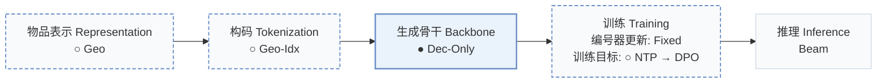
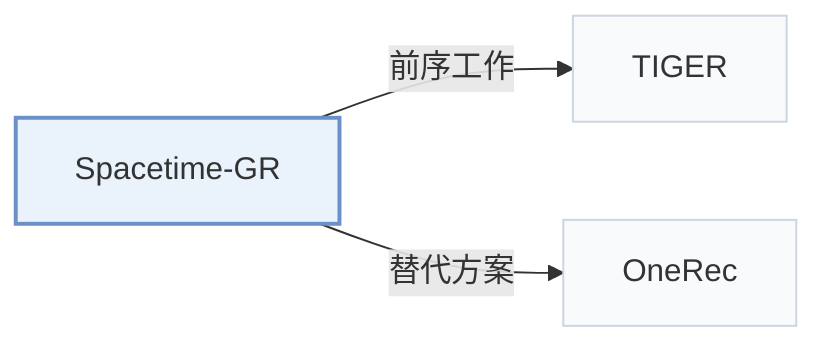

# Spacetime-GR

[← 问题 × 阶段矩阵](../../../README.zh.md#i--backbone) · [按阶段索引](../index/stages.md) · [按模态找论文](../index/modality.md) · [按领域找论文](../index/domain.md) · [English](../../papers/spacetime-gr.md) | 中文

| **题目** | *A Spacetime-Aware Generative Model for Large Scale Online POI Recommendation* |
| :-- | :-- |
| **作者** | Lin et al. |
| **发表** | arXiv’25 |
| **问题与阶段** | `I. 信息量` · `生成骨干（Backbone）` · `POI` |
| **改动** | ○ 物品表示 · ○ 构码 · ● 生成骨干 · ○ 训练目标 |
| **构码输入** | `Geo` |
| **领域** | `本地生活与 POI` |
| **链接** | [论文](https://arxiv.org/abs/2508.16126) |
| **阅读级别** | 概览（第 1 级） |

**本页目录**：[TL;DR](#tldr) · [3. 实验发现](#3-实验发现) · [5. 相关工作](#5-相关工作)

- `Geo`：地理坐标或空间拓扑特征。
- `Geo-Idx`：基于地理网格或空间索引构建的标识符。
- `Dec-Only`：仅解码器（Decoder-only）自回归架构。
- `Fixed`：先独立训练并冻结编号器，生成器训练期间 SID 保持不变。
- `NTP → DPO`：先进行下一 token 预测微调，再执行直接偏好优化（DPO）。
- `Beam`：在 SID token 上执行自回归束搜索（Beam search）。

### TL;DR

> [!NOTE]
> Spacetime-GR 用地理层级索引 POI，将时空上下文编码进动作序列，融入多模态 POI 嵌入，并针对嵌入、排序分数与候选生成做后训练。

---

### 3. 实验发现

实验设置

- **数据集**：One year of sampled Amap actions; predict interest-based actions, discard sequences with distinct-POI/action ratio <0.3. Public Foursquare-NYC/TKY and Gowalla-CA follow STHGCN preprocessing, not detailed here.
  - 出处：Sections 3.2.1/4.2.1: [S3.SS2.SSS1.p1](https://arxiv.org/html/2508.16126v1#S3.SS2.SSS1.p1) and [S3.SS2.SSS1.Px1.SPx1.p1](https://arxiv.org/html/2508.16126v1#S3.SS2.SSS1.Px1.SPx1.p1) and [S3.SS2.SSS1.Px1.SPx2.p3](https://arxiv.org/html/2508.16126v1#S3.SS2.SSS1.Px1.SPx2.p3) and [S4.SS2.SSS1.p1](https://arxiv.org/html/2508.16126v1#S4.SS2.SSS1.p1)
- **切分**：Industrial train/validation/test counts: pretraining 578M/19794/19837; SFT-alignment 31M/611K/553K. Partition construction and public splits not reported. Alignment probe uses last 5 POI actions as targets, earlier actions as context.
  - 出处：Table 3 and Section 5.1.3: [S4.T3](https://arxiv.org/html/2508.16126v1#S4.T3) and [S5.SS1.SSS3.p1](https://arxiv.org/html/2508.16126v1#S5.SS1.SSS3.p1)
- **候选集**：Generation evaluation universe not reported. SFT/alignment test requests average 10.6 provided POIs; candidate selection and historical-item exclusion not reported.
  - 出处：Table 3 and Sections 4.1.5/5.1.1: [S4.T3](https://arxiv.org/html/2508.16126v1#S4.T3) and [S4.SS1.SSS5.p1](https://arxiv.org/html/2508.16126v1#S4.SS1.SSS5.p1) and [S5.SS1.SSS1.p3](https://arxiv.org/html/2508.16126v1#S5.SS1.SSS1.p3)
- **可见性**：warm; no unseen-item protocol is defined.
  - 出处：Sections 4-5 define no unseen-item holdout: [S4](https://arxiv.org/html/2508.16126v1#S4) and [S5](https://arxiv.org/html/2508.16126v1#S5)
- **SID 规格**：Industrial: two tokens, 5km x 5km block plus within-block POI index; one-to-one mapping, total vocabulary reduced from 100M to 400K. Public experiments use a single-level index; codebooks n/a.
  - 出处：Sections 3.2.1/4.2.2: [S3.SS2.SSS1.Px2.p2](https://arxiv.org/html/2508.16126v1#S3.SS2.SSS1.Px2.p2) and [S4.SS2.SSS2.p1](https://arxiv.org/html/2508.16126v1#S4.SS2.SSS2.p1)
- **推理预算**：Generate 10 blocks x 10 inner IDs, rank 100 POIs. Generation hardware, batch size and latency not reported. T4 latency 10-20ms applies to SFT representation/ranking services.
  - 出处：Sections 5.1.1/4.1.6: [S5.SS1.SSS1.p3](https://arxiv.org/html/2508.16126v1#S5.SS1.SSS1.p3) and [S4.SS1.SSS6.p1](https://arxiv.org/html/2508.16126v1#S4.SS1.SSS6.p1)
- **结果来源**：Tables 5/9: aligned industrial generation; Table 7: pretraining ablation; Table 6: public next-POI accuracy. Table 5 judges 800 requests with LLMs and seven volunteers; public-baseline score provenance not reported.
  - 出处：Original Tables 5/6/7/9: [S4.T5](https://arxiv.org/html/2508.16126v1#S4.T5) and [S4.T6](https://arxiv.org/html/2508.16126v1#S4.T6) and [S5.T7](https://arxiv.org/html/2508.16126v1#S5.T7) and [S5.T9](https://arxiv.org/html/2508.16126v1#S5.T9)

---

### 5. 相关工作

- **前序工作** · [TIGER](tiger.md): Semantic-ID generation inspires the geographic two-token POI indexing design.
  - 出处：Spacetime-GR v1, Section 3.2.1, citing Rajput et al. (2023): [S3.SS2.SSS1.Px2.p2](https://arxiv.org/html/2508.16126v1#S3.SS2.SSS1.Px2.p2).
- **替代方案** · [OneRec](onerec.md): Cited MoE/DPO recommender; Spacetime-GR specializes generation for spatiotemporal POI contexts.
  - 出处：Spacetime-GR v1, Section 2.1, citing Deng et al. (2025): [S2.SS1.p3](https://arxiv.org/html/2508.16126v1#S2.SS1.p3).

[查看同格全部论文](../../../README.zh.md#i--backbone)
