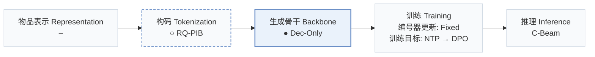
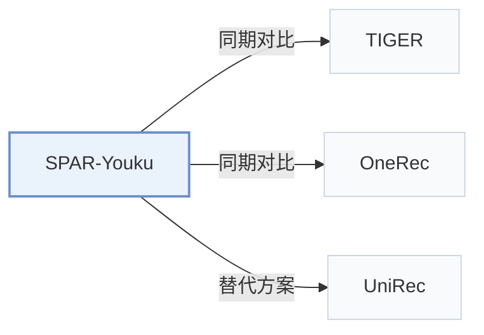

# SPAR-Youku

[← 问题 × 阶段矩阵](../../../README.zh.md#i--backbone) · [按阶段索引](../index/stages.md) · [按模态找论文](../index/modality.md) · [按领域找论文](../index/domain.md) · [English](../../papers/spar-youku.md) | 中文

| **题目** | *SPAR: Stepwise Personalized Autoregressive Recommendation with Prefix-Balanced Semantic IDs* |
| :-- | :-- |
| **作者** | Zhang et al. |
| **发表** | arXiv’26 |
| **问题与阶段** | `I. 信息量` · `生成骨干（Backbone）` |
| **改动** | ○ 构码 · ● 生成骨干 |
| **构码输入** | `其他`（负载均衡构码，向量来源未写） |
| **领域** | `长视频` |
| **链接** | [论文](https://arxiv.org/abs/2610.27898) |
| **阅读级别** | 概览（第 1 级） |

**本页目录**：[TL;DR](#tldr) · [3. 实验发现](#3-实验发现) · [5. 相关工作](#5-相关工作)

- `RQ-PIB`：前缀交互负载均衡残差量化（RQ with Prefix-aware Interaction Balancing）。
- `Dec-Only`：仅解码器（Decoder-only）自回归架构。
- `Fixed`：先独立训练并冻结编号器，生成器训练期间 SID 保持不变。
- `NTP → DPO`：先进行下一 token 预测微调，再执行直接偏好优化（DPO）。
- `C-Beam`：受合法物品集合约束的束搜索（Constrained beam search）。

### TL;DR

> [!NOTE]
> SPAR-Youku 从压缩用户记忆中提取前缀相关证据引导每步 SID 解码，并用 RQ-PIB 均衡兄弟分支间的交互负载，减少分支错误与流行度偏差。

---

### 3. 实验发现

实验设置

- **数据集**：Youku homepage production playback logs spanning several months; daily DPO uses recent request contexts. Dataset size, dates and filtering not reported.
  - 出处：[S3.SS5.SSS1.Px1.p1](https://arxiv.org/html/2610.27898v1#S3.SS5.SSS1.Px1.p1)
- **切分**：User-disjoint train/validation/test split 90:5:5; randomization method not reported. Seven-day online A/B: control and treatment each approximately 10% of traffic.
  - 出处：[S3.SS5.SSS1.Px1.p1](https://arxiv.org/html/2610.27898v1#S3.SS5.SSS1.Px1.p1) ; #S3.SS6.p1 ; #S4.p2
- **候选集**：not reported; trie validity and HR cutoffs do not specify the evaluation universe.
  - 出处：[S3.SS5.SSS1.Px2.p1](https://arxiv.org/html/2610.27898v1#S3.SS5.SSS1.Px2.p1) ; #S3.SS5.SSS1.Px3.p1
- **可见性**：warm; no unseen-item protocol is defined. RQ-PIB branch weights use training-set interaction counts; tokenizer content-fitting exposure to test items not reported.
  - 出处：[S3.SS5.SSS1.Px1.p1](https://arxiv.org/html/2610.27898v1#S3.SS5.SSS1.Px1.p1) ; #S3.SS5.SSS1.Px3.p1
- **SID 规格**：Three-level RQ-PIB: residual K-means centers followed by prefix-local interaction-load balancing with frozen centers. Codebook sizes and collision handling not reported.
  - 出处：[S3.SS3.p3](https://arxiv.org/html/2610.27898v1#S3.SS3.p3) ; #S3.SS3.SSS0.Px2.p1 ; #S3.SS5.SSS1.Px3.p1
- **推理预算**：Qwen3-0.6B with trie-constrained beam search. Main HR@10/20/50/100; ablations also HR@1/5. Beam width, inference hardware, batch size and latency not reported.
  - 出处：[S3.SS5.SSS1.Px3.p1](https://arxiv.org/html/2610.27898v1#S3.SS5.SSS1.Px3.p1) ; #S3.T1 ; #S3.T3
- **结果来源**：Original Table 1: Youku retrieval comparisons; Table 2: backbone scaling; Table 3: module/SID/DPO ablations; Table 4: online A/B. Table 3 parts (a)-(c) use SFT only; part (d) adds DPO. Baseline-result reuse not stated.
  - 出处：[S3.T1](https://arxiv.org/html/2610.27898v1#S3.T1) ; #S3.T2 ; #S3.T3 ; #S3.T4 ; #S3.SS5.SSS4.p1

---

### 5. 相关工作

- **同期对比** · [TIGER](tiger.md): TIGER is a residual-SID retrieval baseline; SPAR jointly changes prefix-local branch balance and prefix-conditioned user evidence.
  - 出处：SPAR-Youku v1, Section 3.5.1 and Table 1: [S3.SS5.SSS1.Px4.p1](https://arxiv.org/html/2610.27898v1#S3.SS5.SSS1.Px4.p1); [S3.T1](https://arxiv.org/html/2610.27898v1#S3.T1).
- **同期对比** · [OneRec](onerec.md): OneRec is the strongest measured generative baseline; SPAR adds stepwise memory retrieval and prefix-balanced SID construction.
  - 出处：SPAR-Youku v1, Sections 3.5.1/3.5.2 and Table 1: [S3.SS5.SSS1.Px4.p1](https://arxiv.org/html/2610.27898v1#S3.SS5.SSS1.Px4.p1); [S3.SS5.SSS2.p1](https://arxiv.org/html/2610.27898v1#S3.SS5.SSS2.p1); [S3.T1](https://arxiv.org/html/2610.27898v1#S3.T1).
- **替代方案** · [UniRec](unirec.md): UniRec is cited for load-regulated SID assignment; SPAR regulates sibling-branch loads conditioned on parent prefixes and couples this with stepwise personalization.
  - 出处：SPAR-Youku v1, Introduction and Section 2.1; cited alternative, not an evaluated baseline: [S1.p2](https://arxiv.org/html/2610.27898v1#S1.p2); [S2.SS1.p2](https://arxiv.org/html/2610.27898v1#S2.SS1.p2).

[查看同格全部论文](../../../README.zh.md#i--backbone)
