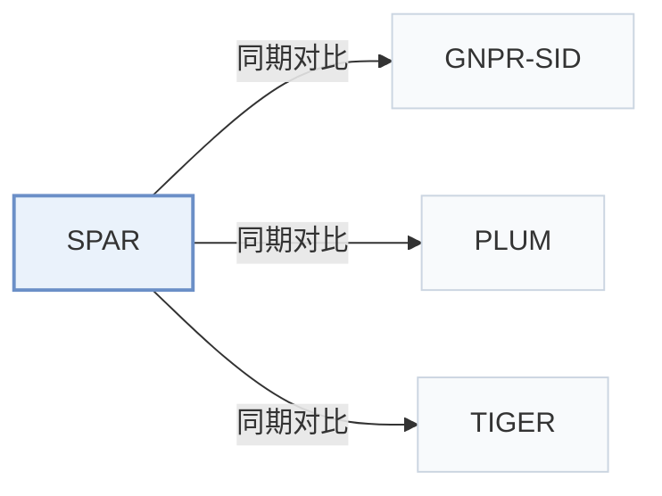

# SPAR

[← 问题 × 阶段矩阵](../../../README.zh.md#i--representation) · [按阶段索引](../index/stages.md) · [按模态找论文](../index/modality.md) · [按领域找论文](../index/domain.md) · [English](../../papers/spar.md) | 中文

| **题目** | *Enhancing Industrial-Scale Generative POI Recommendation via Real-World Spatial Perception* |
| :-- | :-- |
| **作者** | Wang et al. |
| **发表** | arXiv’26 |
| **问题与阶段** | `I. 信息量` · `物品表示（Representation）` · `POI` |
| **改动** | ● 物品表示 · ○ 训练目标 |
| **构码输入** | `Text` + `Geo` |
| **领域** | `本地生活与 POI` |
| **链接** | [论文](https://arxiv.org/abs/2609.02062) |
| **阅读级别** | 概览（第 1 级） |

**本页目录**：[TL;DR](#tldr) · [3. 实验发现](#3-实验发现) · [5. 相关工作](#5-相关工作)

- `Text+Geo`：文本表征结合地理空间特征。
- `R-KM`：残差 k-means 量化（Residual k-means）。
- `Dec-Only`：仅解码器（Decoder-only）自回归架构。
- `Fixed`：先独立训练并冻结编号器，生成器训练期间 SID 保持不变。
- `Multi-task NTP`：在多个对齐或推荐子任务上联合优化下一 token 预测损失。

### TL;DR

> [!NOTE]
> SPAR 将正弦坐标嵌入融入 SID 构建，在地理空间数据上持续预训练 LLM，并在行为微调期间将该知识固定为冻结任务向量。

---

### 3. 实验发现

实验设置

- **数据集**：Public NYC/TKY; one month of AMAP logs from Beijing, Shanghai, Tianjin and Zhejiang. MG-CPT adds 25 geospatial datasets per city. Cleaning details not reported.
  - 出处：Section 5.1, Table 1 and Appendix B: [S5.SS1.p1](https://arxiv.org/html/2609.02062v2#S5.SS1.p1) and [S5.T1](https://arxiv.org/html/2609.02062v2#S5.T1) and [A2.p1](https://arxiv.org/html/2609.02062v2#A2.p1)
- **切分**：Public: chronological 80%/10%/10% train/validation/test. Industrial: last day test, earlier interactions train; industrial validation allocation not reported. Each interaction uses its preceding history.
  - 出处：Section 5.1: [S5.SS1.p1](https://arxiv.org/html/2609.02062v2#S5.SS1.p1)
- **候选集**：not reported
  - 出处：Section 5.1 reports metrics and splits without candidate enumeration or negative sampling: [S5.SS1](https://arxiv.org/html/2609.02062v2#S5.SS1)
- **可见性**：warm; no unseen-item protocol is defined. Cold/warm users have <8/>=16 historical interactions; queries and real-time location remain available. Quantizer fits training POIs; test-POI exclusion not detailed.
  - 出处：Sections 4.1.2/5.5: [S4.SS1.SSS2.p2](https://arxiv.org/html/2609.02062v2#S4.SS1.SSS2.p2) and [S5.SS5.p1](https://arxiv.org/html/2609.02062v2#S5.SS5.p1)
- **SID 规格**：SI-SID: 3 residual K-Means codebooks x 32 codes for NYC/TKY or x 512 for AMAP, plus a fourth disambiguation index guaranteeing unique POI IDs.
  - 出处：Sections 4.1.2/5.1: [S4.SS1.SSS2.p2](https://arxiv.org/html/2609.02062v2#S4.SS1.SSS2.p2) and [S5.SS1.p4](https://arxiv.org/html/2609.02062v2#S5.SS1.p4)
- **推理预算**：Default Qwen3-4B; Recall/NDCG/MRR@5/10/20. Experiment environment: 64 A100 GPUs; beam width, inference batch size and latency not reported. Reported batch 32 is training.
  - 出处：Section 5.1: [S5.SS1.p2](https://arxiv.org/html/2609.02062v2#S5.SS1.p2) and [S5.SS1.p4](https://arxiv.org/html/2609.02062v2#S5.SS1.p4)
- **结果来源**：Original Tables 2/3: public/industrial recommendation comparisons; Table 5: sparse-history users. Generative baselines are standardized to four-level SIDs with final disambiguation indices.
  - 出处：Original Tables 2/3/5 and Section 5.1: [S5.T2](https://arxiv.org/html/2609.02062v2#S5.T2) and [S5.T3](https://arxiv.org/html/2609.02062v2#S5.T3) and [S5.T5](https://arxiv.org/html/2609.02062v2#S5.T5) and [S5.SS1.p4](https://arxiv.org/html/2609.02062v2#S5.SS1.p4)

---

### 5. 相关工作

- **同期对比** · [GNPR-SID](gnpr-sid.md): SID POI baseline; SPAR explicitly injects and preserves urban spatial knowledge.
  - 出处：SPAR v2, Section 5.1 and Tables 2/3: [S5.SS1.p3](https://arxiv.org/html/2609.02062v2#S5.SS1.p3); [S5.T2](https://arxiv.org/html/2609.02062v2#S5.T2); [S5.T3](https://arxiv.org/html/2609.02062v2#S5.T3).
- **同期对比** · [PLUM](plum.md): Generic SID-CPT-SFT comparator against SPAR's spatially specialized stages.
  - 出处：SPAR v2, Section 5.2.2: [S5.SS2.SSS2.p2](https://arxiv.org/html/2609.02062v2#S5.SS2.SSS2.p2).
- **同期对比** · [TIGER](tiger.md): Evaluated with four-level SIDs including a final disambiguation index.
  - 出处：SPAR v2, Section 5.1 and Tables 2/3: [S5.SS1.p3](https://arxiv.org/html/2609.02062v2#S5.SS1.p3); [S5.SS1.p4](https://arxiv.org/html/2609.02062v2#S5.SS1.p4); [S5.T2](https://arxiv.org/html/2609.02062v2#S5.T2); [S5.T3](https://arxiv.org/html/2609.02062v2#S5.T3).

[查看同格全部论文](../../../README.zh.md#i--representation)
