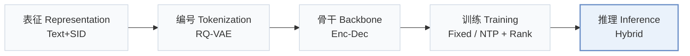
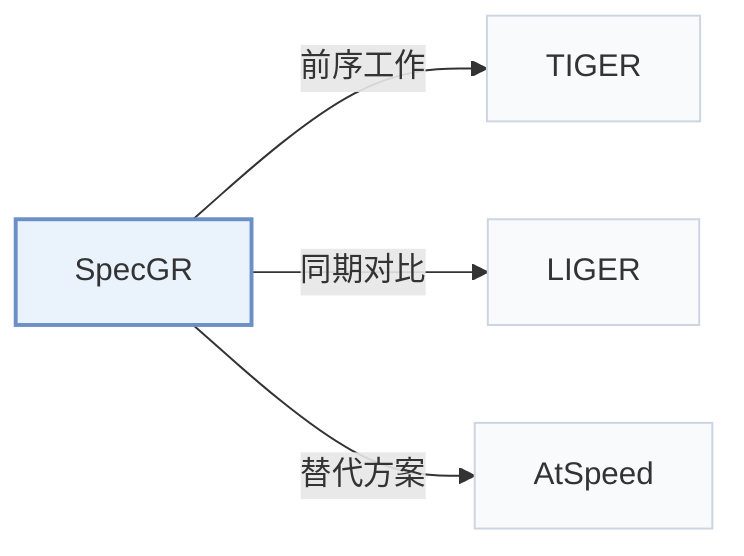

# SpecGR

[← 问题 × 阶段矩阵](../../../README.zh.md#vi--inference) · [按阶段索引](../index/stages.md) · [按模态索引](../index/modality.md) · [English](../../papers/specgr.md) | 中文

| **题目** | *Inductive Generative Recommendation via Retrieval-based Speculation* |
| :-- | :-- |
| **作者** | Ding et al. |
| **发表** | AAAI’26 |
| **问题与阶段** | `VI. 泛化` · `推理（Inference）` |
| **链接** | [论文](https://arxiv.org/abs/2410.02939) · [代码](https://github.com/Jamesding000/SpecGR) |
| **阅读级别** | 概览（第 1 级） |

**本页目录**：[TL;DR](#tldr) · [速览](#速览) · [3. 实验发现](#3-实验发现) · [5. 相关工作](#5-相关工作)

- `Text+SID`：稠密文本表征拼接离散语义 ID（稠密与生成式混合检索）。
- `RQ-VAE`：残差量化变分自编码器（Residual-Quantized VAE）。
- `Enc-Dec`：编码器-解码器（Encoder-decoder）架构。
- `Fixed`：先独立训练并冻结编号器，生成器训练期间 SID 保持不变。
- `NTP + Rank`：下一 token 预测结合显式排序损失。
- `Hybrid`：结合生成式 SID 解码与稠密/共现检索的混合召回。

### TL;DR

> [!NOTE]
> SpecGR 用归纳式草稿模型提议已有物品与新物品，由生成式推荐器负责验证，使模型能够推荐训练中未见过的冷启动物品。

---

### 速览

| 维度 | 摘要 |
| :-- | :-- |
| 研究问题 | VI. 泛化：面对冷启动新物品、跨领域迁移与动态兴趣漂移时能否保持泛化？ |
| 核心贡献 | SpecGR 用归纳式草稿模型提议已有物品与新物品，由生成式推荐器负责验证，使模型能够推荐训练中未见过的冷启动物品。 |
| 主要改动阶段 | 推理（Inference） |

---

### 3. 实验发现

实验设置

- **数据集**：Amazon Reviews 2023 Video Games, Office Products, Cell Phones and Accessories; timestamp_w_his 5-core benchmark excludes users/items with fewer than five interactions; maximum input history 20 items.
  - 出处：[Sx4.SSx1.SSSx1.p1](https://arxiv.org/html/2410.02939v2#Sx4.SSx1.SSSx1.p1) ; #Sx4.SSx1.SSSx4.p1
- **切分**：Global predefined timestamp cutoffs create train/validation/test sets; exact dates not reported in paper. Test divided into In-Sample and Unseen according to target-item occurrence in training.
  - 出处：[Sx4.SSx1.SSSx1.p1](https://arxiv.org/html/2410.02939v2#Sx4.SSx1.SSSx1.p1) ; #Sx4.SSx1.SSSx3.p1
- **候选集**：not reported; full-catalog and subset-ranking capabilities are discussed, but the main evaluation universe and negative-sampling protocol are not explicitly specified.
  - 出处：[Sx4.SSx1.SSSx3.p1](https://arxiv.org/html/2410.02939v2#Sx4.SSx1.SSSx3.p1) ; #A6.SSx1.p1
- **可见性**：Unseen targets have no training interactions and are unseen by the generator. New items are assigned SIDs for inference; tokenizer fitting exposure is not reported, so whether they are unseen by tokenizer too is not established.
  - 出处：[Sx3.SSx1.p1](https://arxiv.org/html/2410.02939v2#Sx3.SSx1.p1) ; #Sx3.SSx1.p2 ; #Sx4.SSx1.SSSx3.p1
- **SID 规格**：TIGER RQ-VAE tokenization; standard experiments use four-digit SIDs, including a final collision-identification token. Codebook sizes and suffix-assignment rule not reported. Verification excludes the identification token for unseen items.
  - 出处：[Sx4.SSx1.SSSx4.p1](https://arxiv.org/html/2410.02939v2#Sx4.SSx1.SSSx4.p1) ; #Sx3.SSx2.SSSx2.p3 ; #A5.SSx2.p1
- **推理预算**：Beam beta and draft size delta are 50 or output K (10/50); verification threshold tuned -1.1 to -1.8. Draft/verify with guided redrafting and early exit, then beam fallback if needed. Table A6 at draft size 50: SpecGR++ drafting/verifying 0.0003/0.0249 s versus TIGER 0.0403 s. Inference hardware, batch size and timing aggregation not reported.
  - 出处：[A2.SSx1.p1](https://arxiv.org/html/2410.02939v2#A2.SSx1.p1) ; #Sx3.SSx2.SSSx4.p1 ; #A5.T6
- **结果来源**：Original Table 1: overall comparison; Table 2: seen/unseen breakdown; Table 3: ablations; Table A6: latency. Baselines reproduced/tuned; Recformer starts from a third-party reproduction checkpoint and is fine-tuned on these datasets.
  - 出处：[Sx4.SSx2.p1](https://arxiv.org/html/2410.02939v2#Sx4.SSx2.p1) ; #Sx4.SSx2.p2 ; #Sx4.T3 ; #A2.SSx3.p1 ; #A5.T6

---

### 5. 相关工作

- **前序工作** · [TIGER](tiger.md): SpecGR uses TIGER as its generative verifier and adds inductive drafting; SpecGR++ reuses the same encoder for self-drafting.
  - 出处：SpecGR v2, Implementation Details and Drafting Strategies: [Sx4.SSx1.SSSx4.p1](https://arxiv.org/html/2410.02939v2#Sx4.SSx1.SSSx4.p1); [Sx3.SSx3.SSSx2.p1](https://arxiv.org/html/2410.02939v2#Sx3.SSx3.SSSx2.p1).
- **同期对比** · [LIGER](liger.md): LIGER blends dense-retrieved candidates with generated items; SpecGR filters and orders inductive drafts using generative target-aware likelihoods.
  - 出处：SpecGR v2, Performance Analysis and Table 2: [Sx4.SSx2.p2](https://arxiv.org/html/2410.02939v2#Sx4.SSx2.p2).
- **替代方案** · [AtSpeed](atspeed.md): AtSpeed adapts speculative decoding to accelerate top-K generative recommendation; SpecGR uses draft-and-verify to introduce unseen-item recommendation capability.
  - 出处：SpecGR v2, Related Work, citing Lin et al. (2024), arXiv:2410.05165: [Sx2.p3](https://arxiv.org/html/2410.02939v2#Sx2.p3).

[查看同格全部论文](../../../README.zh.md#vi--inference)
