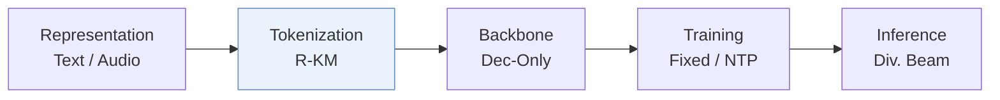
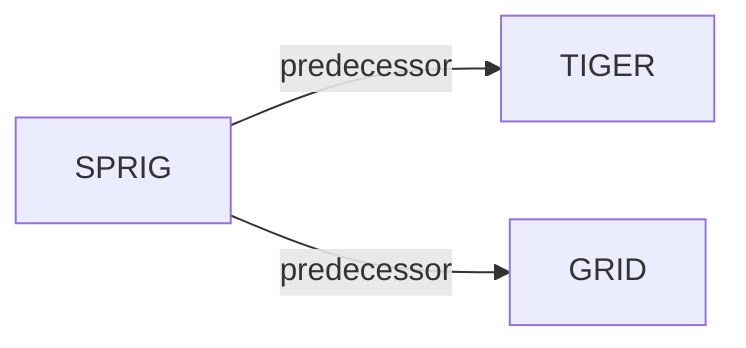

# SPRIG

| **题目** | *Semantic-ID-enhanced Paths for Knowledge Graph-based Generative Recommendation* |
| :-- | :-- |
| **作者** | Hangoebl et al. |
| **会议** | CIKM’26 Short |
| **问题与阶段** | `I. 信息量` · `Tokenization` |
| **链接** | [论文](https://arxiv.org/abs/2610.06590) · [代码](https://github.com/justinhangoebl/semantic-id-knowledge-graph-recommender) · [矩阵](../../../README.zh.md#i--tokenization) · [English](../../papers/sprig.md) |
| **阅读级别** | 概览（第 1 级） |

本页目录：[TL;DR](#tldr) · [速览](#速览) · [3. 实验发现](#3-实验发现) · [5. 相关工作](#5-相关工作)

- `Text / Audio`: Text or audio representations in different branches or evaluation settings.
- `R-KM`: Residual k-means.
- `Dec-Only`: Decoder-only.
- `Fixed`: SIDs are built first and not changed while the generator trains.
- `NTP`: Next-token prediction loss only; continuing from a pretrained LLM (SFT) also counts as NTP.
- `Div. Beam`: Beam search with an explicit diversity mechanism.

### TL;DR

> [!NOTE]
> SPRIG 在以内容派生 SID 结尾的知识图谱路径上训练生成器，将关系结构锚定与共享物品 token 结合起来，替代绑定嵌入表的不透明 token。

---

### 速览

| 维度 | 摘要 |
| :-- | :-- |
| 研究问题 | I. 信息量：Do the SIDs, or the model reading them, carry the collaborative and multimodal signals recommendation needs? |
| 核心贡献 | SPRIG 在以内容派生 SID 结尾的知识图谱路径上训练生成器，将关系结构锚定与共享物品 token 结合起来，替代绑定嵌入表的不透明 token。 |
| 主要改动阶段 | Tokenization |

---

### 3. 实验发现

实验设置

- **数据集**：KG-enriched MovieLens-1M from RecBole (2984 items); Onion (18415 tracks): LFM-2B March-May 2018 interactions plus music content and artist/genre/album/tag KG, iteratively filtered to 20-core. Additional ML-1M filtering: not reported.
  - 出处：Sec.3 Datasets and Table1: [S3.p3](https://arxiv.org/html/2610.06590v1#S3.p3) and [S3.T1](https://arxiv.org/html/2610.06590v1#S3.T1)
- **切分**：Per-user chronological 60/20/20 train/validation/test; identical preprocessing and splits across models. History cap: not reported.
  - 出处：Sec.3 Task and Protocol: [S3.p6](https://arxiv.org/html/2610.06590v1#S3.p6)
- **候选集**：Full catalog evaluation against held-out interactions; SPRIG/KGGLM rank terminal items from up to 50 generated paths per user, deduplicating by highest path log-likelihood. SASRec scores the catalog directly. History-item exclusion: not reported.
  - 出处：Sec.3 Task and Protocol and Sec.4 comparison limits: [S3.p6](https://arxiv.org/html/2610.06590v1#S3.p6) and [S4.p3](https://arxiv.org/html/2610.06590v1#S4.p3)
- **可见性**：warm; no unseen-item protocol is defined. Generic KG pretraining excludes user-item edges; fine-tuning uses user-to-item paths. KG/quantizer exposure to test items or held-out interactions: not reported.
  - 出处：Sec.2.2 pretraining excludes user-item edges; Sec.5 leaves cold-start splits to future work: [S2.SS2.p1](https://arxiv.org/html/2610.06590v1#S2.SS2.p1) and [S5.p2](https://arxiv.org/html/2610.06590v1#S5.p2)
- **SID 规格**：Offline residual K-means, 3 levels x 256 codes (768 shared tokens), on T5 movie embeddings/musicnn track embeddings. Item entities in KG paths are expanded into SIDs; inverse lookup maps terminal SIDs to items. Collision handling: not reported.
  - 出处：Sec.3 SID construction and Figure1 lookup: [S3.p4](https://arxiv.org/html/2610.06590v1#S3.p4) and [S0.F1](https://arxiv.org/html/2610.06590v1#S0.F1)
- **推理预算**：Deterministic diverse beam search: 60 beams, 5 groups, diversity penalty 0.4, length penalty 0; 3-hop paths, up to 50 paths/user. Rank by terminal path log-likelihood; nDCG/MRR/HR@10. Experiments use NVIDIA A40. Inference batch, numerical latency/throughput and runtime timing scope: not reported; reported FLOPs are per-step compute, not latency.
  - 出处：Sec.3 implementation/protocol/metrics, Table2 and Sec.4 cost comparison: [S3.p5](https://arxiv.org/html/2610.06590v1#S3.p5) and [S3.p6](https://arxiv.org/html/2610.06590v1#S3.p6) and [S3.p7](https://arxiv.org/html/2610.06590v1#S3.p7) and [S4.T2](https://arxiv.org/html/2610.06590v1#S4.T2) and [S4.p6](https://arxiv.org/html/2610.06590v1#S4.p6)
- **结果来源**：This paper's Table2 experiments and quantizer/audio-feature ablations. Baselines run under original-publication best configurations and verified on shared splits; TIGER uses a GRID variant. SPRIG/KGGLM share DistilGPT-2 and decoding; SASRec is a full-catalog scoring reference. No quoted-score provenance is claimed.
  - 出处：Sec.3 implementation/baselines, Table2 and Sec.4 ablation: [S3.p5](https://arxiv.org/html/2610.06590v1#S3.p5) and [S3.p8](https://arxiv.org/html/2610.06590v1#S3.p8) and [S4.T2](https://arxiv.org/html/2610.06590v1#S4.T2) and [S4.SS0.SSS0.Px1.p1](https://arxiv.org/html/2610.06590v1#S4.SS0.SSS0.Px1.p1)

---

### 5. 相关工作

- **前序工作** · [TIGER](tiger.md): SPRIG adopts TIGER's content-derived SID formulation and evaluates its GRID variant.
  - 出处：SPRIG v1, Sec.1 and Table2: https://arxiv.org/html/2610.06590v1#S1.p2; https://arxiv.org/html/2610.06590v1#S4.T2.
- **前序工作** · [GRID](grid.md): GRID supplies the residual K-means quantization choice.
  - 出处：SPRIG v1, Sec.1 and Sec.3: https://arxiv.org/html/2610.06590v1#S1.p2; https://arxiv.org/html/2610.06590v1#S3.p4.

[查看同格全部论文](../../../README.zh.md#i--tokenization)
