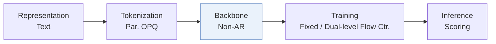
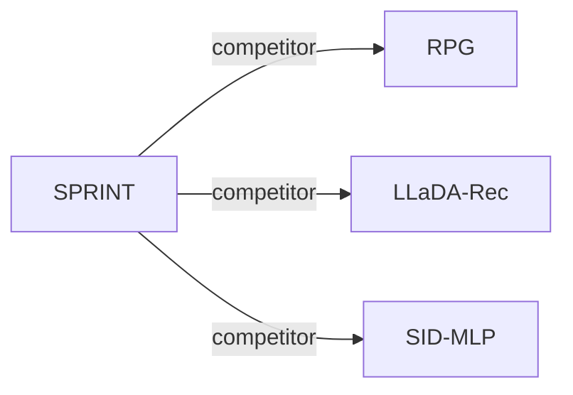

# SPRINT

| **题目** | *Single-Step Generative Recommendation via Average Probability Velocity* |
| :-- | :-- |
| **作者** | Cai et al. |
| **会议** | arXiv’26 |
| **问题与阶段** | `V. 效率` · `Backbone` |
| **链接** | [论文](https://arxiv.org/abs/2609.34306) · [代码](https://github.com/iamZhuoCai/SPRINT) · [矩阵](../../../README.zh.md#v--backbone) · [English](../../papers/sprint.md) |
| **阅读级别** | 概览（第 1 级） |

本页目录：[TL;DR](#tldr) · [速览](#速览) · [3. 实验发现](#3-实验发现) · [5. 相关工作](#5-相关工作)

- `Non-AR`: Non-autoregressive.
- `Fixed`: SIDs are built first and not changed while the generator trains.
- `Dual-level Flow Ctr.`: Contrastive training at token and complete-identifier levels in a flow-based model.

### TL;DR

> [!NOTE]
> SPRINT 基于平均概率速度在双向 Transformer 的单次前向传播中预测全部 SID token 概率，并用双层流对比目标恢复 token 间的一致性。

---

### 速览

| 维度 | 摘要 |
| :-- | :-- |
| 研究问题 | V. 效率：Can it be trained and served within latency and cost budgets? |
| 核心贡献 | SPRINT 基于平均概率速度在双向 Transformer 的单次前向传播中预测全部 SID token 概率，并用双层流对比目标恢复 token 间的一致性。 |
| 主要改动阶段 | Backbone |

---

### 3. 实验发现

实验设置

- **数据集**：Amazon Reviews 2014 Sports, Beauty and Toys; Amazon Reviews 2023 Instruments, Scientific, Games and Arts; Yelp. Filtering thresholds: not reported.
  - 出处：Sec.4.1 and Appendix D.1: [S4.SS1.p1](https://arxiv.org/html/2609.34306v1#S4.SS1.p1) and [A4.SS1.p1](https://arxiv.org/html/2609.34306v1#A4.SS1.p1)
- **切分**：Per-user timestamp-ordered leave-one-out: last interaction test, penultimate validation, remainder training; history cap 20.
  - 出处：Appendix D.1 and D.3: [A4.SS1.p1](https://arxiv.org/html/2609.34306v1#A4.SS1.p1) and [A4.SS3.p1](https://arxiv.org/html/2609.34306v1#A4.SS3.p1)
- **候选集**：Full catalog: score valid SIDs with the sum of separately normalized token-probability and joint-SID similarity scores, returning top K. History-item exclusion: not reported. The 100/1000 sampled negative SIDs are training settings.
  - 出处：Sec.4.1 and Sec.3.4 inference; sampled SIDs in Eq.9 are training negatives: [S4.SS1.p1](https://arxiv.org/html/2609.34306v1#S4.SS1.p1) and [S3.SS4.p3](https://arxiv.org/html/2609.34306v1#S3.SS4.p3) and [S3.SS3.p6](https://arxiv.org/html/2609.34306v1#S3.SS3.p6) and [S4.SS1.p3](https://arxiv.org/html/2609.34306v1#S4.SS1.p3)
- **可见性**：warm; no unseen-item protocol is defined. Tokenizer exposure to test items: not reported.
  - 出处：Sec.4.1 and Appendix D.1/D.3 define standard evaluation without unseen-item experiments: [S4.SS1](https://arxiv.org/html/2609.34306v1#S4.SS1) and [A4.SS1.p1](https://arxiv.org/html/2609.34306v1#A4.SS1.p1) and [A4.SS3.p1](https://arxiv.org/html/2609.34306v1#A4.SS3.p1)
- **SID 规格**：OPQ on sentence-t5-base content embeddings; four parallel codebooks x 256 codewords, four tokens/item. Collision handling: not reported.
  - 出处：Sec.3.1 and Appendix D.3: [S3.SS1.p2](https://arxiv.org/html/2609.34306v1#S3.SS1.p2) and [A4.SS3.p1](https://arxiv.org/html/2609.34306v1#A4.SS3.p1)
- **推理预算**：One encoder-decoder pass from four masks, followed by all-valid-SID scoring with precomputed item-side vectors; beam n/a for SPRINT. Test batch 256/history20; efficiency baselines use beam10 where applicable, embedding256. Recall/NDCG@5/10; additional K=20/50/100/1000. Whole-test-set seconds on Sports/Beauty/Toys/Scientific/Instruments/Games: 2.65/1.52/1.28/4.08/4.62/7.55. Hardware, per-request latency, and inclusion of precomputation/data loading/metric computation in timing: not reported.
  - 出处：Sec.3.4, Sec.4.1, Table3, Appendix D.3/D.11 and Algorithm2: [S3.SS4.p2](https://arxiv.org/html/2609.34306v1#S3.SS4.p2) and [S3.SS4.p3](https://arxiv.org/html/2609.34306v1#S3.SS4.p3) and [S4.SS1.p1](https://arxiv.org/html/2609.34306v1#S4.SS1.p1) and [S4.T3](https://arxiv.org/html/2609.34306v1#S4.T3) and [A4.SS3.p2](https://arxiv.org/html/2609.34306v1#A4.SS3.p2) and [A4.SS11.p1](https://arxiv.org/html/2609.34306v1#A4.SS11.p1) and [alg2](https://arxiv.org/html/2609.34306v1#alg2)
- **结果来源**：Paper's comparisons/ablations, averaged over five random-seed runs (seed values not reported). Tables2/8 main accuracy, Table12 Yelp/Arts, Tables3/10 whole-test inference time, Table9 per-epoch training time. Efficiency configurations are shared; accuracy settings follow original papers and are tuned per dataset. Table10 accelerators use TIGER backbones. Explicit borrowed-versus-rerun score attribution: not reported.
  - 出处：Sec.4.1, Tables2/3/4 and Appendix D.3/D.6/D.8: [S4.SS1.p3](https://arxiv.org/html/2609.34306v1#S4.SS1.p3) and [S4.T2](https://arxiv.org/html/2609.34306v1#S4.T2) and [S4.T3](https://arxiv.org/html/2609.34306v1#S4.T3) and [S4.T4](https://arxiv.org/html/2609.34306v1#S4.T4) and [A4.SS3.p2](https://arxiv.org/html/2609.34306v1#A4.SS3.p2) and [A4.SS6.p2](https://arxiv.org/html/2609.34306v1#A4.SS6.p2) and [A4.SS8.p1](https://arxiv.org/html/2609.34306v1#A4.SS8.p1)

---

### 5. 相关工作

- **同期对比** · [RPG](rpg.md): RPG is the compared single-step baseline with longer SIDs.
  - 出处：SPRINT v1, Sec.1 and Sec.4.2: https://arxiv.org/html/2609.34306v1#S1.p2; https://arxiv.org/html/2609.34306v1#S4.SS2.p2.
- **同期对比** · [LLaDA-Rec](llada-rec.md): LLaDA-Rec is compared under one-step and four-step generation.
  - 出处：SPRINT v1, Table1 and Sec.4.1: https://arxiv.org/html/2609.34306v1#S1.T1; https://arxiv.org/html/2609.34306v1#S4.SS1.p2.
- **同期对比** · [SID-MLP](sid-mlp.md): SID-MLP is the closest compared efficiency-oriented baseline.
  - 出处：SPRINT v1, Appendix D.6: https://arxiv.org/html/2609.34306v1#A4.SS6.p2; https://arxiv.org/html/2609.34306v1#A4.T10.

[查看同格全部论文](../../../README.zh.md#v--backbone)
