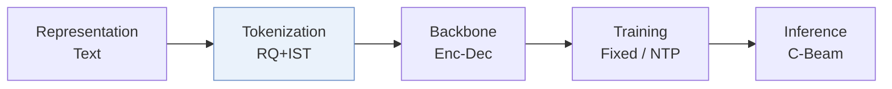
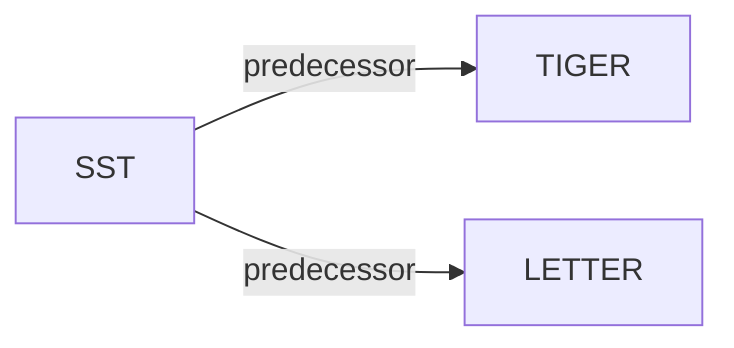

# SST

| **题目** | *Rethinking Item Tokenization in Generative Recommenders: From Fixed Atoms to Semantic Subwords* |
| :-- | :-- |
| **作者** | Miao et al. |
| **会议** | CIKM’26 |
| **问题与阶段** | `III. SID 与模型对齐` · `Tokenization` |
| **链接** | [论文](https://arxiv.org/abs/2608.22734) · [代码](https://github.com/mxrcandy/Semantic-Subword-Tokenization) · [矩阵](../../../README.zh.md#iii--tokenization) · [English](../../papers/sst.md) |
| **阅读级别** | 概览（第 1 级） |

本页目录：[TL;DR](#tldr) · [速览](#速览) · [3. 实验发现](#3-实验发现) · [5. 相关工作](#5-相关工作)

- `RQ+IST`: Residual quantization combined with item-level subword tokenization.
- `Enc-Dec`: Encoder-decoder.
- `Fixed`: SIDs are built first and not changed while the generator trains.
- `NTP`: Next-token prediction loss only; continuing from a pretrained LLM (SFT) also counts as NTP.
- `C-Beam`: Constrained beam search.

### TL;DR

> [!NOTE]
> SST 将历史物品表示为由稳定相邻 SID token 合并而成的变长子词，同时保持目标侧定长解码，以减少编码器在单个物品内部的注意力开销。

---

### 速览

| 维度 | 摘要 |
| :-- | :-- |
| 研究问题 | III. SID 与模型对齐：Can the generator read, write, and reason over SIDs, and do the tokenizer and generator work toward the same goal? |
| 核心贡献 | SST 将历史物品表示为由稳定相邻 SID token 合并而成的变长子词，同时保持目标侧定长解码，以减少编码器在单个物品内部的注意力开销。 |
| 主要改动阶段 | Tokenization |

---

### 3. 实验发现

实验设置

- **数据集**：Amazon Beauty/Instruments and Yelp; user/item 5-core filtering, chronological histories capped at 20.
  - 出处：Section 3.1.1: [S3.SS1.SSS1.p1](https://arxiv.org/html/2608.22734v1#S3.SS1.SSS1.p1)
- **切分**：Per-user last interaction test, penultimate validation, earlier interactions training.
  - 出处：Section 3.1.3: [S3.SS1.SSS3.p1](https://arxiv.org/html/2608.22734v1#S3.SS1.SSS3.p1)
- **候选集**：full catalog; no sampled negatives.
  - 出处：Section 3.1.3: [S3.SS1.SSS3.p1](https://arxiv.org/html/2608.22734v1#S3.SS1.SSS3.p1)
- **可见性**：warm; no unseen-item protocol is defined. Tokenizer/collaborative encoder exposure to test items not reported.
  - 出处：Section 3.1 defines no unseen-item holdout: [S3.SS1](https://arxiv.org/html/2608.22734v1#S3.SS1)
- **SID 规格**：Sentence-T5 text embeddings; TIGER-VAE, TIGER-KM or LETTER targets retain 4 levels x 256 codes. History-side IST adds semantic subwords (merge budget tuned 64-512). Collision handling not reported.
  - 出处：Section 3.1.4: [S3.SS1.SSS4.p2](https://arxiv.org/html/2608.22734v1#S3.SS1.SSS4.p2)
- **推理预算**：Full-trie beam 20; Recall/NDCG@5/10. Hardware, inference batch size and standalone latency not reported; Table 3 wall time combines training, checkpoint loading and test evaluation.
  - 出处：Sections 3.1.4/3.5: [S3.SS1.SSS4.p3](https://arxiv.org/html/2608.22734v1#S3.SS1.SSS4.p3) and [S3.SS5.p1](https://arxiv.org/html/2608.22734v1#S3.SS5.p1)
- **结果来源**：Original Table 1: SST on three backbones; SARQ/VSID re-adapted to history-only variable lengths while preserving fixed target decoding. Table 6 reports all tokenizer-criterion variants.
  - 出处：Table 1 and Section 3.1.2: [S3.T1](https://arxiv.org/html/2608.22734v1#S3.T1) and [S3.SS1.SSS2.p5](https://arxiv.org/html/2608.22734v1#S3.SS1.SSS2.p5) and [A1.T6](https://arxiv.org/html/2608.22734v1#A1.T6)

---

### 5. 相关工作

- **前序工作** · [TIGER](tiger.md): SST compresses TIGER-VAE/TIGER-KM histories while retaining fixed-length target SIDs.
  - 出处：SST v1, Sections 3.1.2/3.1.4 and Table 1: https://arxiv.org/html/2608.22734v1#S3.SS1.SSS2.p2; https://arxiv.org/html/2608.22734v1#S3.SS1.SSS4.p2; https://arxiv.org/html/2608.22734v1#S3.T1.
- **前序工作** · [LETTER](letter.md): LETTER is the collaborative-tokenization backbone used for the third SST configuration.
  - 出处：SST v1, Section 3.1.2 and Table 1: https://arxiv.org/html/2608.22734v1#S3.SS1.SSS2.p2; https://arxiv.org/html/2608.22734v1#S3.T1.

[查看同格全部论文](../../../README.zh.md#iii--tokenization)
