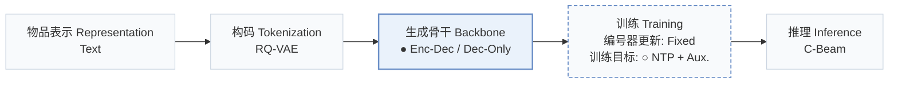
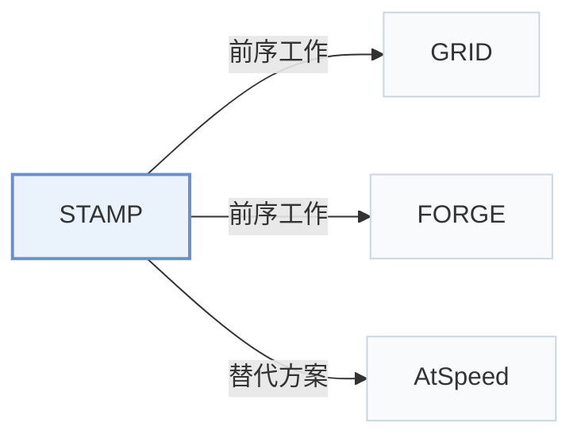

# STAMP

[← 问题 × 阶段矩阵](../../../README.zh.md#v--backbone) · [按阶段索引](../index/stages.md) · [按模态找论文](../index/modality.md) · [按领域找论文](../index/domain.md) · [English](../../papers/stamp.md) | 中文

| **题目** | *Semantic Trimming and Auxiliary Multi-step Prediction for Generative Recommendation* |
| :-- | :-- |
| **作者** | Zhan et al. |
| **发表** | arXiv’26 |
| **问题与阶段** | `V. 效率` · `生成骨干（Backbone）` |
| **改动** | ● 生成骨干 · ○ 训练目标 |
| **构码输入** | A: `Text` · B: `Text` + `Img` + `unknown` |
| **领域** | `电商` |
| **链接** | [论文](https://arxiv.org/abs/2604.05329) |
| **阅读级别** | 概览（第 1 级） |

**本页目录**：[TL;DR](#tldr) · [3. 实验发现](#3-实验发现) · [5. 相关工作](#5-相关工作)

- `Text`：物品文本元数据（标题、描述、类目或提示词）。
- `RQ-VAE`：残差量化变分自编码器（Residual-Quantized VAE）。
- `Enc-Dec / Dec-Only`：同时在编码器-解码器与仅解码器两种骨干上验证。
- `Fixed`：先独立训练并冻结编号器，生成器训练期间 SID 保持不变。
- `NTP + Aux.`：下一 token 预测结合辅助正则或对齐损失。
- `C-Beam`：受合法物品集合约束的束搜索（Constrained beam search）。

### TL;DR

> [!NOTE]
> STAMP 在前向传播中自适应剪除冗余 SID token，并加入多步辅助预测目标，降低训练开销并加密长 SID 的监督信号。

---

### 3. 实验发现

实验设置

- **数据集**：Amazon Beauty (22.4K users / 12.1K items), Sports (35.6K / 18.4K), Toys (19.4K / 11.9K) with 5-core filtering; and AL-GR-Tiny, a subset of the AL-GR benchmark from a Chinese e-commerce platform (the full AL-GR has 131M users / 251M items / 14B interactions).
  - 出处：Datasets: [S5.I2.i1.p1](https://arxiv.org/html/2604.05329v3#S5.I2.i1.p1) and [S5.I2.i2.p1](https://arxiv.org/html/2604.05329v3#S5.I2.i2.p1); statistics: [S5.T1](https://arxiv.org/html/2604.05329v3#S5.T1).
- **切分**：Amazon: per-user leave-one-out (final interaction for test, penultimate for validation). AL-GR-Tiny: the benchmark's Stage 1 split, four days of training behaviors and a test set from the following day. GRID results averaged over five seeds.
  - 出处：Leave-one-out on Amazon; AL-GR S1 split: [S5.I2.i1.p1](https://arxiv.org/html/2604.05329v3#S5.I2.i1.p1) and [S5.I2.i2.p1](https://arxiv.org/html/2604.05329v3#S5.I2.i2.p1).
- **候选集**：not reported (full catalog versus sampled); Recall/NDCG at 5 and 10 under GRID, HitRate at 20-1000 under FORGE, as defined by those frameworks.
  - 出处：Metrics inherited from GRID and FORGE: [S5.I4.i1.p1](https://arxiv.org/html/2604.05329v3#S5.I4.i1.p1).
- **可见性**：warm; no unseen-item protocol is defined.
  - 出处：No unseen-item protocol: [S5.I2.i1.p1](https://arxiv.org/html/2604.05329v3#S5.I2.i1.p1) and [S5.I2.i2.p1](https://arxiv.org/html/2604.05329v3#S5.I2.i2.p1).
- **SID 规格**：Uses each framework's SIDs unchanged: GRID with RK-Means over Flan-T5-XL embeddings and three codebooks (codebook size not restated); FORGE's pre-processed AL-GR SIDs. Collision handling: not reported.
  - 出处：GRID RK-Means with three codebooks over Flan-T5-XL: [S5.SS1.SSS4.p2](https://arxiv.org/html/2604.05329v3#S5.SS1.SSS4.p2); FORGE SIDs from AL-GR: [S5.SS1.SSS4.p3](https://arxiv.org/html/2604.05329v3#S5.SS1.SSS4.p3).
- **推理预算**：STAMP accelerates training (token pruning plus an auxiliary loss that is discarded at inference, so no inference overhead is claimed); inference decoding settings follow GRID and FORGE and are not restated. Training speed and VRAM reported on one A100-40GB (GRID) and two A100-80GB (FORGE).
  - 出处：Training-time acceleration; MAP discarded at inference: [S4.SS4.p1](https://arxiv.org/html/2604.05329v3#S4.SS4.p1); hardware: [S5.SS1.SSS4.p2](https://arxiv.org/html/2604.05329v3#S5.SS1.SSS4.p2) and [S5.SS1.SSS4.p3](https://arxiv.org/html/2604.05329v3#S5.SS1.SSS4.p3).
- **结果来源**：Table 2 (GRID T5 on Beauty, Sports, Toys: accuracy, training time, VRAM versus EARN; five seeds); Table 3 (FORGE Qwen2.5-0.5B on AL-GR-Tiny); later analyses and ablations.
  - 出处：Results: [S5.T2](https://arxiv.org/html/2604.05329v3#S5.T2) and [S5.T3](https://arxiv.org/html/2604.05329v3#S5.T3).

---

### 5. 相关工作

- **前序工作** · [GRID](grid.md): STAMP is implemented inside the GRID framework and keeps its tokenizer and T5 backbone, adding training-time token pruning and multi-step auxiliary prediction.
  - 出处：STAMP v3, Section 5.1.4 GRID setup: [S5.SS1.SSS4.p2](https://arxiv.org/html/2604.05329v3#S5.SS1.SSS4.p2); Table 2: [S5.T2](https://arxiv.org/html/2604.05329v3#S5.T2).
- **前序工作** · [FORGE](forge.md): STAMP uses FORGE's AL-GR-Tiny data and Qwen backbone as its second testbed.
  - 出处：STAMP v3, Section 5.1.1 and 5.1.4: [S5.I2.i2.p1](https://arxiv.org/html/2604.05329v3#S5.I2.i2.p1) and [S5.SS1.SSS4.p3](https://arxiv.org/html/2604.05329v3#S5.SS1.SSS4.p3); Table 3: [S5.T3](https://arxiv.org/html/2604.05329v3#S5.T3).
- **替代方案** · [AtSpeed](atspeed.md): AtSpeed accelerates inference by speculative decoding; STAMP targets training-time cost instead.
  - 出处：STAMP v3, Section 2 acceleration paragraph: [S2.p3](https://arxiv.org/html/2604.05329v3#S2.p3).

[查看同格全部论文](../../../README.zh.md#v--backbone)
