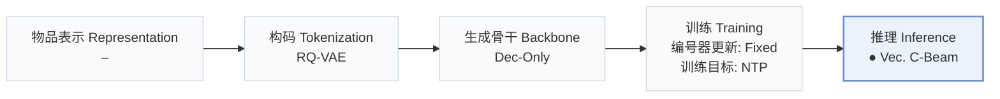
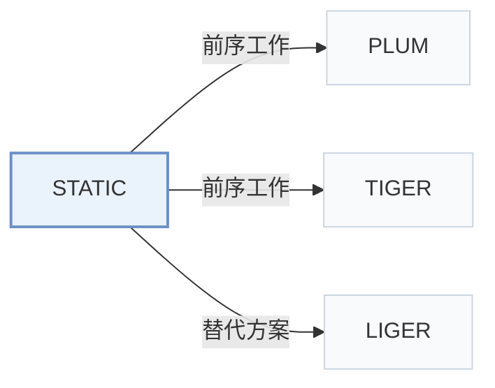

# STATIC

[← 问题 × 阶段矩阵](../../../README.zh.md#v--inference) · [按阶段索引](../index/stages.md) · [按模态找论文](../index/modality.md) · [按领域找论文](../index/domain.md) · [English](../../papers/static.md) | 中文

| **题目** | *Vectorizing the Trie: Efficient Constrained Decoding for LLM-based Generative Retrieval on Accelerators* |
| :-- | :-- |
| **作者** | Su et al. |
| **发表** | KDD’26 ADS |
| **问题与阶段** | `V. 效率` · `推理（Inference）` |
| **改动** | ● 推理 |
| **构码输入** | `unknown` |
| **领域** | `电商` · `视频` |
| **特殊设置** | `冷启动（物品）` |
| **链接** | [论文](https://arxiv.org/abs/2602.22647) · [代码](https://github.com/youtube/static-constraint-decoding) |
| **阅读级别** | 概览（第 1 级） |

**本页目录**：[TL;DR](#tldr) · [3. 实验发现](#3-实验发现) · [5. 相关工作](#5-相关工作)

- `RQ-VAE`：残差量化变分自编码器（Residual-Quantized VAE）。
- `Dec-Only`：仅解码器（Decoder-only）自回归架构。
- `Fixed`：先独立训练并冻结编号器，生成器训练期间 SID 保持不变。
- `NTP`：标准下一 token 预测（Next-Token Prediction）交叉熵损失；基于预训练 LLM 的指令微调（SFT）亦归入此类。
- `Vec. C-Beam`：向量化并行前缀约束束搜索。

### TL;DR

> [!NOTE]
> STATIC 将合法 SID 前缀树展平为稀疏 CSR 矩阵，把前缀树遍历转化为可在 TPU 和 GPU 上向量化执行的受约束解码运算。

---

### 3. 实验发现

实验设置

- **数据集**：YouTube corpus (100M-1B items); Amazon Beauty, Sports and Outdoors, Toys and Games (10K-20K items/domain). Filtering rules not reported.
  - 出处：Sections 5.1/6.1 and Table 3: [S5.SS1.p1](https://arxiv.org/html/2602.22647v3#S5.SS1.p1) and [S6.SS1.p1](https://arxiv.org/html/2602.22647v3#S6.SS1.p1) and [S6.T3](https://arxiv.org/html/2602.22647v3#S6.T3)
- **切分**：Amazon cold targets: newest 2% or 5% of items by oldest-review date. Training-sequence exclusion wording is internally contradictory; exact temporal/validation split not reported. YouTube training split not reported.
  - 出处：Section 6.2 and Appendix F: [S6.SS2.p1](https://arxiv.org/html/2602.22647v3#S6.SS2.p1) and [A6.p2](https://arxiv.org/html/2602.22647v3#A6.p2)
- **候选集**：Restricted catalog: YouTube about 20M high-quality videos uploaded within 7 days; Amazon only the selected cold-item set. Unconstrained baselines can access the full catalog.
  - 出处：Sections 5.2/6.2: [S5.SS2.p1](https://arxiv.org/html/2602.22647v3#S5.SS2.p1) and [S6.SS2.p1](https://arxiv.org/html/2602.22647v3#S6.SS2.p1)
- **可见性**：Amazon generator exclusion is ambiguous; tokenizer cold-item exposure is not reported. Section 6.2 calls training sequences no-cold-start but says to remove sequences without cold items. Unseen by generator only versus unseen by tokenizer too cannot be established.
  - 出处：Sections 6.1/6.2: [S6.SS1.p1](https://arxiv.org/html/2602.22647v3#S6.SS1.p1) and [S6.SS2.p1](https://arxiv.org/html/2602.22647v3#S6.SS2.p1)
- **SID 规格**：YouTube: 8 levels x 2048 codes; Amazon: separate RQ-VAE per domain, 4 levels x 256. Collision handling not reported.
  - 出处：Sections 5.1/6.1: [S5.SS1.p1](https://arxiv.org/html/2602.22647v3#S5.SS1.p1) and [S6.SS1.p1](https://arxiv.org/html/2602.22647v3#S6.SS1.p1)
- **推理预算**：TPU v6e. YouTube: Gemini-based dense 3B, batch 2/chip, beam 70; added constraint overhead 0.033 ms/step, 0.25% of inference time. Amazon: Gemma-based dense 1B, batch 16, beam 20, Recall@1.
  - 出处：Sections 5.1/5.2/6.1: [S5.SS1.p2](https://arxiv.org/html/2602.22647v3#S5.SS1.p2) and [S5.SS2.p3](https://arxiv.org/html/2602.22647v3#S5.SS2.p3) and [S6.SS1.p2](https://arxiv.org/html/2602.22647v3#S6.SS1.p2)
- **结果来源**：Original Table 1: constraint-enforcement latency (100 trials); Table 2: STATIC-enabled PLUM deployment A/B; Table 3: Amazon cold-start Recall@1, reported as peak over 70 training epochs.
  - 出处：Tables 1-3 and Appendix F: [S5.T1](https://arxiv.org/html/2602.22647v3#S5.T1) and [S5.T2](https://arxiv.org/html/2602.22647v3#S5.T2) and [S6.T3](https://arxiv.org/html/2602.22647v3#S6.T3) and [A6.p2](https://arxiv.org/html/2602.22647v3#A6.p2)

---

### 5. 相关工作

- **前序工作** · [PLUM](plum.md): STATIC adds production decoding constraints to a PLUM-based YouTube retriever.
  - 出处：STATIC v3, Sections 5.1/5.4: [S5.SS1.p2](https://arxiv.org/html/2602.22647v3#S5.SS1.p2); [S5.SS4.p1](https://arxiv.org/html/2602.22647v3#S5.SS4.p1).
- **前序工作** · [TIGER](tiger.md): STATIC retains hierarchical SID retrieval and accelerates validity masking.
  - 出处：STATIC v3, Sections 2.1/6.1: [S2.SS1.p2](https://arxiv.org/html/2602.22647v3#S2.SS1.p2); [S6.SS1.p1](https://arxiv.org/html/2602.22647v3#S6.SS1.p1).
- **替代方案** · [LIGER](liger.md): LIGER motivates the cold-start limitation; STATIC restricts decoding to cold items.
  - 出处：STATIC v3, Section 2.1 (Yang et al., 2024) and Section 6: [S2.SS1.p3](https://arxiv.org/html/2602.22647v3#S2.SS1.p3); [S6.SS2.p1](https://arxiv.org/html/2602.22647v3#S6.SS2.p1).

[查看同格全部论文](../../../README.zh.md#v--inference)
