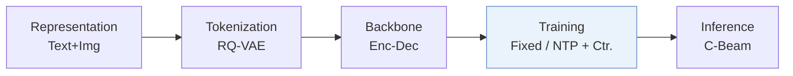
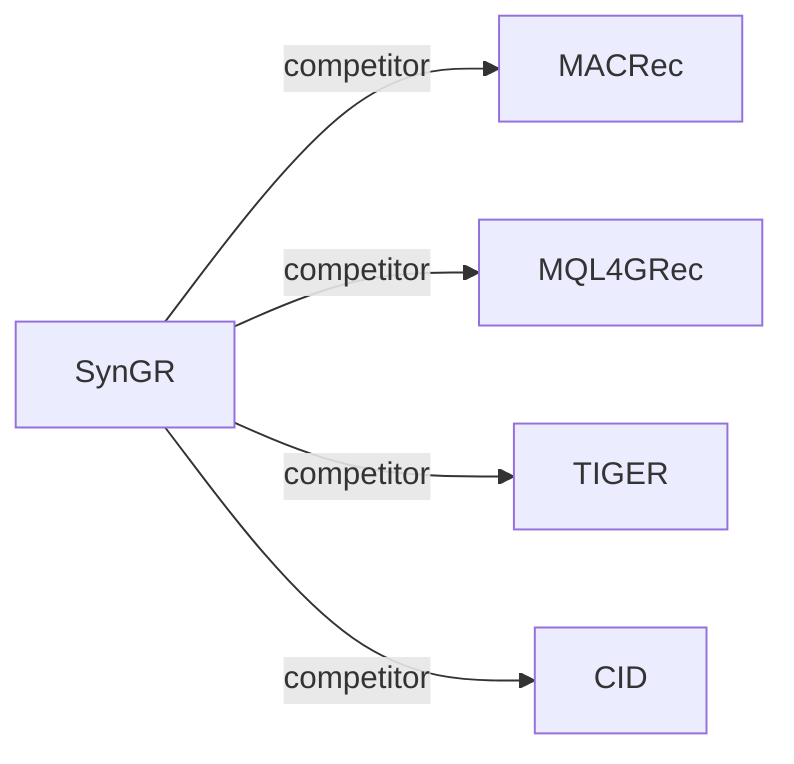

# SynGR

| **题目** | *Unleashing the Potential of Cross-Modal Synergy for Generative Recommendation* |
| :-- | :-- |
| **作者** | Chen et al. |
| **会议** | ICML’26 |
| **问题与阶段** | `I. 信息量` · `Training` |
| **链接** | [论文](https://arxiv.org/abs/2605.18920) · [代码](https://github.com/gxingyu/SynGR) · [矩阵](../../../README.zh.md#i--training) · [English](../../papers/syngr.md) |
| **阅读级别** | 概览（第 1 级） |

本页目录：[TL;DR](#tldr) · [速览](#速览) · [3. 实验发现](#3-实验发现) · [5. 相关工作](#5-相关工作)

- `Enc-Dec`: Encoder-decoder.
- `Fixed`: SIDs are built first and not changed while the generator trains.
- `NTP + Ctr.`: NTP plus a contrastive loss.
- `C-Beam`: Constrained beam search.

### TL;DR

> [!NOTE]
> SynGR 在生成阶段限制模型对主导模态的依赖，促使生成器利用超出模态共享或模态特定信号的跨模态协同信息，替代以对齐为中心的融合。

---

### 速览

| 维度 | 摘要 |
| :-- | :-- |
| 研究问题 | I. 信息量：Do the SIDs, or the model reading them, carry the collaborative and multimodal signals recommendation needs? |
| 核心贡献 | SynGR 在生成阶段限制模型对主导模态的依赖，促使生成器利用超出模态共享或模态特定信号的跨模态协同信息，替代以对齐为中心的融合。 |
| 主要改动阶段 | Training |

---

### 3. 实验发现

实验设置

- **数据集**：Amazon Reviews 2018 targets: Arts (22,171 users / 9,416 items), Games (42,259 / 13,839), Instruments (17,112 / 6,250), as in MQL4GRec; pre-training on six other categories (about 7.1M interactions, 884,918 users, 255,181 items). Filtering rules: not restated.
  - 出处：Target datasets: [S5.SS1.p1](https://arxiv.org/html/2605.18920v2#S5.SS1.p1) and [S4.T2](https://arxiv.org/html/2605.18920v2#S4.T2); pre-training corpus: [A3.p1](https://arxiv.org/html/2605.18920v2#A3.p1).
- **切分**：Leave-one-out (following MQL4GRec and MACRec; allocation not restated beyond the label).
  - 出处：Leave-one-out following MQL4GRec and MACRec: [S5.SS1.p3](https://arxiv.org/html/2605.18920v2#S5.SS1.p3).
- **候选集**：full catalog (full ranking over the entire item space).
  - 出处：Full ranking and beam 20: [S5.SS1.p3](https://arxiv.org/html/2605.18920v2#S5.SS1.p3).
- **可见性**：warm; no unseen-item protocol is defined.
  - 出处：Standard split with no unseen-item protocol: [S5.SS1.p3](https://arxiv.org/html/2605.18920v2#S5.SS1.p3).
- **SID 规格**：Separate text (LLaMA) and image (ViT-L/14) semantic IDs from RQ-VAEs with 4 levels x 256 codes, merged into a unified dictionary; collision handling: not reported.
  - 出处：4 layers x 256 per modality RQ-VAE: [A3.p2](https://arxiv.org/html/2605.18920v2#A3.p2) and [S4.SS1.p2](https://arxiv.org/html/2605.18920v2#S4.SS1.p2); collision handling not found.
- **推理预算**：Beam search with beam size 20 for all generative models, following MQL4GRec's multimodal decoding; the synergy loss is training-only. Efficiency study on six NVIDIA RTX 4090 GPUs reports inference 6.0% (Arts) and 4.0% (Instruments) faster than MACRec; absolute latency and batch size: not reported.
  - 出处：Beam size 20 for all generative models: [S5.SS1.p3](https://arxiv.org/html/2605.18920v2#S5.SS1.p3); inference follows MQL4GRec: [S4.SS3.p2](https://arxiv.org/html/2605.18920v2#S4.SS3.p2); hardware: [S5.F3](https://arxiv.org/html/2605.18920v2#S5.F3).
- **结果来源**：Table 1 (Arts, Games, Instruments versus sequential, multimodal, and generative baselines); Figure 3 (training time, inference speed, convergence versus MACRec); Figures 4-5 (parameters and ablations).
  - 出处：Main: [S4.T1](https://arxiv.org/html/2605.18920v2#S4.T1); efficiency: [S5.F3](https://arxiv.org/html/2605.18920v2#S5.F3); parameters: [S5.F4](https://arxiv.org/html/2605.18920v2#S5.F4); ablation: [S5.F5](https://arxiv.org/html/2605.18920v2#S5.F5).

---

### 5. 相关工作

- **同期对比** · [MACRec](macrec.md): MACRec aligns modalities with multiple explicit and implicit generation tasks; SynGR diagnoses modality shortcuts and adds a synergy-focused contrastive objective, with lower training cost.
  - 出处：SynGR v2, generative baselines: https://arxiv.org/html/2605.18920v2#S5.SS1.p2; Table 1: https://arxiv.org/html/2605.18920v2#S4.T1; efficiency comparison: https://arxiv.org/html/2605.18920v2#S5.SS3.p2.
- **同期对比** · [MQL4GRec](mql4grec.md): MQL4GRec translates each modality into its own quantitative language; SynGR follows its decoding and pre-training protocol but targets synergistic information between modalities.
  - 出处：SynGR v2, baselines and protocol: https://arxiv.org/html/2605.18920v2#S5.SS1.p2, https://arxiv.org/html/2605.18920v2#S5.SS1.p3, https://arxiv.org/html/2605.18920v2#S4.SS3.p2; Table 1: https://arxiv.org/html/2605.18920v2#S4.T1.
- **同期对比** · [TIGER](tiger.md): TIGER uses unimodal text SIDs; SynGR fuses text and image codes and regularizes their synergy.
  - 出处：SynGR v2, generative baselines: https://arxiv.org/html/2605.18920v2#S5.SS1.p2; Table 1: https://arxiv.org/html/2605.18920v2#S4.T1.
- **同期对比** · [CID](cid.md): P5-CID uses collaborative IDs in a P5 model; SynGR uses multimodal semantic IDs.
  - 出处：SynGR v2, sequential baselines (P5-CID): https://arxiv.org/html/2605.18920v2#S5.SS1.p2; Table 1: https://arxiv.org/html/2605.18920v2#S4.T1.

[查看同格全部论文](../../../README.zh.md#i--training)
