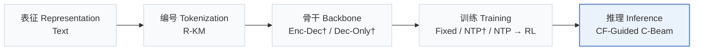
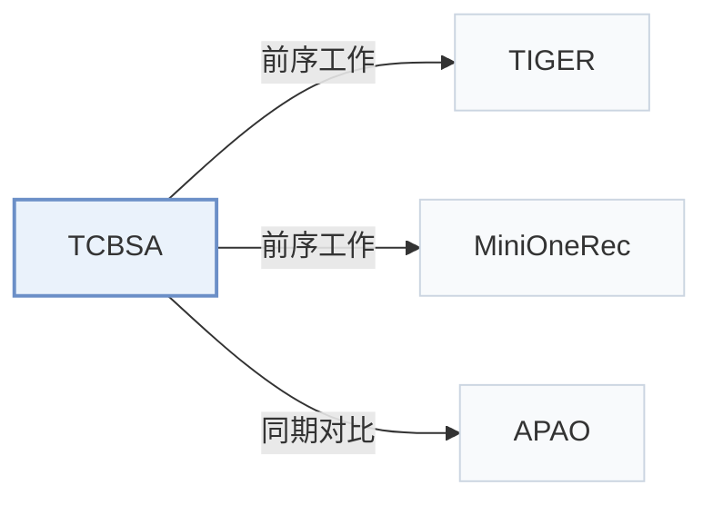

# TCBSA

[← 问题 × 阶段矩阵](../../../README.zh.md#iv--inference) · [按阶段索引](../index/stages.md) · [按模态索引](../index/modality.md) · [English](../../papers/tcbsa.md) | 中文

| **题目** | *From Item Scores to Semantic Tokens: Test-Time Collaborative Adaptation for Generative Recommendation* |
| :-- | :-- |
| **作者** | Shan et al. |
| **发表** | arXiv’26 |
| **问题与阶段** | `IV. 实用目标` · `推理（Inference）` |
| **链接** | [论文](https://arxiv.org/abs/2610.32098) |
| **阅读级别** | 概览（第 1 级） |

**本页目录**：[TL;DR](#tldr) · [速览](#速览) · [3. 实验发现](#3-实验发现) · [5. 相关工作](#5-相关工作)

- `Text`：物品文本元数据（标题、描述、类目或提示词）。
- `R-KM`：残差 k-means 量化（Residual k-means）。
- `Enc-Dec† / Dec-Only†`：同时在编码器-解码器与仅解码器骨干上验证（由配置推断）。
- `Fixed`：先独立训练并冻结编号器，生成器训练期间 SID 保持不变。
- `NTP† / NTP → RL`：一种配置采用下一 token 预测，另一种配置后接强化学习微调。
- `CF-Guided C-Beam`：由协同过滤信号引导剪枝与打分的约束束搜索。

### TL;DR

> [!NOTE]
> TCBSA 将判别式推荐器的分数间隔转化为共享 SID 前缀上的势函数，经置信度门控后在束剪枝前加到路径分数上，无需重新训练。

---

### 速览

| 维度 | 摘要 |
| :-- | :-- |
| 研究问题 | IV. 实用目标：训练目标与解码搜索是否面向用户真实偏好与平台业务价值，而非单纯拟合下一 token 似然？ |
| 核心贡献 | TCBSA 将判别式推荐器的分数间隔转化为共享 SID 前缀上的势函数，经置信度门控后在束剪枝前加到路径分数上，无需重新训练。 |
| 主要改动阶段 | 推理（Inference） |

---

### 3. 实验发现

实验设置

- **数据集**：Amazon Reviews 2023 Industrial and Scientific, Musical Instruments, Office Products: official 5-core, no extra rating thresholds/deduplication. Yelp Kaggle v2, 2019 window, all ratings implicit, iterative 5-core.
  - 出处：Section 5.1 and Appendix B.1: [S5.SS1.SSS0.Px1.p1](https://arxiv.org/html/2610.32098v1#S5.SS1.SSS0.Px1.p1) and [A2.SS1.p1](https://arxiv.org/html/2610.32098v1#A2.SS1.p1)
- **切分**：Per-user chronological last/penultimate interactions are test/validation; earlier interactions train. Input histories capped at 20.
  - 出处：Section 5.1: [S5.SS1.SSS0.Px1.p1](https://arxiv.org/html/2610.32098v1#S5.SS1.SSS0.Px1.p1)
- **候选集**：full catalog; previously interacted items remain eligible, padding masked
  - 出处：Section 5.1: [S5.SS1.SSS0.Px2.p1](https://arxiv.org/html/2610.32098v1#S5.SS1.SSS0.Px2.p1)
- **可见性**：warm; no unseen-item protocol is defined. Generator and discriminative checkpoints remain frozen during adaptation.
  - 出处：Section 5.1 defines no unseen-item holdout: [S5.SS1.SSS0.Px1.p1](https://arxiv.org/html/2610.32098v1#S5.SS1.SSS0.Px1.p1) and [S5.SS1.SSS0.Px4.p1](https://arxiv.org/html/2610.32098v1#S5.SS1.SSS0.Px4.p1)
- **SID 规格**：Sentence-T5 text embeddings; 3 RQ-K-means levels plus fourth collision-resolution token for unique IDs. Codebook sizes not reported. Shared mapping across semantic-ID models.
  - 出处：Section 5.1: [S5.SS1.SSS0.Px4.p1](https://arxiv.org/html/2610.32098v1#S5.SS1.SSS0.Px4.p1)
- **推理预算**：Default beam 20, retrieval width 500; beam sweep 10/20/30/40/50. RTX 5880 Ada, inference batch 32. Synchronized per-user latency includes discriminative scoring/adaptation; default TCBSA costs 1.43-1.63x same-beam TIGER.
  - 出处：Sections 5.1/5.6 and Appendix B.2: [S5.SS1.SSS0.Px4.p1](https://arxiv.org/html/2610.32098v1#S5.SS1.SSS0.Px4.p1) and [S5.SS6.p1](https://arxiv.org/html/2610.32098v1#S5.SS6.p1) and [S5.SS6.p3](https://arxiv.org/html/2610.32098v1#S5.SS6.p3) and [A2.SS2.p1](https://arxiv.org/html/2610.32098v1#A2.SS2.p1)
- **结果来源**：Original Table 1: full-catalog comparisons; Figure 5: accuracy/latency. Baselines instantiated using specified implementations; MiniOneRec evaluated at its final RL checkpoint.
  - 出处：Original Table 1 and Figure 5, implementation details: [S5.T1](https://arxiv.org/html/2610.32098v1#S5.T1) and [S5.F5](https://arxiv.org/html/2610.32098v1#S5.F5) and [S5.SS1.SSS0.Px4.p1](https://arxiv.org/html/2610.32098v1#S5.SS1.SSS0.Px4.p1)

---

### 5. 相关工作

- **前序工作** · [TIGER](tiger.md): Frozen generative backbone used with SASRec and GRU4Rec guidance.
  - 出处：TCBSA v1, Section 5.1: [S5.SS1.SSS0.Px4.p1](https://arxiv.org/html/2610.32098v1#S5.SS1.SSS0.Px4.p1).
- **前序工作** · [MiniOneRec](minionerec.md): Final RL checkpoint supplies the second frozen generative backbone.
  - 出处：TCBSA v1, Section 5.1: [S5.SS1.SSS0.Px4.p1](https://arxiv.org/html/2610.32098v1#S5.SS1.SSS0.Px4.p1).
- **同期对比** · [APAO](apao.md): Prefix-aware training comparator against test-time beam adaptation.
  - 出处：TCBSA v1, Section 5.1 and Table 1: [S5.SS1.SSS0.Px3.p1](https://arxiv.org/html/2610.32098v1#S5.SS1.SSS0.Px3.p1); [S5.T1](https://arxiv.org/html/2610.32098v1#S5.T1).

[查看同格全部论文](../../../README.zh.md#iv--inference)
