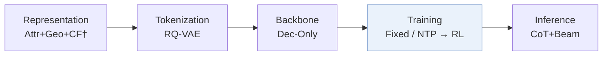
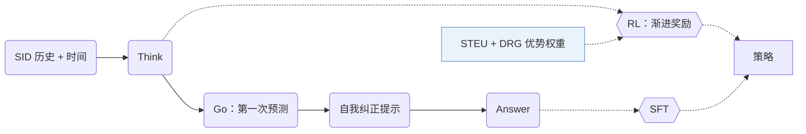
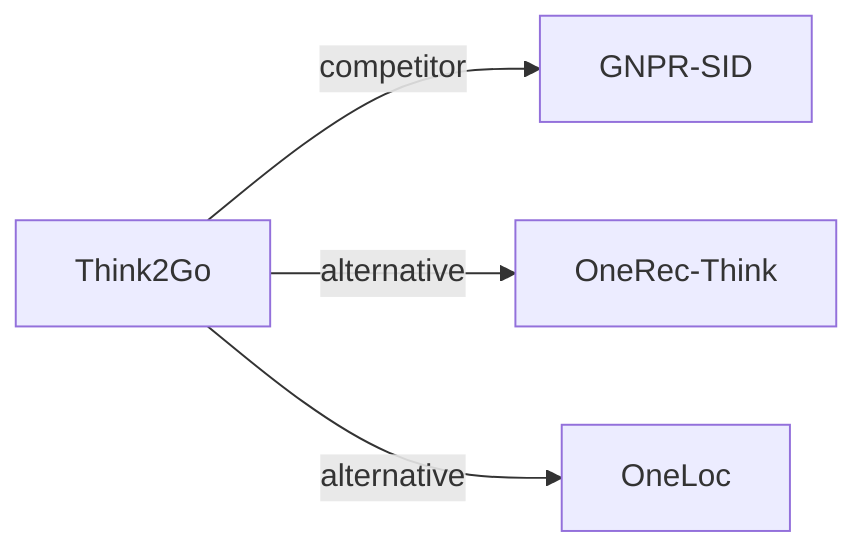

# Think2Go

| **题目** | *Generative Next POI Recommendation with LLM Reasoning* |
| :-- | :-- |
| **作者** | Zhuang et al. |
| **会议** | KDD’26 |
| **问题与阶段** | `III. SID 与模型对齐` · `Training` · `POI` |
| **链接** | [论文](https://arxiv.org/abs/2607.28997) · [代码](https://doi.org/10.5281/zenodo.18206701) · [矩阵](../../../README.zh.md#iii--training) · [English](../../papers/think2go.md) |
| **阅读级别** | 阅读笔记（第 2 级） |

本页目录：[TL;DR](#tldr) · [速览](#速览) · [1. 为什么重要](#1-为什么重要) · [2. 方法](#2-方法) · [3. 实验发现](#3-实验发现) · [4. 局限与分析](#4-局限与分析) · [5. 相关工作](#5-相关工作)

- `Attr+Geo+CF†`: Structured item attributes, geographic information, and collaborative signals (inferred).
- `Dec-Only`: Decoder-only.
- `Fixed`: SIDs are built first and not changed while the generator trains.
- `NTP → RL`: NTP, then reinforcement learning (GRPO, GBPO, etc.).
- `CoT+Beam`: Reasoning followed by beam-search decoding.

### TL;DR

> [!NOTE]
> Think2Go 统一监督微调与强化学习推理以用于下一 POI 生成，按提示的认知不确定性与归一化奖励为优势加权，加深 LLM 对 SID 的理解。

---

### 速览

| 维度 | 摘要 |
| :-- | :-- |
| 研究问题 | III. SID 与模型对齐：Can the generator read, write, and reason over SIDs, and do the tokenizer and generator work toward the same goal? |
| 核心贡献 | Think2Go 统一监督微调与强化学习推理以用于下一 POI 生成，按提示的认知不确定性与归一化奖励为优势加权，加深 LLM 对 SID 的理解。 |
| 主要改动阶段 | Training |

---

### 1. 为什么重要

下一 POI 推荐要从稀疏而复杂的出行模式中学习（Abstract）。作者认为，不做推理的模型抓不到其中深层的意图；语义 ID（Semantic ID，SID）如果和模型分开训练，LLM 也读不懂它（Abstract，Sec. 5.8）。Think2Go 让 LLM 先推理再推荐，并在一个结构里同时训练记忆和推理，而不是先 SFT 再 RL（Sec. 4，Sec. 4.1）。

---

### 2. 方法

#### 统一 SFT 与 RL

模型输入只有 SID 和时间信息（Appendix E）。训练时，模型先推理并给出第一次预测，然后接上一段固定的自我纠正提示，再接正确答案（Sec. 4.1，Table 7）。

> "This forms a Think–>Go–>Self–correct–>Answer structure, where tokens from the reasoning trace are used for RL, and tokens from the appended answer are used for SFT."（Sec. 4.1）（形成"思考-出发-自我纠正-答案"结构，推理部分的 token 用于 RL，答案部分的 token 用于 SFT。）

#### 渐进奖励

奖励先偏向格式正确的回答，再偏向语义正确的答案（Sec. 4.2.2）。正确性在拆开的 SID 单元上计分。

#### 校准的优势

标准的组优势对容易和困难的样本给同样的更新权重（Sec. 4.2.3）。Think2Go 加了两个权重。核密度估计衡量查询和用户时空历史的吻合程度，这种认知不确定性改变更新幅度（Sec. 4.2.1，Sec. 6）。

> "challenging samples with high epistemic uncertainty and correct predictions receive larger updates to encourage exploration, while incorrect predictions are updated conservatively to ensure robustness."（Sec. 4.2.1）（认知不确定性高且预测正确的难样本更新更大，预测错误的更新保守。）

第二个权重按奖励相对最大奖励的比例缩放组优势，保留绝对表现的信号（Sec. 4.2.4，Eq. 9）。作者把两者的组合称为一种隐式课程。

---

### 3. 实验发现

实验设置

- **数据集**：Foursquare NYC and TKY (April 2012-February 2013) and Gowalla CA (February 2009-October 2010), preprocessed as in GNPR-SID: POIs with fewer than 10 interactions and users with fewer than 10 check-ins removed. Sizes (users / POIs): NYC 1,083 / 5,135; TKY 2,293 / 7,873; CA 6,592 / 14,027.
  - 出处：Datasets and GNPR preprocessing: [S5.SS1.p1](https://arxiv.org/html/2607.28997v1#S5.SS1.p1); statistics: [S5.T1](https://arxiv.org/html/2607.28997v1#S5.T1).
- **切分**：Records sorted chronologically and split 80% / 10% / 10% for training, validation, and test; for each user the last check-in is the answer. Separate cross-city transfer test (Table 5).
  - 出处：Temporal 80/10/10 with last check-in as answer: [S5.SS1.p1](https://arxiv.org/html/2607.28997v1#S5.SS1.p1); cross-domain: [S5.T5](https://arxiv.org/html/2607.28997v1#S5.T5).
- **候选集**：not reported (full catalog versus sampled); Acc@1, 5, 10 and MRR over the predicted top-K POIs.
  - 出处：Acc@K and MRR over predicted lists: [S5.SS3.p1](https://arxiv.org/html/2607.28997v1#S5.SS3.p1).
- **可见性**：warm; users and POIs that do not appear in training are removed from the test set. The cross-city transfer (Table 5) tests POIs of another city; their tokenizer exposure is not reported.
  - 出处：Test users and POIs absent from training removed: [S5.SS1.p1](https://arxiv.org/html/2607.28997v1#S5.SS1.p1).
- **SID 规格**：Listwise semantic IDs built with RQ-VAE, which the paper contrasts with the pointwise semantic IDs of GNPR; numerical levels, codebook sizes, and collision handling: not reported.
  - 出处：Listwise semantic IDs whose correlations are learned through RQ-VAE, contrasted with GNPR's pointwise IDs: [S5.SS5.p2](https://arxiv.org/html/2607.28997v1#S5.SS5.p2); numerical settings not found.
- **推理预算**：Reasoning generated with vLLM (max length 1,024, temperature 1.3, 4 rollouts, beam search width 10) before the POI SID; LLaMA3.1-8B with LoRA. Five NVIDIA L40s GPUs (four for training, one for rollout inference); latency: not reported.
  - 出处：Rollout and decoding settings, hardware: [A1.p1](https://arxiv.org/html/2607.28997v1#A1.p1).
- **结果来源**：Table 2 (NYC, TKY, CA versus traditional, sequence, GCN, LLM, and reasoning baselines); Table 3 (ablations); Table 4 (SID category prediction versus GNPR); Table 5 (cross-city generalization).
  - 出处：Main: [S5.T2](https://arxiv.org/html/2607.28997v1#S5.T2); ablation: [S5.T3](https://arxiv.org/html/2607.28997v1#S5.T3); SID understanding: [S5.T4](https://arxiv.org/html/2607.28997v1#S5.T4); cross-domain: [S5.T5](https://arxiv.org/html/2607.28997v1#S5.T5).

- 消融：Table 3 分别去掉推理 token、认知不确定性权重（STEU）、奖励感知权重（DRG）和 token 熵奖励（Sec. 5.5）。
- 熵：奖励感知的缩放让推理 token 的熵在训练中保持较高（Sec. 4.2.4，Sec. 5.6，Fig. 3）。

  > "Through comparative experiments, we further observe that it effectively alleviates entropy collapse by maintaining a high entropy level for the reasoning tokens, which implies greater exploration capacity."（Sec. 4.2.4）（推理 token 的熵保持较高，缓解了熵坍缩，探索能力更强。）

- 理解 SID：给出一个 SID 和十个候选品类，让模型选出正确品类，并与 GNPR 比较（Sec. 5.7，Table 4）。这个任务的提示带一个示例（Appendix C.2，Table 8）。
- 域外：在域外数据集上，Think2Go 的下降比其他方法少（Sec. 5.8，Table 5）。
- 效率：对比在 NYC 上训练的 Refine-POI，论文报告了每轮训练时间、测试时间和内存（Appendix E，Table 10）。

---

### 4. 局限与分析

**Our analysis.**

- GNPR-SID 只用 `NTP` 在 `RQ-VAE` POI SID 上训练，没有报告推理策略（`–`）；Think2Go 加了强化学习阶段（`NTP → RL`），并在解码前推理（`CoT+Beam`）。
- ROS 也在解码前推理（`CoT+C-Beam`），但把地理放进 SID 本身（`Geo-Prefix+RQ-VAE`）；Think2Go 保留普通 `RQ-VAE` SID，通过优势权重建模空间。

---

### 5. 相关工作

- **同期对比** · [GNPR-SID](gnpr-sid.md): GNPR-SID trains SID knowledge by SFT alone; Think2Go adds reasoning tokens and advantage-calibrated GRPO over the same kind of POI semantic IDs and generalizes better across cities.
  - 出处：Think2Go v1, LLM-based baselines and preprocessing: https://arxiv.org/html/2607.28997v1#S5.SS2.p4 and https://arxiv.org/html/2607.28997v1#S5.SS1.p1; Tables 2, 4, 5: https://arxiv.org/html/2607.28997v1#S5.T2, https://arxiv.org/html/2607.28997v1#S5.T4, https://arxiv.org/html/2607.28997v1#S5.T5.
- **替代方案** · [OneRec-Think](onerec-think.md): OneRec-Think adds reasoning to industrial video recommendation; Think2Go applies RL-trained reasoning to next-POI prediction with SIDs.
  - 出处：Think2Go v1, Section 2.2 cites OneRec-Think: https://arxiv.org/html/2607.28997v1#S2.SS2.p1.
- **替代方案** · [OneLoc](oneloc.md): OneLoc is a geo-aware generative recommender trained without explicit reasoning; Think2Go relies on reasoning to use spatial context.
  - 出处：Think2Go v1, Section 1 cites OneLoc: https://arxiv.org/html/2607.28997v1#S1.p4.

[查看同格全部论文](../../../README.zh.md#iii--training)
