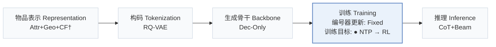
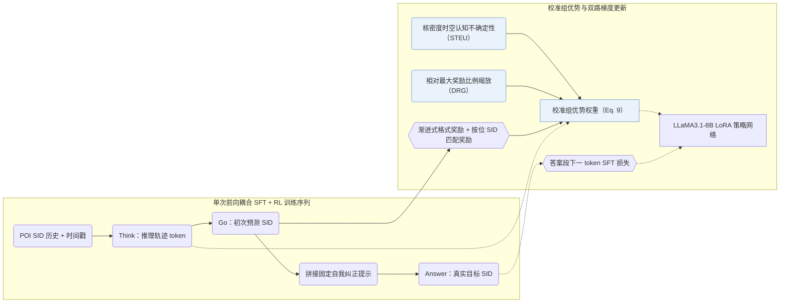
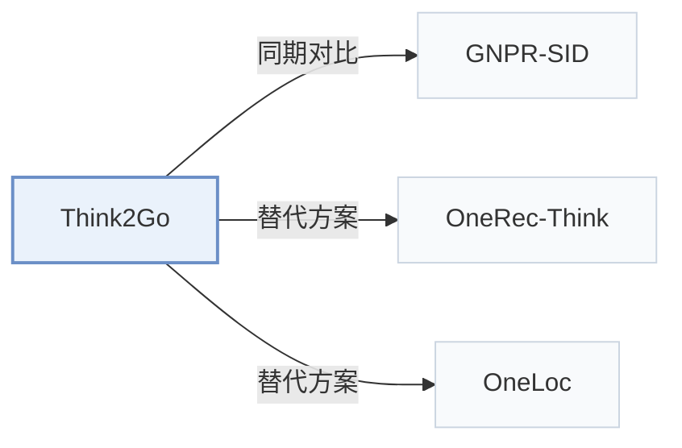

# Think2Go

[← 问题 × 阶段矩阵](../../../README.zh.md#iii--training) · [按阶段索引](../index/stages.md) · [按模态找论文](../index/modality.md) · [按领域找论文](../index/domain.md) · [English](../../papers/think2go.md) | 中文

| **题目** | *Generative Next POI Recommendation with LLM Reasoning* |
| :-- | :-- |
| **作者** | Zhuang et al. |
| **发表** | KDD’26 |
| **问题与阶段** | `III. SID 与模型对齐` · `训练（Training）` · `POI` |
| **改动** | ● 训练目标 |
| **构码输入** | `其他`（地点编号，构码输入未写） |
| **领域** | `本地生活与 POI` |
| **特殊设置** | `跨域迁移` |
| **应用场景** | `POI 与本地生活`；`公开数据` |
| **链接** | [论文](https://arxiv.org/abs/2607.28997) · [代码](https://doi.org/10.5281/zenodo.18206701) |
| **阅读级别** | 阅读笔记（第 2 级） |

**本页目录**：[TL;DR](#tldr) · [速览](#速览) · [1. 为什么重要](#1-为什么重要) · [2. 方法](#2-方法) · [3. 实验发现](#3-实验发现) · [4. 局限与分析](#4-局限与分析) · [5. 相关工作](#5-相关工作)

- `Attr+Geo+CF†`：结构化属性、地理信息与协同信号融合（由配置推断）。
- `RQ-VAE`：残差量化变分自编码器（Residual-Quantized VAE）。
- `Dec-Only`：仅解码器（Decoder-only）自回归架构。
- `Fixed`：先独立训练并冻结编号器，生成器训练期间 SID 保持不变。
- `NTP → RL`：先进行下一 token 预测微调，再执行强化学习（如 GRPO、GBPO 等）。
- `CoT+Beam`：显式推理后接束搜索解码。

### TL;DR

> [!NOTE]
> Think2Go 统一监督微调与强化学习推理以用于下一 POI 生成，按提示的认知不确定性与归一化奖励为优势加权，加深 LLM 对 SID 的理解。

---

### 速览

| 维度 | 摘要 |
| :-- | :-- |
| 主要发现 | 在 Foursquare NYC、TKY 与 Gowalla CA 上，Think2Go 超越序列、图网络、LLM 与推理类 POI 基线，在 10 选 1 SID 品类识别任务上优于 GNPR，并在跨城市域外迁移中保持更小性能衰减（Sec. 5.5–5.8，Tables 2–5）。 |
| 局限 | 模型输入仅含离散 POI 语义 ID（Semantic ID，SID）与时间戳，不含原始名称或经纬度文本，空间信息完全依赖 RQ-VAE 码与核密度不确定性权重传递（Sec. 4.2.1，Appendix E）。 |

---

### 1. 为什么重要

下一兴趣点（POI）签到序列稀疏且多变：不带推理的模型难以捕捉深层出行意图，而与基座分开训练的离散 SID 又难以被预训练 LLM 直接理解（Abstract，Sec. 5.8）。Think2Go 将监督记忆与强化学习探索耦合进单条 `Think -> Go -> Self-correct -> Answer` 轨迹，并用时空认知不确定性与相对奖励比例校准组优势权重（Sec. 4，Sec. 4.1）。

---

### 2. 方法

#### 统一 SFT 与 RL

模型仅读入列表式 RQ-VAE POI SID 与时间信息（Appendix E）。训练时先由模型生成推理轨迹（`Think`）与初次预测（`Go`），随后拼接固定自我纠正提示与真实答案（`Answer`）：推理段 token 接受 RL 策略梯度更新，追加答案段 token 接受 SFT 交叉熵监督（Sec. 4.1，Table 7）。

> "This forms a Think–>Go–>Self–correct–>Answer structure, where tokens from the reasoning trace are used for RL, and tokens from the appended answer are used for SFT."（Sec. 4.1）

#### 渐进奖励

强化学习奖励先激励合法的输出格式，随后按拆分的层级 SID 码位逐位奖励语义命中（Sec. 4.2.2）。

#### 校准的优势

常规组内归一化优势对高频惯常签到与低频跨区探索赋予相同步长（Sec. 4.2.3）。Think2Go 叠乘两项校准权重：其一用核密度估计（KDE）度量当前查询与用户历史时空分布的偏离度作为认知不确定性（STEU），放大高不确定性且答对样本的更新步长、收缩答错样本步长（Sec. 4.2.1，Sec. 6）；其二按当前奖励占最大奖励的比例缩放组优势（DRG），保留绝对质量信号并形成隐式课程（Sec. 4.2.4，Eq. 9）。

> "challenging samples with high epistemic uncertainty and correct predictions receive larger updates to encourage exploration, while incorrect predictions are updated conservatively to ensure robustness."（Sec. 4.2.1）

---

### 3. 实验发现

实验设置

- **数据集**：Foursquare NYC and TKY (April 2012-February 2013) and Gowalla CA (February 2009-October 2010), preprocessed as in GNPR-SID: POIs with fewer than 10 interactions and users with fewer than 10 check-ins removed. Sizes (users / POIs): NYC 1,083 / 5,135; TKY 2,293 / 7,873; CA 6,592 / 14,027.
  - 出处：Datasets and GNPR preprocessing: [S5.SS1.p1](https://arxiv.org/html/2607.28997v1#S5.SS1.p1); statistics: [S5.T1](https://arxiv.org/html/2607.28997v1#S5.T1).
- **切分**：Records sorted chronologically and split 80% / 10% / 10% for training, validation, and test; for each user the last check-in is the answer. Separate cross-city transfer test (Table 5).
  - 出处：Temporal 80/10/10 with last check-in as answer: [S5.SS1.p1](https://arxiv.org/html/2607.28997v1#S5.SS1.p1); cross-domain: [S5.T5](https://arxiv.org/html/2607.28997v1#S5.T5).
- **候选集**：not reported (full catalog versus sampled); Acc@1, 5, 10 and MRR over the predicted top-K POIs.
  - 出处：Acc@K and MRR over predicted lists: [S5.SS3.p1](https://arxiv.org/html/2607.28997v1#S5.SS3.p1).
- **可见性**：warm; users and POIs that do not appear in training are removed from the test set. The cross-city transfer (Table 5) tests POIs of another city; their tokenizer exposure is not reported.
  - 出处：Test users and POIs absent from training removed: [S5.SS1.p1](https://arxiv.org/html/2607.28997v1#S5.SS1.p1).
- **SID 规格**：Listwise semantic IDs built with RQ-VAE, which the paper contrasts with the pointwise semantic IDs of GNPR; numerical levels, codebook sizes, and collision handling: not reported.
  - 出处：Listwise semantic IDs whose correlations are learned through RQ-VAE, contrasted with GNPR's pointwise IDs: [S5.SS5.p2](https://arxiv.org/html/2607.28997v1#S5.SS5.p2); numerical settings not found.
- **推理预算**：Reasoning generated with vLLM (max length 1,024, temperature 1.3, 4 rollouts, beam search width 10) before the POI SID; LLaMA3.1-8B with LoRA. Five NVIDIA L40s GPUs (four for training, one for rollout inference); latency: not reported.
  - 出处：Rollout and decoding settings, hardware: [A1.p1](https://arxiv.org/html/2607.28997v1#A1.p1).
- **结果来源**：Table 2 (NYC, TKY, CA versus traditional, sequence, GCN, LLM, and reasoning baselines); Table 3 (ablations); Table 4 (SID category prediction versus GNPR); Table 5 (cross-city generalization).
  - 出处：Main: [S5.T2](https://arxiv.org/html/2607.28997v1#S5.T2); ablation: [S5.T3](https://arxiv.org/html/2607.28997v1#S5.T3); SID understanding: [S5.T4](https://arxiv.org/html/2607.28997v1#S5.T4); cross-domain: [S5.T5](https://arxiv.org/html/2607.28997v1#S5.T5).

- 模块消融与探索熵：去掉推理 token、STEU 不确定性权重、DRG 奖励缩放或 token 熵正则均会导致准确率回落（Sec. 5.5，Table 3）；DRG 在训练全程维持了较高的推理 token 熵值，抑制策略过早坍缩（Sec. 4.2.4，Sec. 5.6，Fig. 3）。

  > "Through comparative experiments, we further observe that it effectively alleviates entropy collapse by maintaining a high entropy level for the reasoning tokens, which implies greater exploration capacity."（Sec. 4.2.4）

- SID 语义探针与跨城迁移：在给定单样本提示（Appendix C.2，Table 8）、仅凭裸 SID 从 10 个候选品类中判别正确类目的测试中，Think2Go 显著高于 GNPR（Sec. 5.7，Table 4），在跨城市域外评测中衰减更小（Sec. 5.8，Table 5），并在 NYC 上对比 Refine-POI 报告了单轮训练时长、测试耗时与显存开销（Appendix E，Table 10）。

---

### 4. 局限与分析

**Our analysis.**

- GNPR-SID 仅用 `NTP` 训练 `RQ-VAE` POI SID 且未报告具体解码策略（`–`）；Think2Go 联合 SFT 与不确定性校准 RL（`NTP → RL`），并以 `CoT+Beam` 先推理后解码。
- ROS 将地理网格前缀直接写进标识符本身（`Geo-Prefix+RQ-VAE`）并配 `CoT+C-Beam`；Think2Go 保持纯 `RQ-VAE` SID，改由强化学习优势权重注入时空分布先验。

---

### 5. 相关工作

- **同期对比** · [GNPR-SID](gnpr-sid.md): GNPR-SID trains SID knowledge by SFT alone; Think2Go adds reasoning tokens and advantage-calibrated GRPO over the same kind of POI semantic IDs and generalizes better across cities.
  - 出处：Think2Go v1, LLM-based baselines and preprocessing: [S5.SS2.p4](https://arxiv.org/html/2607.28997v1#S5.SS2.p4) and [S5.SS1.p1](https://arxiv.org/html/2607.28997v1#S5.SS1.p1); Tables 2, 4, 5: [S5.T2](https://arxiv.org/html/2607.28997v1#S5.T2), [S5.T4](https://arxiv.org/html/2607.28997v1#S5.T4), [S5.T5](https://arxiv.org/html/2607.28997v1#S5.T5).
- **替代方案** · [OneRec-Think](onerec-think.md): OneRec-Think adds reasoning to industrial video recommendation; Think2Go applies RL-trained reasoning to next-POI prediction with SIDs.
  - 出处：Think2Go v1, Section 2.2 cites OneRec-Think: [S2.SS2.p1](https://arxiv.org/html/2607.28997v1#S2.SS2.p1).
- **替代方案** · [OneLoc](oneloc.md): OneLoc is a geo-aware generative recommender trained without explicit reasoning; Think2Go relies on reasoning to use spatial context.
  - 出处：Think2Go v1, Section 1 cites OneLoc: [S1.p4](https://arxiv.org/html/2607.28997v1#S1.p4).

[查看同格全部论文](../../../README.zh.md#iii--training)
