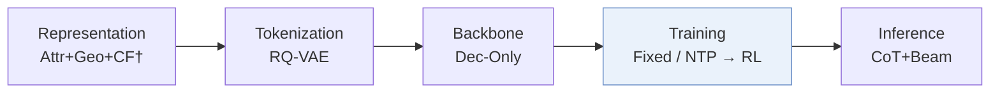
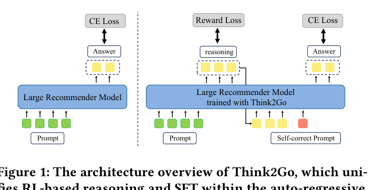
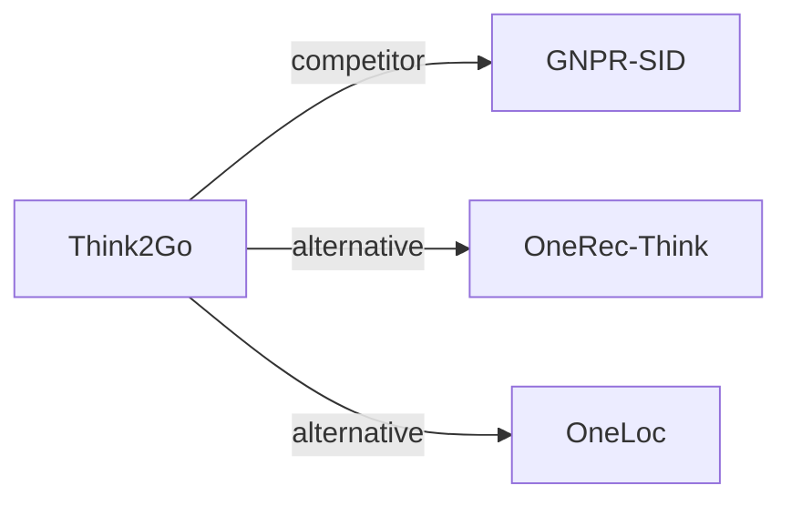

# Think2Go

*Generative Next POI Recommendation with LLM Reasoning* — Zhuang et al. · KDD’26

`III. SID 与模型对齐` · `Training` · `POI` · [论文](https://arxiv.org/abs/2607.28997) · [代码](https://doi.org/10.5281/zenodo.18206701) · [矩阵](../../../README.zh.md#iii--training) · [English](../../papers/think2go.md)

阅读级别：概览（第 1 级） · 本页目录：[TL;DR](#tldr) · [速览](#速览) · [2. 方法](#2-方法) · [3. 实验发现](#3-实验发现) · [5. 相关工作](#5-相关工作)

- `Attr+Geo+CF†`: Structured item attributes, geographic information, and collaborative signals (inferred).
- `Dec-Only`: Decoder-only.
- `Fixed`: SIDs are built first and not changed while the generator trains.
- `NTP → RL`: NTP, then reinforcement learning (GRPO, GBPO, etc.).
- `CoT+Beam`: Reasoning followed by beam-search decoding.

### TL;DR

> [!NOTE]
> Think2Go 统一监督微调与强化学习推理以用于下一 POI 生成，按提示的认知不确定性与归一化奖励为优势加权，加深 LLM 对 SID 的理解。

### 速览

| 维度 | 摘要 |
| :-- | :-- |
| 研究问题 | III. SID 与模型对齐：Can the generator read, write, and reason over SIDs, and do the tokenizer and generator work toward the same goal? |
| 核心贡献 | Think2Go 统一监督微调与强化学习推理以用于下一 POI 生成，按提示的认知不确定性与归一化奖励为优势加权，加深 LLM 对 SID 的理解。 |
| 主要改动阶段 | Training |

### 2. 方法

### 3. 实验发现

实验设置

- **数据集**：Foursquare NYC and TKY (April 2012-February 2013) and Gowalla CA (February 2009-October 2010), preprocessed as in GNPR-SID: POIs with fewer than 10 interactions and users with fewer than 10 check-ins removed. Sizes (users / POIs): NYC 1,083 / 5,135; TKY 2,293 / 7,873; CA 6,592 / 14,027.
  - 出处：Datasets and GNPR preprocessing: [S5.SS1.p1](https://arxiv.org/html/2607.28997v1#S5.SS1.p1); statistics: [S5.T1](https://arxiv.org/html/2607.28997v1#S5.T1).
- **切分**：Records sorted chronologically and split 80% / 10% / 10% for training, validation, and test; for each user the last check-in is the answer. Separate cross-city transfer test (Table 5).
  - 出处：Temporal 80/10/10 with last check-in as answer: [S5.SS1.p1](https://arxiv.org/html/2607.28997v1#S5.SS1.p1); cross-domain: [S5.T5](https://arxiv.org/html/2607.28997v1#S5.T5).
- **候选集**：not reported (full catalog versus sampled); Acc@1, 5, 10 and MRR over the predicted top-K POIs.
  - 出处：Acc@K and MRR over predicted lists: [S5.SS3.p1](https://arxiv.org/html/2607.28997v1#S5.SS3.p1).
- **可见性**：warm; users and POIs that do not appear in training are removed from the test set. The cross-city transfer (Table 5) tests POIs of another city; their tokenizer exposure is not reported.
  - 出处：Test users and POIs absent from training removed: [S5.SS1.p1](https://arxiv.org/html/2607.28997v1#S5.SS1.p1).
- **SID 规格**：Listwise semantic IDs built with RQ-VAE, which the paper contrasts with the pointwise semantic IDs of GNPR; numerical levels, codebook sizes, and collision handling: not reported.
  - 出处：Listwise semantic IDs whose correlations are learned through RQ-VAE, contrasted with GNPR's pointwise IDs: [S5.SS5.p2](https://arxiv.org/html/2607.28997v1#S5.SS5.p2); numerical settings not found.
- **推理预算**：Reasoning generated with vLLM (max length 1,024, temperature 1.3, 4 rollouts, beam search width 10) before the POI SID; LLaMA3.1-8B with LoRA. Five NVIDIA L40s GPUs (four for training, one for rollout inference); latency: not reported.
  - 出处：Rollout and decoding settings, hardware: [A1.p1](https://arxiv.org/html/2607.28997v1#A1.p1).
- **结果来源**：Table 2 (NYC, TKY, CA versus traditional, sequence, GCN, LLM, and reasoning baselines); Table 3 (ablations); Table 4 (SID category prediction versus GNPR); Table 5 (cross-city generalization).
  - 出处：Main: [S5.T2](https://arxiv.org/html/2607.28997v1#S5.T2); ablation: [S5.T3](https://arxiv.org/html/2607.28997v1#S5.T3); SID understanding: [S5.T4](https://arxiv.org/html/2607.28997v1#S5.T4); cross-domain: [S5.T5](https://arxiv.org/html/2607.28997v1#S5.T5).

### 5. 相关工作

- **同期对比** · [GNPR-SID](gnpr-sid.md): GNPR-SID trains SID knowledge by SFT alone; Think2Go adds reasoning tokens and advantage-calibrated GRPO over the same kind of POI semantic IDs and generalizes better across cities.
  - 出处：Think2Go v1, LLM-based baselines and preprocessing: https://arxiv.org/html/2607.28997v1#S5.SS2.p4 and https://arxiv.org/html/2607.28997v1#S5.SS1.p1; Tables 2, 4, 5: https://arxiv.org/html/2607.28997v1#S5.T2, https://arxiv.org/html/2607.28997v1#S5.T4, https://arxiv.org/html/2607.28997v1#S5.T5.
- **替代方案** · [OneRec-Think](onerec-think.md): OneRec-Think adds reasoning to industrial video recommendation; Think2Go applies RL-trained reasoning to next-POI prediction with SIDs.
  - 出处：Think2Go v1, Section 2.2 cites OneRec-Think: https://arxiv.org/html/2607.28997v1#S2.SS2.p1.
- **替代方案** · [OneLoc](oneloc.md): OneLoc is a geo-aware generative recommender trained without explicit reasoning; Think2Go relies on reasoning to use spatial context.
  - 出处：Think2Go v1, Section 1 cites OneLoc: https://arxiv.org/html/2607.28997v1#S1.p4.

[查看同格全部论文](../../../README.zh.md#iii--training)
