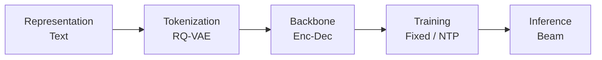
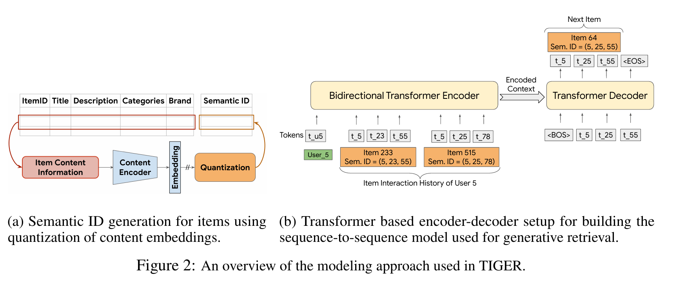
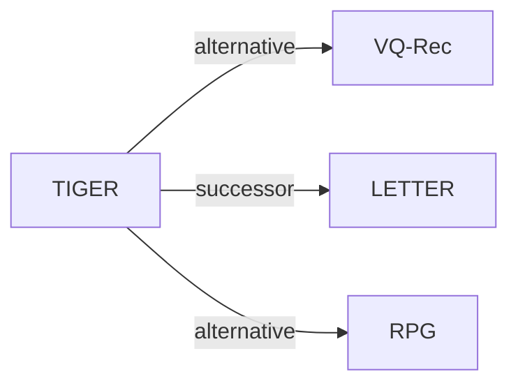

# TIGER

*Recommender Systems with Generative Retrieval* — Rajput et al. · NeurIPS’23

`范式、系统与基准` · `无单一阶段` · [论文](https://arxiv.org/abs/2305.05065) · [代码（第三方）](https://github.com/baiyimeng/TIGER) · [矩阵](../../../README.zh.md#范式系统与基准) · [English](../../papers/tiger.md)

阅读级别：概览（第 1 级） · 本页目录：[TL;DR](#tldr) · [速览](#速览) · [2. 方法](#2-方法) · [3. 实验发现](#3-实验发现) · [5. 相关工作](#5-相关工作)

- `Enc-Dec`: Encoder-decoder.
- `Fixed`: SIDs are built first and not changed while the generator trains.
- `NTP`: Next-token prediction loss only; continuing from a pretrained LLM (SFT) also counts as NTP.

### TL;DR

> [!NOTE]
> TIGER 用 RQ-VAE 将物品文本编码为语义 ID（SID），并训练 Transformer 编码器-解码器自回归解码下一物品的 SID，替代近似最近邻检索。

### 速览

| 维度 | 摘要 |
| :-- | :-- |
| 研究问题 | 范式、系统与基准：Baseline (TIGER), end-to-end multi-stage paradigms, open-source frameworks, benchmarks, and diagnostic resources. |
| 核心贡献 | TIGER 用 RQ-VAE 将物品文本编码为语义 ID（SID），并训练 Transformer 编码器-解码器自回归解码下一物品的 SID，替代近似最近邻检索。 |
| 主要改动阶段 | 无单一阶段 |

### 2. 方法

### 3. 实验发现

实验设置

- **数据集**：Amazon Product Reviews (May 1996-July 2014): Beauty, Sports and Outdoors, Toys and Games. Users with fewer than 5 reviews are filtered; an item-frequency filter is not reported. Retained item counts: 12,101 / 18,357 / 11,924, respectively.
  - 出处：Dataset/date range and user-only filtering: [A3.p1](https://arxiv.org/html/2305.05065v3#A3.p1); corpus sizes: [A3.T6](https://arxiv.org/html/2305.05065v3#A3.T6).
- **切分**：Chronological per-user leave-one-out: last interaction for test, penultimate for validation, earlier interactions for training; training histories contain at most 20 items. Separate Beauty cold-start experiment: remove 5% of test items from the training split.
  - 出处：Chronological ordering, exact leave-one-out allocation, and training-history cap: [A3.p1](https://arxiv.org/html/2305.05065v3#A3.p1). The separate Beauty cold-start manipulation removes 5% of test items from the training split: [S4.SS3.p3](https://arxiv.org/html/2305.05065v3#S4.SS3.p3).
- **候选集**：Main evaluation: full catalog versus sampled candidates not reported. Cold-start retrieval adds unseen items sharing the first three codes with a generated SID to the matching seen item; epsilon caps the proportion of unseen items in the returned top-K list (epsilon=0.1 in Fig. 5a).
  - 出处：Full-catalog versus sampled-negative evaluation is not specified in Methods/Experiments or Appendices A-E; the evaluation description is [S4.p2](https://arxiv.org/html/2305.05065v3#S4.p2) and [A3.p1](https://arxiv.org/html/2305.05065v3#A3.p1). Cold-start candidate construction and unseen-item quota: [S4.SS3.p4](https://arxiv.org/html/2305.05065v3#S4.SS3.p4); epsilon=0.1 comparison: [S4.SS3.p5](https://arxiv.org/html/2305.05065v3#S4.SS3.p5).
- **可见性**：Main leave-one-out evaluation: per-target generator/tokenizer training visibility not reported. Beauty cold-start experiment: unseen by tokenizer too; the selected items are removed from the training split, both RQ-VAE and the generator are trained on that split, and unseen-item SIDs are produced afterward.
  - 出处：Main preprocessing defines interaction holdouts without explicitly enumerating item-level training visibility: [A3.p1](https://arxiv.org/html/2305.05065v3#A3.p1) and [S4.p4](https://arxiv.org/html/2305.05065v3#S4.p4). For the cold-start experiment both RQ-VAE and the sequence-to-sequence model are trained on the reduced training split; unseen items are encoded afterward: [S4.SS3.p3](https://arxiv.org/html/2305.05065v3#S4.SS3.p3).
- **SID 规格**：Main configuration: 3 residual-quantization levels x 256 codewords (32-dimensional code embeddings), plus a fourth collision-disambiguation token, giving 4 tokens per item. Colliding three-code tuples receive different fourth tokens; non-colliding tuples receive 0. The generator uses 4 x 256 item-token entries.
  - 出处：Main RQ levels, codebook cardinality, latent dimension, and collision suffix including zero for a unique tuple: [S4.p4](https://arxiv.org/html/2305.05065v3#S4.p4). Four position-specific 256-token vocabularies: [S4.p5](https://arxiv.org/html/2305.05065v3#S4.p5); one-time collision lookup: [S3.SS1.p8](https://arxiv.org/html/2305.05065v3#S3.SS1.p8).
- **推理预算**：Autoregressive beam search; numerical beam width not reported. Main evaluation: Recall and NDCG at K=5 and 10. Cold-start Fig. 5a varies K at epsilon=0.1; Fig. 5b evaluates Recall@10 while varying epsilon. Hardware, inference batch size, and measured latency: not reported.
  - 出处：Autoregressive beam search: [A5.p3](https://arxiv.org/html/2305.05065v3#A5.p3); main metric cutoffs: [S4.p2](https://arxiv.org/html/2305.05065v3#S4.p2); cold-start cutoffs/quota experiment: [S4.F5](https://arxiv.org/html/2305.05065v3#S4.F5). No numerical beam width, inference hardware, inference batch size, or latency is specified after checking Methods/Experiments and Appendices A-E; [S4.p4](https://arxiv.org/html/2305.05065v3#S4.p4) and [S4.p6](https://arxiv.org/html/2305.05065v3#S4.p6) give training batches only.
- **结果来源**：Original paper Table 1 (main sequential recommendation); Appendix E, Table 9 (three-seed means and standard errors); Fig. 5 (Beauty cold start). Table 1 combines the authors' TIGER results, previously published S3-Rec benchmark results for baselines other than P5, and P5 rerun with modified preprocessing.
  - 出处：Original main comparison: [S4.T1](https://arxiv.org/html/2305.05065v3#S4.T1); separate three-seed mean/standard-error table: [A5.T9](https://arxiv.org/html/2305.05065v3#A5.T9); cold-start: [S4.F5](https://arxiv.org/html/2305.05065v3#S4.F5). Baselines except P5 were taken from S3-Rec's published results; P5 was rerun with modified preprocessing: [S4.SS1.p2](https://arxiv.org/html/2305.05065v3#S4.SS1.p2) and [A4.p2](https://arxiv.org/html/2305.05065v3#A4.p2).

### 5. 相关工作

- **替代方案** · [VQ-Rec](vq-rec.md): VQ-Rec uses product-quantized content codes for transferable recommendation without generative retrieval; TIGER uses RQ-VAE codes for autoregressive retrieval.
  - 出处：TIGER, Section 2, Semantic IDs paragraph: https://arxiv.org/html/2305.05065v3#S2.SS0.SSS0.Px2.p1; Section 3.2: https://arxiv.org/html/2305.05065v3#S3.SS2.p1.
- **后续工作** · [LETTER](letter.md): LETTER extends TIGER's semantic-only tokenization with collaborative and diversity regularization, and adds a ranking-guided generation loss.
  - 出处：Evidence is from the later LETTER paper, Section 3.1: https://arxiv.org/html/2405.07314v1#S3.SS1.p6; Section 4.3.1 explicitly builds the LETTER-TIGER variants: https://arxiv.org/html/2405.07314v1#S4.SS3.SSS1.p1.
- **替代方案** · [RPG](rpg.md): RPG predicts long OPQ IDs in parallel and uses graph-constrained decoding, while TIGER generates RQ-VAE IDs autoregressively.
  - 出处：Evidence is from the later RPG paper: Section 2 overview, https://arxiv.org/html/2506.05781v1#S2.p1; Section 2.1.1, https://arxiv.org/html/2506.05781v1#S2.SS1.SSS1.p1; its TIGER baseline description in Section 3.1, https://arxiv.org/html/2506.05781v1#S3.SS1.p4.

[查看同格全部论文](../../../README.zh.md#范式系统与基准)
