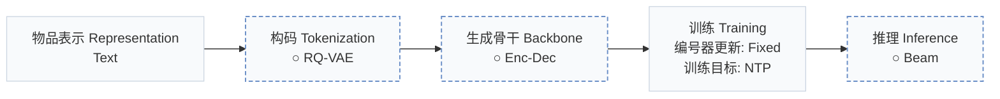
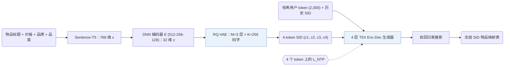
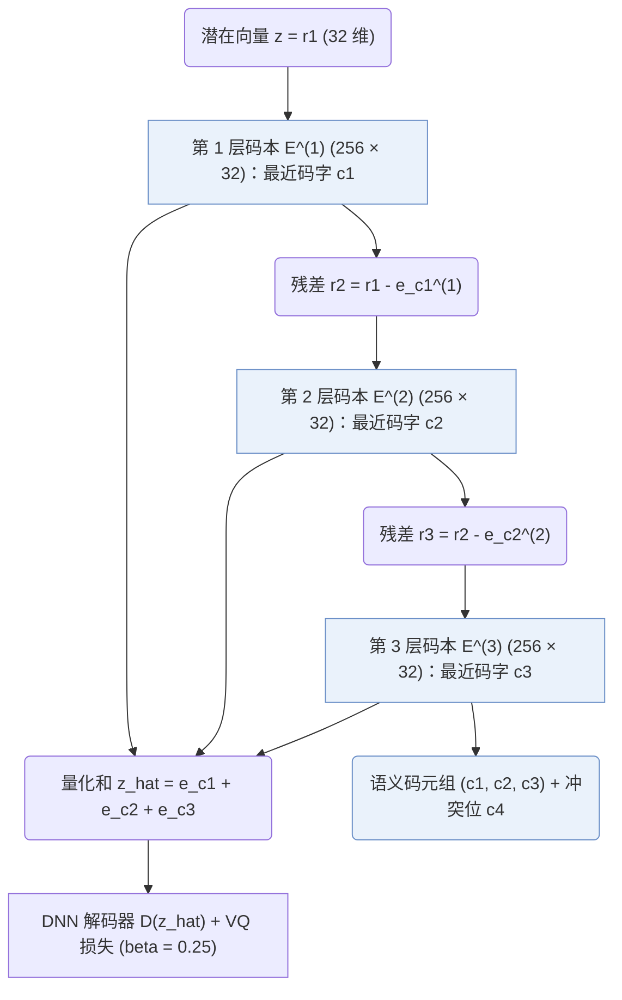
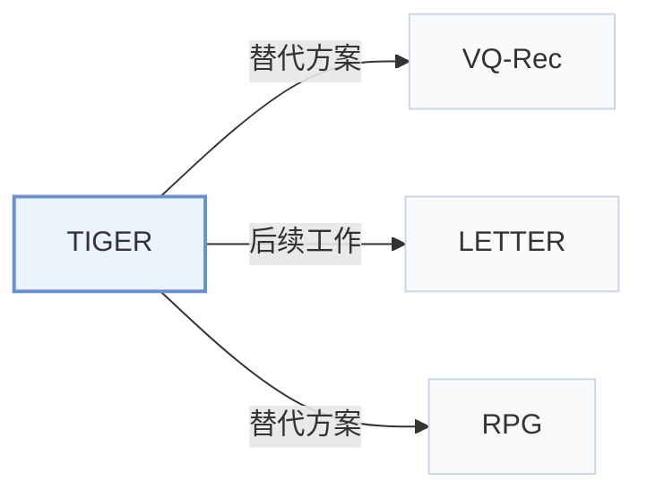

# TIGER

[← 问题 × 阶段矩阵](../../../README.zh.md#范式系统与基准) · [按阶段索引](../index/stages.md) · [按模态找论文](../index/modality.md) · [按领域找论文](../index/domain.md) · [English](../../papers/tiger.md) | 中文

| **题目** | *Recommender Systems with Generative Retrieval* |
| :-- | :-- |
| **作者** | Rajput et al. |
| **发表** | NeurIPS’23 |
| **问题与阶段** | `范式、系统与基准` · `无单一阶段` |
| **改动** | ○ 构码 · ○ 生成骨干 · ○ 推理 |
| **构码输入** | `Text` |
| **领域** | `电商` |
| **特殊设置** | `冷启动（物品）` |
| **链接** | [论文](https://arxiv.org/abs/2305.05065) · [代码（第三方）](https://github.com/baiyimeng/TIGER) |
| **阅读级别** | 代码级精读（第 3 级） |

**本页目录**：[TL;DR](#tldr) · [速览](#速览) · [1. 为什么重要](#1-为什么重要) · [2. 方法](#2-方法) · [3. 实验发现](#3-实验发现) · [4. 局限与分析](#4-局限与分析) · [5. 相关工作](#5-相关工作)



- `Text`：物品文本元数据（标题、描述、类目或提示词）。
- `RQ-VAE`：残差量化变分自编码器（Residual-Quantized VAE）。
- `Enc-Dec`：编码器-解码器（Encoder-decoder）架构。
- `Fixed`：先独立训练并冻结编号器，生成器训练期间 SID 保持不变。
- `NTP`：标准下一 token 预测（Next-Token Prediction）交叉熵损失；基于预训练 LLM 的指令微调（SFT）亦归入此类。
- `Beam`：在 SID token 上执行自回归束搜索（Beam search）。

### TL;DR

> [!NOTE]
> TIGER 用 RQ-VAE 将物品文本编码为语义 ID（SID），并训练 Transformer 编码器-解码器自回归解码下一物品的 SID，替代近似最近邻检索。

---

### 速览

| 维度 | 摘要 |
| :-- | :-- |
| 主要发现 | 在 Amazon Beauty 上，TIGER 的 Recall@5 为 0.0454，SASRec 为 0.0387；RQ-VAE 语义 ID（Semantic ID，SID）好于 LSH ID 和随机 ID（Tables 1 and 2）。 |
| 局限 | 在语义 ID token 上执行自回归束搜索，使 TIGER 在推理时的计算开销高于基于 ANN 的检索模型（Appendix E）。 |

---

### 1. 为什么重要

大规模推荐器通常把用户和物品嵌入同一个空间，再用近似最近邻（ANN）搜索选候选（Abstract）。TIGER 作为首个基于语义 ID 的序列生成式推荐模型（Sec. 2），确立了后续生成式推荐普遍沿用的残差量化语义 ID（SID）两阶段流程。

> "We propose a new paradigm of building generative retrieval models for sequential recommendation."（Sec. 1）

---

### 2. 方法


#### 概览



#### 第 1 步：物品文本到潜在向量

TIGER 用每个物品的标题、价格、品牌和品类拼成一句话，由预训练的 Sentence-T5 编码成 768 维嵌入 $`\mathbf{x}`$（Sec. 4）。DNN 编码器 $`E`$ 的中间层大小为 512、256 和 128，用 ReLU 激活，把 $`\mathbf{x}`$ 映射成 32 维潜在向量 $`\mathbf{z} = E(\mathbf{x})`$（Sec. 4）。

#### 第 2 步：残差量化成码

RQ-VAE 逐层对上一层留下的残差做向量量化，将连续表示离散化为由粗到细的码字元组（即语义 ID）。

> "Residual-Quantized Variational AutoEncoder (RQ-VAE) [40] is a multi-level vector quantizer that applies quantization on residuals to generate a tuple of codewords (aka Semantic IDs)."（Sec. 3.1）

TIGER 用 $`M = 3`$ 层，每层的码本有 $`K = 256`$ 个 32 维码字（Sec. 4）。在第 $`m`$ 层：

```math
\mathbf{r}_1 = \mathbf{z}, \qquad c_m = \arg\min_{k \in \{0, \dots, K-1\}} \left\| \mathbf{r}_m - \mathbf{e}_k^{(m)} \right\|_2^2, \qquad \mathbf{r}_{m+1} = \mathbf{r}_m - \mathbf{e}_{c_m}^{(m)}
```

其中：
- $`\mathbf{r}_m \in \mathbb{R}^{32}`$ 是进入第 $`m`$ 层的残差；
- $`\mathbf{e}_k^{(m)}`$ 是第 $`m`$ 层码本中的第 $`k`$ 个码字；
- $`c_m`$ 是第 $`m`$ 层选中的码。

```python
import torch

def rqvae_quantize(z, codebooks, beta=0.25):
    """
    z:         [B, 32] latent vectors from the encoder E(x)
    codebooks: list of M tensors, each [K, 32] (M = 3, K = 256)
    """
    r = z
    z_hat = torch.zeros_like(z)
    codes, vq_loss = [], 0.0
    for E_m in codebooks:
        # nearest codeword at this level
        c_m = torch.cdist(r, E_m).pow(2).argmin(dim=-1)                     # [B]
        e_m = E_m[c_m]                                                       # [B, 32]
        # codebook and commitment terms of the quantization loss
        vq_loss = vq_loss + (e_m - r.detach()).pow(2).mean() + beta * (r - e_m.detach()).pow(2).mean()
        # straight-through estimate, then the residual for the next level
        z_hat = z_hat + r + (e_m - r).detach()
        r = r - e_m.detach()
        codes.append(c_m)
    return torch.stack(codes, dim=-1), z_hat, vq_loss                        # [B, M], [B, 32], scalar
```

简化说明：代码只写了量化循环和量化损失，省去了 DNN 编码器和解码器、重建损失，以及码本的 k-means 初始化。



#### 第 3 步：训练编号器

解码器 $`D`$ 从选中码字之和 $`\hat{\mathbf{z}} = \sum_{m=1}^{M} \mathbf{e}_{c_m}^{(m)}`$ 重建 $`\hat{\mathbf{x}} = D(\hat{\mathbf{z}})`$。RQ-VAE 用重建损失和量化损失一起训练编码器、解码器和码本：

```math
\mathcal{L}(\mathbf{x}) = \|\mathbf{x} - \hat{\mathbf{x}}\|_2^2 + \sum_{m=1}^{M} \left( \left\|\mathrm{sg}[\mathbf{r}_m] - \mathbf{e}_{c_m}^{(m)}\right\|_2^2 + \beta \left\|\mathbf{r}_m - \mathrm{sg}[\mathbf{e}_{c_m}^{(m)}]\right\|_2^2 \right)
```

其中：
- $`\mathrm{sg}[\cdot]`$ 是停止梯度算子；
- $`\beta = 0.25`$ 是承诺项的权重（Sec. 4）。

为防止码本坍缩，TIGER 在第一个训练批上跑 k-means，用簇中心初始化码本（Sec. 3.1）。

#### 第 4 步：冲突 token

多个物品可能落入相同的三个码字。TIGER 在有序语义码末尾追加第四个冲突消解 token，使每个物品的 SID 唯一：共用 (12, 24, 52) 的两个物品分别变为 (12, 24, 52, 0) 和 (12, 24, 52, 1)（Sec. 3.1）。

> "To remove the collisions, we append an extra token at the end of the ordered semantic codes to make them unique."（Sec. 3.1）

```python
from collections import defaultdict

def append_collision_token(code_tuples):
    """code_tuples: list of (c1, c2, c3), one per item."""
    seen = defaultdict(int)
    sids = []
    for t in code_tuples:
        sids.append((*t, seen[t]))   # 0 for the first item with this tuple, 1 for the second, ...
        seen[t] += 1
    return sids
```

代码按输入顺序分配第四个 token。SID 到物品的映射表在编号器训练完后建一次，之后冻结（Appendix E）。

#### 第 5 步：序列到序列生成

TIGER 把用户历史展开成 SID token 序列，前面加一个用户 token。原始用户 ID 被哈希到 2,000 个用户 token 之一（Sec. 4）。生成器是用 T5X 框架搭的 Transformer 编码器-解码器，编码器和解码器各 4 层，6 个自注意力头，每头 64 维（Sec. 4），根据历史序列预测下一交互物品的语义 ID。

> "Given Semantic IDs for items in a user session, a Transformer-based sequence-to-sequence model is trained to predict the Semantic ID of the next item that the user will interact with."（Abstract）

生成器在目标 SID 的四个 token 上做下一 token 预测：

```math
\mathcal{L}_{\mathrm{NTP}} = -\sum_{m=1}^{4} \log P_\theta\left(c_{t,m} \mid \mathbf{c}_{1:t-1},\, c_{t,1:m-1}\right)
```

其中：
- $`\mathbf{c}_{1:t-1}`$ 是历史物品的 SID token 序列；
- $`c_{t,m}`$ 是目标物品 SID 的第 $`m`$ 个 token。

推理时，TIGER 用自回归束搜索解码 SID，再通过冻结的映射表把每个生成的 SID 对应到物品（Appendix E）。

---

### 3. 实验发现

<details>
<summary>实验设置</summary>

- **数据集**：Amazon Product Reviews (May 1996-July 2014): Beauty, Sports and Outdoors, Toys and Games. Users with fewer than 5 reviews are filtered; an item-frequency filter is not reported. Retained item counts: 12,101 / 18,357 / 11,924, respectively.
  - 出处：Dataset/date range and user-only filtering: [A3.p1](https://arxiv.org/html/2305.05065v3#A3.p1); corpus sizes: [A3.T6](https://arxiv.org/html/2305.05065v3#A3.T6).
- **切分**：Chronological per-user leave-one-out: last interaction for test, penultimate for validation, earlier interactions for training; training histories contain at most 20 items. Separate Beauty cold-start experiment: remove 5% of test items from the training split.
  - 出处：Chronological ordering, exact leave-one-out allocation, and training-history cap: [A3.p1](https://arxiv.org/html/2305.05065v3#A3.p1). The separate Beauty cold-start manipulation removes 5% of test items from the training split: [S4.SS3.p3](https://arxiv.org/html/2305.05065v3#S4.SS3.p3).
- **候选集**：Main evaluation: full catalog versus sampled candidates not reported. Cold-start retrieval adds unseen items sharing the first three codes with a generated SID to the matching seen item; epsilon caps the proportion of unseen items in the returned top-K list (epsilon=0.1 in Fig. 5a).
  - 出处：Full-catalog versus sampled-negative evaluation is not specified in Methods/Experiments or Appendices A-E; the evaluation description is [S4.p2](https://arxiv.org/html/2305.05065v3#S4.p2) and [A3.p1](https://arxiv.org/html/2305.05065v3#A3.p1). Cold-start candidate construction and unseen-item quota: [S4.SS3.p4](https://arxiv.org/html/2305.05065v3#S4.SS3.p4); epsilon=0.1 comparison: [S4.SS3.p5](https://arxiv.org/html/2305.05065v3#S4.SS3.p5).
- **可见性**：Main leave-one-out evaluation: per-target generator/tokenizer training visibility not reported. Beauty cold-start experiment: unseen by tokenizer too; the selected items are removed from the training split, both RQ-VAE and the generator are trained on that split, and unseen-item SIDs are produced afterward.
  - 出处：Main preprocessing defines interaction holdouts without explicitly enumerating item-level training visibility: [A3.p1](https://arxiv.org/html/2305.05065v3#A3.p1) and [S4.p4](https://arxiv.org/html/2305.05065v3#S4.p4). For the cold-start experiment both RQ-VAE and the sequence-to-sequence model are trained on the reduced training split; unseen items are encoded afterward: [S4.SS3.p3](https://arxiv.org/html/2305.05065v3#S4.SS3.p3).
- **SID 规格**：Main configuration: 3 residual-quantization levels x 256 codewords (32-dimensional code embeddings), plus a fourth collision-disambiguation token, giving 4 tokens per item. Colliding three-code tuples receive different fourth tokens; non-colliding tuples receive 0. The generator uses 4 x 256 item-token entries.
  - 出处：Main RQ levels, codebook cardinality, latent dimension, and collision suffix including zero for a unique tuple: [S4.p4](https://arxiv.org/html/2305.05065v3#S4.p4). Four position-specific 256-token vocabularies: [S4.p5](https://arxiv.org/html/2305.05065v3#S4.p5); one-time collision lookup: [S3.SS1.p8](https://arxiv.org/html/2305.05065v3#S3.SS1.p8).
- **推理预算**：Autoregressive beam search; numerical beam width not reported. Main evaluation: Recall and NDCG at K=5 and 10. Cold-start Fig. 5a varies K at epsilon=0.1; Fig. 5b evaluates Recall@10 while varying epsilon. Hardware, inference batch size, and measured latency: not reported.
  - 出处：Autoregressive beam search: [A5.p3](https://arxiv.org/html/2305.05065v3#A5.p3); main metric cutoffs: [S4.p2](https://arxiv.org/html/2305.05065v3#S4.p2); cold-start cutoffs/quota experiment: [S4.F5](https://arxiv.org/html/2305.05065v3#S4.F5). No numerical beam width, inference hardware, inference batch size, or latency is specified after checking Methods/Experiments and Appendices A-E; [S4.p4](https://arxiv.org/html/2305.05065v3#S4.p4) and [S4.p6](https://arxiv.org/html/2305.05065v3#S4.p6) give training batches only.
- **结果来源**：Original paper Table 1 (main sequential recommendation); Appendix E, Table 9 (three-seed means and standard errors); Fig. 5 (Beauty cold start). Table 1 combines the authors' TIGER results, previously published S3-Rec benchmark results for baselines other than P5, and P5 rerun with modified preprocessing.
  - 出处：Original main comparison: [S4.T1](https://arxiv.org/html/2305.05065v3#S4.T1); separate three-seed mean/standard-error table: [A5.T9](https://arxiv.org/html/2305.05065v3#A5.T9); cold-start: [S4.F5](https://arxiv.org/html/2305.05065v3#S4.F5). Baselines except P5 were taken from S3-Rec's published results; P5 was rerun with modified preprocessing: [S4.SS1.p2](https://arxiv.org/html/2305.05065v3#S4.SS1.p2) and [A4.p2](https://arxiv.org/html/2305.05065v3#A4.p2).

</details>

下面三条都是 TIGER 和 SASRec 的比较。在 Sports and Outdoors 的全部四列上，最强基线是 S3-Rec（Table 1）。在 Beauty 和 Toys and Games 的 Recall@10、NDCG@10 上，最强基线也是 S3-Rec。

- Beauty：TIGER 的 Recall@5 = 0.0454，NDCG@5 = 0.0321，Recall@10 = 0.0648，NDCG@10 = 0.0384；SASRec 分别为 0.0387、0.0249、0.0605 和 0.0318（Table 1）。
- Sports and Outdoors：TIGER 的 Recall@5 = 0.0264，NDCG@5 = 0.0181，Recall@10 = 0.0400，NDCG@10 = 0.0225；SASRec 分别为 0.0233、0.0154、0.0350 和 0.0192（Table 1）。
- Toys and Games：TIGER 的 Recall@5 = 0.0521，NDCG@5 = 0.0371，Recall@10 = 0.0712，NDCG@10 = 0.0432；SASRec 分别为 0.0463、0.0306、0.0675 和 0.0374（Table 1）。
- ID 消融：Table 2 比较随机 ID、LSH 语义 ID 和 RQ-VAE 语义 ID。在全部十二列指标上，RQ-VAE ID 均取得最高分，随机 ID 最低（Sec. 4.2，Table 2）。

  > "Our results show that RQ-VAE consistently outperforms LSH."（Sec. 4.2）

- 非法 ID：取 top-10 预测时，三个数据集上有 0.1%–1.6% 的生成 ID 对应不到物品（Sec. 4.5，Fig. 6）。
- 冷启动：共享语义前缀使生成器在混合冷热候选集时能够召回无历史交互的新物品（Abstract，Fig. 5）。
- 多样性：解码时基于温度的采样可以控制预测的多样性（Sec. 4.3）。
- ID 长度与码本大小：改变 SID 结构配置（例如从大小为 64 的码本取 6 个码字）对推荐指标影响很小（Appendix E）。

  > "We noticed that the recommendation metrics for TIGER were robust to these changes."（Appendix E）

---

### 4. 局限与分析

**Stated by the authors.**

> "we note that our model can be more computationally expensive than ANN-based models during inference due to the use of beam search for autoregressive decoding."（Appendix E）

**Our analysis.**

- TIGER 的表示只用物品文本（`Text`）。LETTER 用文本和协同信号（`Text+CF`），配可学习的 RQ 编号器（`Learn. RQ`）。
- 编号器在训练生成器之前就固定了（`Fixed`）。ETEGRec 轮流更新编号器和生成器（`Altern.`）。
- 不加约束的束搜索可能生成对应不到物品的 ID（Sec. 4.5）。LETTER 用约束束搜索解码（`C-Beam`）。
- 束搜索每生成一个 SID token 就要跑一步生成器。RPG 并行预测一个 SID 的所有 token（`Non-AR`），并在合法 ID 构成的图上解码（`Graph`）。

---

### 5. 相关工作



- **替代方案** · [VQ-Rec](vq-rec.md): VQ-Rec uses product-quantized content codes for transferable recommendation without generative retrieval; TIGER uses RQ-VAE codes for autoregressive retrieval.
  - 出处：TIGER, Section 2, Semantic IDs paragraph: [S2.SS0.SSS0.Px2.p1](https://arxiv.org/html/2305.05065v3#S2.SS0.SSS0.Px2.p1); Section 3.2: [S3.SS2.p1](https://arxiv.org/html/2305.05065v3#S3.SS2.p1).
- **后续工作** · [LETTER](letter.md): LETTER extends TIGER's semantic-only tokenization with collaborative and diversity regularization, and adds a ranking-guided generation loss.
  - 出处：Evidence is from the later LETTER paper, Section 3.1: [S3.SS1.p6](https://arxiv.org/html/2405.07314v1#S3.SS1.p6); Section 4.3.1 explicitly builds the LETTER-TIGER variants: [S4.SS3.SSS1.p1](https://arxiv.org/html/2405.07314v1#S4.SS3.SSS1.p1).
- **替代方案** · [RPG](rpg.md): RPG predicts long OPQ IDs in parallel and uses graph-constrained decoding, while TIGER generates RQ-VAE IDs autoregressively.
  - 出处：Evidence is from the later RPG paper: Section 2 overview, [S2.p1](https://arxiv.org/html/2506.05781v1#S2.p1); Section 2.1.1, [S2.SS1.SSS1.p1](https://arxiv.org/html/2506.05781v1#S2.SS1.SSS1.p1); its TIGER baseline description in Section 3.1, [S3.SS1.p4](https://arxiv.org/html/2506.05781v1#S3.SS1.p4).

[查看同格全部论文](../../../README.zh.md#范式系统与基准)
