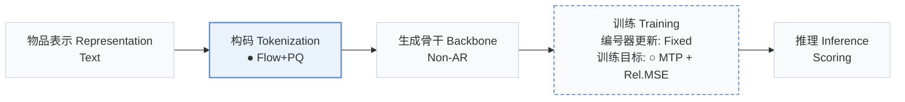
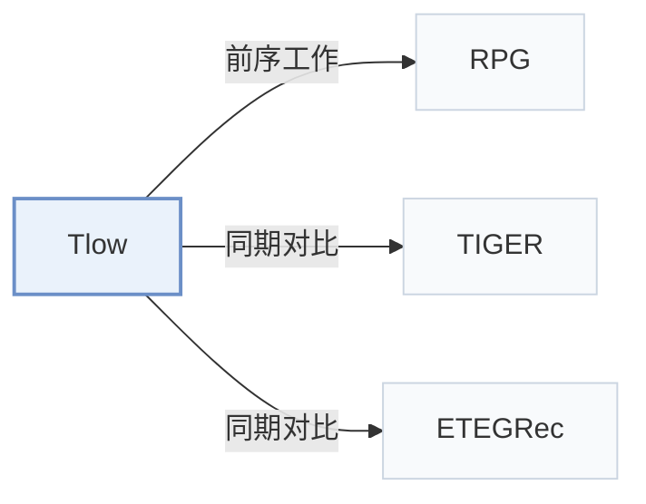

# Tlow

[← 问题 × 阶段矩阵](../../../README.zh.md#i--tokenization) · [按阶段索引](../index/stages.md) · [按模态找论文](../index/modality.md) · [按领域找论文](../index/domain.md) · [English](../../papers/tlow.md) | 中文

| **题目** | *Flow-based Item Tokenizer for Recommendation* |
| :-- | :-- |
| **作者** | Li et al. |
| **发表** | CIKM’26 Applied |
| **问题与阶段** | `I. 信息量` · `构码（Tokenization）` |
| **改动** | ● 构码 · ○ 训练目标 |
| **构码输入** | A: `Text` · B: `Text` + `Img` |
| **领域** | `电商` · `图文与文章` |
| **特殊设置** | `跨域迁移` · `冷启动（物品）` |
| **链接** | [论文](https://arxiv.org/abs/2608.24176) · [代码](https://github.com/wjjln/Tlow) |
| **阅读级别** | 概览（第 1 级） |

**本页目录**：[TL;DR](#tldr) · [3. 实验发现](#3-实验发现) · [5. 相关工作](#5-相关工作)

- `Text`：物品文本元数据（标题、描述、类目或提示词）。
- `Flow+PQ`：归一化流表征变换后接乘积量化（PQ）。
- `Non-AR`：非自回归（Non-autoregressive）并行预测架构。
- `Fixed`：先独立训练并冻结编号器，生成器训练期间 SID 保持不变。
- `MTP + Rel.MSE`：多 token 预测结合关系均方误差（MSE）损失。
- `Scoring`：直接计算候选物品得分，不逐位生成 SID。

### TL;DR

> [!NOTE]
> Tlow 在独立量化前用归一化流将语义嵌入映射到标准正态隐空间，并对齐码本与 token 嵌入空间，区别于 RQ-VAE 和 OPQ。

---

### 3. 实验发现

实验设置

- **数据集**：Amazon Reviews Sports/Beauty/Toys/CDs; processed Cloth-Sports cross-domain data. WeChat picture/article logs for online multimodal retrieval. Filtering not reported.
  - 出处：Sections 3.1.1/3.6.1: [S3.SS1.SSS1.p1](https://arxiv.org/html/2608.24176v1#S3.SS1.SSS1.p1) and [S3.SS6.SSS1.p1](https://arxiv.org/html/2608.24176v1#S3.SS6.SSS1.p1)
- **切分**：Public: chronological last item test, penultimate validation, earlier interactions train. Online holdout protocol and A/B duration not reported; two weeks refers to model training.
  - 出处：Sections 3.1.1/3.6.2: [S3.SS1.SSS1.p2](https://arxiv.org/html/2608.24176v1#S3.SS1.SSS1.p2) and [S3.SS6.SSS2.p1](https://arxiv.org/html/2608.24176v1#S3.SS6.SSS2.p1)
- **候选集**：full catalog for offline ranking; historical-item exclusion not reported
  - 出处：Section 3.1.3: [S3.SS1.SSS3.p1](https://arxiv.org/html/2608.24176v1#S3.SS1.SSS3.p1)
- **可见性**：Offline: warm; no unseen-item protocol is defined. Cold analysis bins targets by training frequency. Online cold pictures are exposed on publication day; generator/tokenizer exclusion not reported. Tokenizer fits about 1M items, then encodes additional unseen items.
  - 出处：Sections 3.5/3.6.2/3.6.3: [S3.SS5.p1](https://arxiv.org/html/2608.24176v1#S3.SS5.p1) and [S3.SS6.SSS2.p1](https://arxiv.org/html/2608.24176v1#S3.SS6.SSS2.p1) and [S3.SS6.SSS3.p1](https://arxiv.org/html/2608.24176v1#S3.SS6.SSS3.p1)
- **SID 规格**：Flow plus independent PQ: C in {16,32,64,96,128}, 256 codes each; selected C per offline dataset not reported. Online: 16 x 256. Collision handling not reported.
  - 出处：Sections 3.1.4/3.6.2: [S3.SS1.SSS4.p1](https://arxiv.org/html/2608.24176v1#S3.SS1.SSS4.p1) and [S3.SS6.SSS2.p1](https://arxiv.org/html/2608.24176v1#S3.SS6.SSS2.p1)
- **推理预算**：Single-forward parallel token scoring, Recall/NDCG@5/10; temperature searched over 0.03/0.05/0.07. Recommendation hardware, batch size and latency not reported. Online tokenization of tens of millions of new items takes minutes on one unspecified GPU, not per-request serving time.
  - 出处：Sections 3.1.4/3.6.1/3.6.2: [S3.SS1.SSS4.p1](https://arxiv.org/html/2608.24176v1#S3.SS1.SSS4.p1) and [S3.SS6.SSS1.p1](https://arxiv.org/html/2608.24176v1#S3.SS6.SSS1.p1) and [S3.SS6.SSS2.p1](https://arxiv.org/html/2608.24176v1#S3.SS6.SSS2.p1)
- **结果来源**：Tables 2/4/5/6: general/cross-domain/multimodal/online results. General comparison reuses RPG-paper baseline scores and reruns RPG; main semantic embeddings are sentence-t5-base.
  - 出处：Section 3.1.4 and Tables 2/4/5/6: [S3.SS1.SSS4.p1](https://arxiv.org/html/2608.24176v1#S3.SS1.SSS4.p1) and [S3.T2](https://arxiv.org/html/2608.24176v1#S3.T2) and [S3.T4](https://arxiv.org/html/2608.24176v1#S3.T4) and [S3.T5](https://arxiv.org/html/2608.24176v1#S3.T5) and [S3.T6](https://arxiv.org/html/2608.24176v1#S3.T6)

---

### 5. 相关工作

- **前序工作** · [RPG](rpg.md): Supplies the parallel prediction setup and the rerun controlled baseline.
  - 出处：Tlow v1, Section 3.1.4: [S3.SS1.SSS4.p1](https://arxiv.org/html/2608.24176v1#S3.SS1.SSS4.p1).
- **同期对比** · [TIGER](tiger.md): Autoregressive RQ-VAE comparator against independent flow-space tokenization.
  - 出处：Tlow v1, Introduction and Section 3.1.2: [S1.p2](https://arxiv.org/html/2608.24176v1#S1.p2); [S3.SS1.SSS2.p1](https://arxiv.org/html/2608.24176v1#S3.SS1.SSS2.p1).
- **同期对比** · [ETEGRec](etegrec.md): Included tokenizer comparator; general baseline scores are reused from the RPG paper.
  - 出处：Tlow v1, Sections 3.1.2/3.1.4 and Table 2: [S3.SS1.SSS2.p1](https://arxiv.org/html/2608.24176v1#S3.SS1.SSS2.p1); [S3.SS1.SSS4.p1](https://arxiv.org/html/2608.24176v1#S3.SS1.SSS4.p1); [S3.T2](https://arxiv.org/html/2608.24176v1#S3.T2).

[查看同格全部论文](../../../README.zh.md#i--tokenization)
