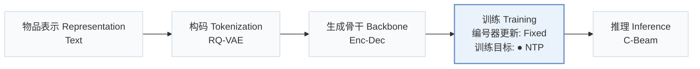
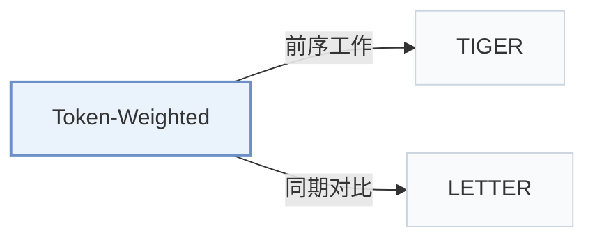

# Token-Weighted

[← 问题 × 阶段矩阵](../../../README.zh.md#iv--training) · [按阶段索引](../index/stages.md) · [按模态找论文](../index/modality.md) · [按领域找论文](../index/domain.md) · [English](../../papers/token-weighted.md) | 中文

| **题目** | *Beyond Uniform Token Training: A Multi-Target Framework for Learning Token-Weighted Objectives in Generative Recommenders* |
| :-- | :-- |
| **作者** | Chiu et al. |
| **发表** | CIKM’26 |
| **问题与阶段** | `IV. 实用目标` · `训练（Training）` |
| **改动** | ● 训练目标 |
| **构码输入** | `Text` |
| **领域** | `电商` · `本地生活与 POI` · `电影` |
| **链接** | [论文](https://arxiv.org/abs/2601.17787) · [代码](https://github.com/CHIUWEINING/Token-Weighted-Multi-Target-Learning-for-Generative-Recommenders-with-Curriculum-Learning) |
| **阅读级别** | 概览（第 1 级） |

**本页目录**：[TL;DR](#tldr) · [3. 实验发现](#3-实验发现) · [5. 相关工作](#5-相关工作)

- `Text`：物品文本元数据（标题、描述、类目或提示词）。
- `RQ-VAE`：残差量化变分自编码器（Residual-Quantized VAE）。
- `Enc-Dec`：编码器-解码器（Encoder-decoder）架构。
- `Fixed`：先独立训练并冻结编号器，生成器训练期间 SID 保持不变。
- `NTP`：标准下一 token 预测（Next-Token Prediction）交叉熵损失；基于预训练 LLM 的指令微调（SFT）亦归入此类。
- `C-Beam`：受合法物品集合约束的束搜索（Constrained beam search）。

### TL;DR

> [!NOTE]
> Token-Weighted 按前缀歧义消减量与 token 频率为 SID token 加权，在课程学习下与标准似然结合，替代对所有位置均匀加权的训练。

---

### 3. 实验发现

实验设置

- **数据集**：Amazon Musical Instruments and Industrial & Scientific, Yelp, MovieLens 1M; 5-core users/items. Maximum history length not reported.
  - 出处：[S5.SS1.SSS1.p1](https://arxiv.org/html/2601.17787v2#S5.SS1.SSS1.p1) ; #S5.SS1.SSS1.p2
- **切分**：Per-user leave-one-out: last interaction test, penultimate validation, others training. Additional head/tail analysis divides test items equally by interaction frequency; it does not redefine the training split.
  - 出处：[S5.SS1.SSS1.p2](https://arxiv.org/html/2601.17787v2#S5.SS1.SSS1.p2) ; #S5.SS2.SSS5.p1
- **候选集**：not reported
  - 出处：[S5.SS1](https://arxiv.org/html/2601.17787v2#S5.SS1)
- **可见性**：warm; no unseen-item protocol is defined. Tokenizer fitting exposure to test items not reported.
  - 出处：[S5.SS1.SSS1.p2](https://arxiv.org/html/2601.17787v2#S5.SS1.SSS1.p2) ; #S5.SS1.SSS3.p2
- **SID 规格**：RQ-VAE: 4 x 256 using LLaMA2-7B item embeddings; duplicate IDs resolved by random reassignment of the final token. PQ extension uses four independently quantized embedding segments; PQ codebook sizes not reported.
  - 出处：[S5.SS1.SSS3.p2](https://arxiv.org/html/2601.17787v2#S5.SS1.SSS3.p2) ; #S5.SS2.SSS3.p1
- **推理预算**：Constrained beam search; Hit/NDCG@5/10. Main backbone TIGER/T5; LLaMA3.2-3B extension uses 8-bit LoRA at training and inference. Beam width, inference batch size and latency not reported. General experiment pool: two RTX 3090s and one RTX A6000; inference allocation not reported.
  - 出处：[S3.SS2.p2](https://arxiv.org/html/2601.17787v2#S3.SS2.p2) ; #S5.SS1.SSS3.p1 ; #S5.SS2.SSS3.p2
- **结果来源**：Original Table 3: main comparison, five-run means; token-level baselines implemented on TIGER. Table 4: ablations; Table 5: PQ IDs; Table 6: larger backbone. Baseline-result reuse not stated.
  - 出处：[S4.T3](https://arxiv.org/html/2601.17787v2#S4.T3) ; #S5.T4 ; #S5.T5 ; #S5.T6 ; #S5.SS1.SSS2.p1 ; #S5.SS1.SSS3.p1

---

### 5. 相关工作

- **前序工作** · [TIGER](tiger.md): The proposed curriculum combines token-weighted objectives with standard likelihood on the TIGER architecture.
  - 出处：Token-Weighted v2, Section 5.1.2 and Table 3: [S5.SS1.SSS2.p1](https://arxiv.org/html/2601.17787v2#S5.SS1.SSS2.p1); [S4.T3](https://arxiv.org/html/2601.17787v2#S4.T3).
- **同期对比** · [LETTER](letter.md): The Rank baseline adapts LETTER ranking-guided loss to TIGER; the proposed method instead combines prefix-dispersion and token-frequency weights through a curriculum.
  - 出处：Token-Weighted v2, Sections 4.1/5.1.2 and Table 3; comparison is to the adapted Rank objective, not the full LETTER system: [S4.SS1.p2](https://arxiv.org/html/2601.17787v2#S4.SS1.p2); [S5.SS1.SSS2.p2](https://arxiv.org/html/2601.17787v2#S5.SS1.SSS2.p2); [S4.T3](https://arxiv.org/html/2601.17787v2#S4.T3).

[查看同格全部论文](../../../README.zh.md#iv--training)
