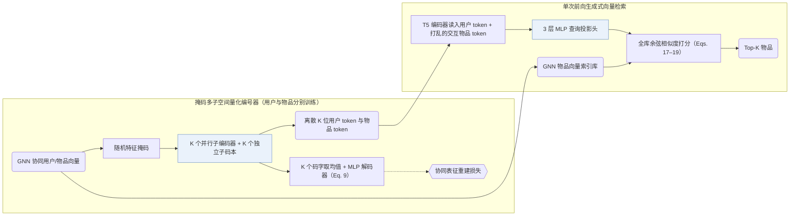
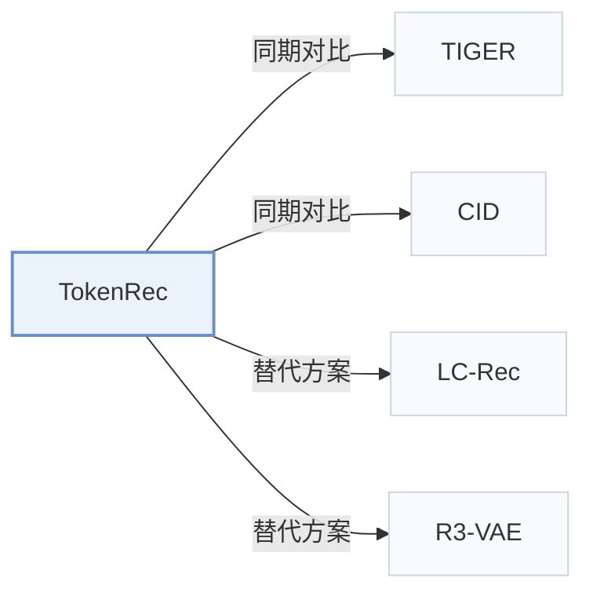

# TokenRec

[← 问题 × 阶段矩阵](../../../README.zh.md#i--tokenization) · [按阶段索引](../index/stages.md) · [按模态索引](../index/modality.md) · [English](../../papers/tokenrec.md) | 中文

| **题目** | *Learning to tokenize id for llm-based generative recommendations* |
| :-- | :-- |
| **作者** | Qu et al. |
| **发表** | TKDE’25 |
| **问题与阶段** | `I. 信息量` · `编号（Tokenization）` |
| **链接** | [论文](https://arxiv.org/abs/2406.10450) · [代码](https://github.com/Quhaoh233/TokenRec) |
| **阅读级别** | 阅读笔记（第 2 级） |

**本页目录**：[TL;DR](#tldr) · [速览](#速览) · [1. 为什么重要](#1-为什么重要) · [2. 方法](#2-方法) · [3. 实验发现](#3-实验发现) · [4. 局限与分析](#4-局限与分析) · [5. 相关工作](#5-相关工作)

- `CF`：纯协同过滤交互信号。
- `Masked VQ`：面向掩码协同表征的向量量化。
- `Encoder`：双向编码器骨干，不进行逐位自回归解码。
- `Fixed`：先独立训练并冻结编号器，生成器训练期间 SID 保持不变。
- `Discrim.`：判别式候选物品打分损失，不直接生成 SID。
- `Scoring`：直接计算候选物品得分，不逐位生成 SID。

### TL;DR

> [!NOTE]
> TokenRec 将掩码协同用户与物品表示量化为离散 token，无需自回归解码或束搜索即可检索 top-K 物品，并泛化到新用户与新物品。

---

### 速览

| 维度 | 摘要 |
| :-- | :-- |
| 研究问题 | I. 信息量：SID 或读取它的模型是否充分携带了推荐所需的协同、多模态与时空信号？ |
| 核心贡献 | TokenRec 将掩码协同用户与物品表示量化为离散 token，无需自回归解码或束搜索即可检索 top-K 物品，并泛化到新用户与新物品。 |
| 主要改动阶段 | 编号（Tokenization） |
| 主要发现 | 在 LastFM、MovieLens-1M、Amazon Beauty 与 Clothing 四个数据集上，TokenRec 全面超越协同、序列与 LLM 基线，并将单用户 top-20 推理耗时降至 5.76–8.43 ms（自回归束搜索基线为 76–102 ms）（Abstract，Tables 2, 3, and 5）。 |
| 局限 | 面对新用户或新物品时，尽管编号器与 LLM 保持冻结，仍需重训上游 GNN 协同过滤模型以生成初始协同表征（Sec. II-E.2）。 |

---

### 1. 为什么重要

若为每个用户和物品各分配一个独立 token，LLM 词表会随用户与物品规模线性膨胀（Sec. I）；而纯文本编码又缺失高阶协同图结构，在训练集外的用户或物品上泛化受限（Abstract）。TokenRec 对随机掩码后的 GNN 协同表征做并行向量量化，将用户与物品表示为紧凑的离散语义 ID（Semantic ID，SID）组合，并以单次向量内积检索替代耗时的自回归束搜索。

---

### 2. 方法

#### MQ-Tokenizer

GNN 协同过滤模型预先学出用户与物品稠密向量并存入向量库（Sec. II-C.2）。独立训练的用户与物品 MQ-Tokenizer 先对输入向量施加随机掩码，再经 $`K`$ 个并行子编码器投影至各自的子码本量化（Sec. II-C.2，Sec. II-C.3）；解码端对选出的 $`K`$ 个码字取平均后经 MLP 重建原始协同向量（Sec. II-C.4，Eq. 9）。

> "Specifically, our MQ-Tokenizer assigns each user and item a small number of discrete tokens generated by quantizing the GNN-based representations."（Sec. II-C.1）

> "we propose to randomly mask these representations to create a challenging task that enables the tokenizer to build a comprehensive understanding and generalize well."（Sec. II-C.2）

#### 生成式检索

T5 骨干充当查询编码器，读入由用户 token 与历史交互物品 token 拼成的提示（训练时打乱历史物品顺序而不按时间排列）（Sec. II-D.2）。其输出隐状态经 3 层 MLP 投影后，直接与向量库中的全量 GNN 物品表征计算余弦相似度，单次前向选出 top-$`K`$ 候选（Sec. II-D.3，Eqs. 17–19）。

---

### 3. 实验发现

实验设置

- **数据集**：LastFM (1,090 users / 3,646 items), MovieLens-1M (6,040 / 3,416), Amazon Beauty (22,363 / 12,101), Amazon Clothing (23,033 / 39,387 as printed); histories capped at 100 items. Filtering rules: not reported.
  - 出处：Datasets and statistics: [S3.SS1.SSS1.p1](https://arxiv.org/html/2406.10450v3#S3.SS1.SSS1.p1) and [S3.T1](https://arxiv.org/html/2406.10450v3#S3.T1).
- **切分**：Leave-one-out: all but the last observation for training; histories are randomly shuffled to give non-chronological lists (to match collaborative-filtering baselines). Separate study on Beauty and LastFM: the 5% of users with the least history are removed from training as unseen users, and all items they interacted with are excluded from training too.
  - 出处：Leave-one-out with shuffled histories: [S3.SS1.SSS1.p1](https://arxiv.org/html/2406.10450v3#S3.SS1.SSS1.p1); unseen-user split: [S3.SS3.p2](https://arxiv.org/html/2406.10450v3#S3.SS3.p2).
- **候选集**：full catalog (scores all items in the item base and retrieves top-K). Training uses 1:1 negatives drawn at random from un-interacted items.
  - 出处：Scores over all items for top-K retrieval; training negatives 1:1: [S2.SS4.SSS3.p3](https://arxiv.org/html/2406.10450v3#S2.SS4.SSS3.p3) and [S3.SS1.SSS4.p1](https://arxiv.org/html/2406.10450v3#S3.SS1.SSS4.p1).
- **可见性**：Main: warm; no unseen-item protocol is defined. Unseen-user study: held-out users and every item they interacted with are excluded from the training split, so those items are unseen by the generator and the MQ-Tokenizer training (tokens for them are produced afterwards from their representations).
  - 出处：Unseen-user study excludes those users' items from training: [S3.SS3.p2](https://arxiv.org/html/2406.10450v3#S3.SS3.p2).
- **SID 规格**：Masked vector-quantized tokenizer (MQ-Tokenizer) for both users and items: K parallel sub-encoders, each quantized against its own sub-codebook of L codes (K searched in 1-5, L in 128-1,024; prompt example uses K=3), over masked collaborative representations. Collision handling: not reported.
  - 出处：K-way masked vector-quantized tokenizer, ranges: [S2.SS3.SSS3.p2](https://arxiv.org/html/2406.10450v3#S2.SS3.SSS3.p2), [S2.SS3.SSS3.p3](https://arxiv.org/html/2406.10450v3#S2.SS3.SSS3.p3), [S3.SS1.SSS4.p1](https://arxiv.org/html/2406.10450v3#S3.SS1.SSS4.p1).
- **推理预算**：No beam search: the T5 output is projected and all items are scored for top-K. Table 5: average top-20 inference time per user of 5.76-8.43 ms versus 76-102 ms for P5, POD, CID, and TIGER; hardware and batch size: not reported.
  - 出处：Generative retrieval by scoring instead of beam decoding: [S2.SS4.SSS3.p3](https://arxiv.org/html/2406.10450v3#S2.SS4.SSS3.p3); timing: [S3.T5](https://arxiv.org/html/2406.10450v3#S3.T5).
- **结果来源**：Tables 2-3 (LastFM, ML1M, Beauty, Clothing versus CF, sequential, and LLM-based baselines); Table 4 (seen versus unseen users); Table 5 (inference time); Table 6 (ablations).
  - 出处：Main: [S3.T2](https://arxiv.org/html/2406.10450v3#S3.T2) and [S3.T3](https://arxiv.org/html/2406.10450v3#S3.T3); unseen users: [S3.T4](https://arxiv.org/html/2406.10450v3#S3.T4); time: [S3.T5](https://arxiv.org/html/2406.10450v3#S3.T5); ablation: [S3.T6](https://arxiv.org/html/2406.10450v3#S3.T6).

- 主结果对比：在四个基准的全库排序与未见用户评测中，TokenRec 均优于传统协同过滤、序列推荐及既有 LLM 推荐基线（Abstract，Tables 2–4）。
- 推理耗时：省去逐 token 自回归生成与束搜索后，单用户 top-20 推理延迟从 76–102 ms 大幅降至 5.76–8.43 ms（Sec. III-D，Table 5）。

  > "This can be attributed to our generative retrieval paradigm, bypassing the most time-consuming auto-regressive decoding and beam search processes of LLMs [ 29 ] ."（Sec. III-D）

---

### 4. 局限与分析

**Our analysis.**

- TIGER 用 `RQ-VAE` 量化纯文本（`Text`）并以 `Beam` 逐位解码；TokenRec 用 `Masked VQ` 量化双侧 `CF` 表征，通过稠密余弦 `Scoring` 一步召回，不逐位生成目标 ID。
- CID 同样离散化 `CF` 信号但采用 `Spectral Clus.` 与 `C-Beam` 自回归解码；TokenRec 则将 LLM 作为 `Encoder` 查询编码器使用。

---

### 5. 相关工作

- **同期对比** · [TIGER](tiger.md): TIGER decodes RQ-VAE item IDs by beam search; TokenRec tokenizes users and items with a masked K-way quantizer and scores all items directly, about ten times faster.
  - 出处：TokenRec v3, baselines: [S3.SS1.SSS2.p1](https://arxiv.org/html/2406.10450v3#S3.SS1.SSS2.p1); Tables 2-5: [S3.T2](https://arxiv.org/html/2406.10450v3#S3.T2), [S3.T3](https://arxiv.org/html/2406.10450v3#S3.T3), [S3.T4](https://arxiv.org/html/2406.10450v3#S3.T4), [S3.T5](https://arxiv.org/html/2406.10450v3#S3.T5).
- **同期对比** · [CID](cid.md): CID builds collaborative indices for P5-style text generation; TokenRec builds collaborative tokens for users and items and retrieves without decoding.
  - 出处：TokenRec v3, baselines: [S3.SS1.SSS2.p1](https://arxiv.org/html/2406.10450v3#S3.SS1.SSS2.p1) and [S3.I2.i4.p1](https://arxiv.org/html/2406.10450v3#S3.I2.i4.p1); Tables 2-5: [S3.T2](https://arxiv.org/html/2406.10450v3#S3.T2) and [S3.T5](https://arxiv.org/html/2406.10450v3#S3.T5).
- **替代方案** · [LC-Rec](lc-rec.md): LC-Rec decodes item indices autoregressively, which TokenRec avoids for speed and to limit hallucinated items.
  - 出处：TokenRec v3, Section 2.4.3 cites Zheng et al. (2024): [S2.SS4.SSS3.p1](https://arxiv.org/html/2406.10450v3#S2.SS4.SSS3.p1).
- **替代方案** · [R3-VAE](r3-vae.md): R3-VAE later evaluates TokenRec's masked quantizer (MQ) as a tokenizer baseline and proposes reference-guided residual quantization.
  - 出处：Evidence is from the later R3-VAE paper: baselines and Tables 1, 4: [S4.SS1.SSS2.p1](https://arxiv.org/html/2604.11440v3#S4.SS1.SSS2.p1), [S3.T1](https://arxiv.org/html/2604.11440v3#S3.T1), [S4.T4](https://arxiv.org/html/2604.11440v3#S4.T4).

[查看同格全部论文](../../../README.zh.md#i--tokenization)
