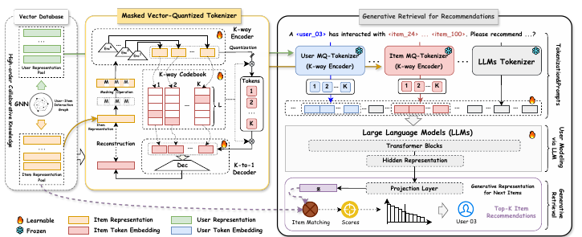
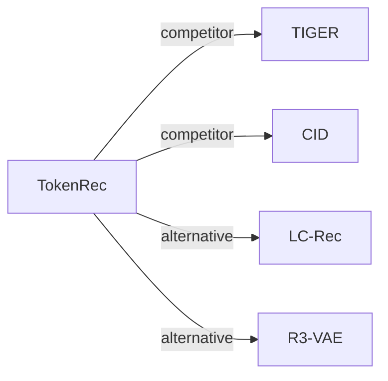

# TokenRec

*Learning to tokenize id for llm-based generative recommendations* — Qu et al. · TKDE’25

`I. 信息量` · `Tokenization` · [论文](https://arxiv.org/abs/2406.10450) · [代码](https://github.com/Quhaoh233/TokenRec) · [矩阵](../../../README.zh.md#i--tokenization) · [English](../../papers/tokenrec.md)

阅读级别：概览（第 1 级） · 本页目录：[TL;DR](#tldr) · [速览](#速览) · [2. 方法](#2-方法) · [3. 实验发现](#3-实验发现) · [5. 相关工作](#5-相关工作)

- `CF`: Collaborative filtering signal.
- `Fixed`: SIDs are built first and not changed while the generator trains.
- `Discrim.`: Scores items; does not generate SIDs.

### TL;DR

> [!NOTE]
> TokenRec 将掩码协同用户与物品表示量化为离散 token，无需自回归解码或束搜索即可检索 top-K 物品，并泛化到新用户与新物品。

### 速览

| 维度 | 摘要 |
| :-- | :-- |
| 研究问题 | I. 信息量：Do the SIDs, or the model reading them, carry the collaborative and multimodal signals recommendation needs? |
| 核心贡献 | TokenRec 将掩码协同用户与物品表示量化为离散 token，无需自回归解码或束搜索即可检索 top-K 物品，并泛化到新用户与新物品。 |
| 主要改动阶段 | Tokenization |

### 2. 方法

### 3. 实验发现

实验设置

- **数据集**：LastFM (1,090 users / 3,646 items), MovieLens-1M (6,040 / 3,416), Amazon Beauty (22,363 / 12,101), Amazon Clothing (23,033 / 39,387 as printed); histories capped at 100 items. Filtering rules: not reported.
  - 出处：Datasets and statistics: [S3.SS1.SSS1.p1](https://arxiv.org/html/2406.10450v3#S3.SS1.SSS1.p1) and [S3.T1](https://arxiv.org/html/2406.10450v3#S3.T1).
- **切分**：Leave-one-out: all but the last observation for training; histories are randomly shuffled to give non-chronological lists (to match collaborative-filtering baselines). Separate study on Beauty and LastFM: the 5% of users with the least history are removed from training as unseen users, and all items they interacted with are excluded from training too.
  - 出处：Leave-one-out with shuffled histories: [S3.SS1.SSS1.p1](https://arxiv.org/html/2406.10450v3#S3.SS1.SSS1.p1); unseen-user split: [S3.SS3.p2](https://arxiv.org/html/2406.10450v3#S3.SS3.p2).
- **候选集**：full catalog (scores all items in the item base and retrieves top-K). Training uses 1:1 negatives drawn at random from un-interacted items.
  - 出处：Scores over all items for top-K retrieval; training negatives 1:1: [S2.SS4.SSS3.p3](https://arxiv.org/html/2406.10450v3#S2.SS4.SSS3.p3) and [S3.SS1.SSS4.p1](https://arxiv.org/html/2406.10450v3#S3.SS1.SSS4.p1).
- **可见性**：Main: warm; no unseen-item protocol is defined. Unseen-user study: held-out users and every item they interacted with are excluded from the training split, so those items are unseen by the generator and the MQ-Tokenizer training (tokens for them are produced afterwards from their representations).
  - 出处：Unseen-user study excludes those users' items from training: [S3.SS3.p2](https://arxiv.org/html/2406.10450v3#S3.SS3.p2).
- **SID 规格**：Masked vector-quantized tokenizer (MQ-Tokenizer) for both users and items: K parallel sub-encoders, each quantized against its own sub-codebook of L codes (K searched in 1-5, L in 128-1,024; prompt example uses K=3), over masked collaborative representations. Collision handling: not reported.
  - 出处：K-way masked vector-quantized tokenizer, ranges: [S2.SS3.SSS3.p2](https://arxiv.org/html/2406.10450v3#S2.SS3.SSS3.p2), [S2.SS3.SSS3.p3](https://arxiv.org/html/2406.10450v3#S2.SS3.SSS3.p3), [S3.SS1.SSS4.p1](https://arxiv.org/html/2406.10450v3#S3.SS1.SSS4.p1).
- **推理预算**：No beam search: the T5 output is projected and all items are scored for top-K. Table 5: average top-20 inference time per user of 5.76-8.43 ms versus 76-102 ms for P5, POD, CID, and TIGER; hardware and batch size: not reported.
  - 出处：Generative retrieval by scoring instead of beam decoding: [S2.SS4.SSS3.p3](https://arxiv.org/html/2406.10450v3#S2.SS4.SSS3.p3); timing: [S3.T5](https://arxiv.org/html/2406.10450v3#S3.T5).
- **结果来源**：Tables 2-3 (LastFM, ML1M, Beauty, Clothing versus CF, sequential, and LLM-based baselines); Table 4 (seen versus unseen users); Table 5 (inference time); Table 6 (ablations).
  - 出处：Main: [S3.T2](https://arxiv.org/html/2406.10450v3#S3.T2) and [S3.T3](https://arxiv.org/html/2406.10450v3#S3.T3); unseen users: [S3.T4](https://arxiv.org/html/2406.10450v3#S3.T4); time: [S3.T5](https://arxiv.org/html/2406.10450v3#S3.T5); ablation: [S3.T6](https://arxiv.org/html/2406.10450v3#S3.T6).

### 5. 相关工作

- **同期对比** · [TIGER](tiger.md): TIGER decodes RQ-VAE item IDs by beam search; TokenRec tokenizes users and items with a masked K-way quantizer and scores all items directly, about ten times faster.
  - 出处：TokenRec v3, baselines: https://arxiv.org/html/2406.10450v3#S3.SS1.SSS2.p1; Tables 2-5: https://arxiv.org/html/2406.10450v3#S3.T2, https://arxiv.org/html/2406.10450v3#S3.T3, https://arxiv.org/html/2406.10450v3#S3.T4, https://arxiv.org/html/2406.10450v3#S3.T5.
- **同期对比** · [CID](cid.md): CID builds collaborative indices for P5-style text generation; TokenRec builds collaborative tokens for users and items and retrieves without decoding.
  - 出处：TokenRec v3, baselines: https://arxiv.org/html/2406.10450v3#S3.SS1.SSS2.p1 and https://arxiv.org/html/2406.10450v3#S3.I2.i4.p1; Tables 2-5: https://arxiv.org/html/2406.10450v3#S3.T2 and https://arxiv.org/html/2406.10450v3#S3.T5.
- **替代方案** · [LC-Rec](lc-rec.md): LC-Rec decodes item indices autoregressively, which TokenRec avoids for speed and to limit hallucinated items.
  - 出处：TokenRec v3, Section 2.4.3 cites Zheng et al. (2024): https://arxiv.org/html/2406.10450v3#S2.SS4.SSS3.p1.
- **替代方案** · [R3-VAE](r3-vae.md): R3-VAE later evaluates TokenRec's masked quantizer (MQ) as a tokenizer baseline and proposes reference-guided residual quantization.
  - 出处：Evidence is from the later R3-VAE paper: baselines and Tables 1, 4: https://arxiv.org/html/2604.11440v3#S4.SS1.SSS2.p1, https://arxiv.org/html/2604.11440v3#S3.T1, https://arxiv.org/html/2604.11440v3#S4.T4.

[查看同格全部论文](../../../README.zh.md#i--tokenization)
