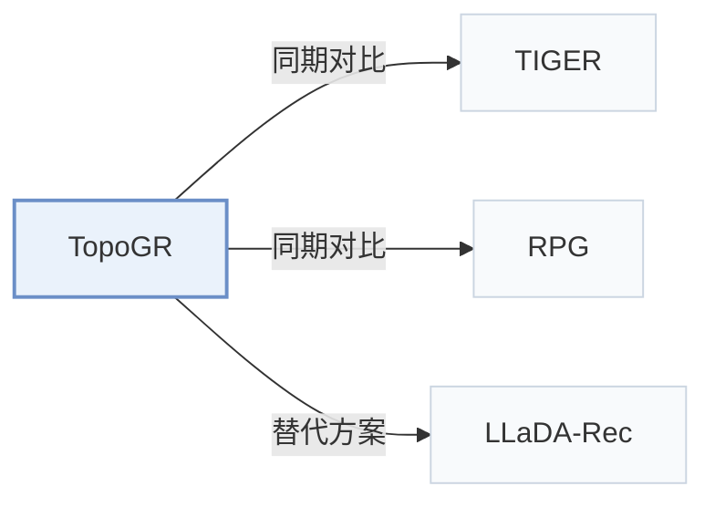

# TopoGR

[← 问题 × 阶段矩阵](../../../README.zh.md#iii--tokenization) · [按阶段索引](../index/stages.md) · [按模态索引](../index/modality.md) · [English](../../papers/topogr.md) | 中文

| **题目** | *Revealing and Preserving Latent Structure of Semantic ID in Generative Recommendation* |
| :-- | :-- |
| **作者** | Zheng et al. |
| **发表** | arXiv’26 |
| **问题与阶段** | `III. SID 与模型对齐` · `编号（Tokenization）` |
| **链接** | [论文](https://arxiv.org/abs/2607.25216) |
| **阅读级别** | 概览（第 1 级） |

**本页目录**：[TL;DR](#tldr) · [速览](#速览) · [3. 实验发现](#3-实验发现) · [5. 相关工作](#5-相关工作)

- `Text`：物品文本元数据（标题、描述、类目或提示词）。
- `BDQ`：比特可分解量化器（Bit-Decomposable Quantizer）。
- `Non-AR`：非自回归（Non-autoregressive）并行预测架构。
- `Fixed`：先独立训练并冻结编号器，生成器训练期间 SID 保持不变。
- `MTP + Aux.`：多 token 预测与辅助损失联合优化。
- `Scoring+Rerank`：先对候选集打分筛选，再对头部子集精细重排。

### TL;DR

> [!NOTE]
> TopoGR 学习可按位分解的二值 SID，并在输入特征、软训练目标与重排中利用其汉明几何结构，不再将 SID token 视作彼此独立的符号。

---

### 速览

| 维度 | 摘要 |
| :-- | :-- |
| 研究问题 | III. SID 与模型对齐：生成模型能否理解并推理离散 SID，编号器与生成器的优化目标是否一致？ |
| 核心贡献 | TopoGR 学习可按位分解的二值 SID，并在输入特征、软训练目标与重排中利用其汉明几何结构，不再将 SID token 视作彼此独立的符号。 |
| 主要改动阶段 | 编号（Tokenization） |

---

### 3. 实验发现

实验设置

- **数据集**：Amazon Review Sports & Outdoors, Beauty, Toys & Games, CDs & Vinyl; reviews treated as chronological interactions. Filtering and maximum history length not reported.
  - 出处：[S5.SS1.p1](https://arxiv.org/html/2607.25216v1#S5.SS1.p1) ; #A1.T3
- **切分**：Leave-one-out with checkpoint selection by validation performance; exact train/validation/test holdout allocation not reported.
  - 出处：[S5.SS1.p3](https://arxiv.org/html/2607.25216v1#S5.SS1.p3)
- **候选集**：full catalog scored through vectorized SID-probability gathering, followed by top-1000 reranking; consumed-item exclusion not reported.
  - 出处：[S4.SS5.p1](https://arxiv.org/html/2607.25216v1#S4.SS5.p1) ; #A1.SS4.p4
- **可见性**：warm; no unseen-item protocol is defined. Tokenizer fitting exposure to test items not reported.
  - 出处：[S5.SS1.p1](https://arxiv.org/html/2607.25216v1#S5.SS1.p1) ; #S5.SS1.p3 ; #S4.SS1.p8
- **SID 规格**：BDQ/LFQ: 64 positions x 8 bits, each position mapping to 256 integer codes; implicit fixed binary vertices, not learned centroid codebooks. Reported full-SID collapse ratio <0.003; collision disambiguation not reported.
  - 出处：[A1.T4](https://arxiv.org/html/2607.25216v1#A1.T4) ; #A1.SS3.p2 ; #A1.SS2.p1
- **推理预算**：Parallel prediction of all 64 SID positions, full-corpus gather scoring and Hamming reranking of 1000 items; no beam search; Recall/NDCG@5/10. One H20 96GB is used for experiments; Figure 8 plots approximately 9 ms inference time on Beauty. Inference batch size and timing aggregation not reported.
  - 出处：[S4.SS3.p3](https://arxiv.org/html/2607.25216v1#S4.SS3.p3) ; #S4.SS5 ; #S5.SS1.p4 ; #A1.F8
- **结果来源**：Table 1: four-dataset comparison; some baseline numbers adopted from Rajput et al. (2023), remaining datasets/models reproduced with official implementations or RecBole; exact reused rows not specified. Table 6: ablations; Figure 8: inference efficiency.
  - 出处：[S5.T1](https://arxiv.org/html/2607.25216v1#S5.T1) ; #S5.SS1.p4 ; #A2.T6 ; #A1.F8

---

### 5. 相关工作

- **同期对比** · [TIGER](tiger.md): TIGER decodes residual SIDs autoregressively; TopoGR exposes binary SID geometry and predicts all positions in parallel before full-corpus scoring.
  - 出处：TopoGR v1, Section 5.1 and Appendix A.4: [S5.SS1.p2](https://arxiv.org/html/2607.25216v1#S5.SS1.p2); [A1.SS4.p4](https://arxiv.org/html/2607.25216v1#A1.SS4.p4).
- **同期对比** · [RPG](rpg.md): RPG uses parallel SID prediction with graph-constrained decoding; TopoGR instead uses vectorized full-corpus scoring and Hamming-consistent reranking.
  - 出处：TopoGR v1, Section 5.1 and Appendix A.4: [S5.SS1.p2](https://arxiv.org/html/2607.25216v1#S5.SS1.p2); [A1.SS4.p5](https://arxiv.org/html/2607.25216v1#A1.SS4.p5).
- **替代方案** · [LLaDA-Rec](llada-rec.md): LLaDA-Rec uses discrete diffusion for bidirectional SID generation; TopoGR predicts SID positions simultaneously and adds binary-topology supervision and reranking.
  - 出处：TopoGR v1, Related Work and Section 4.3; cited alternative rather than a listed baseline: [S2.p2](https://arxiv.org/html/2607.25216v1#S2.p2); [S4.SS3.p1](https://arxiv.org/html/2607.25216v1#S4.SS3.p1).

[查看同格全部论文](../../../README.zh.md#iii--tokenization)
