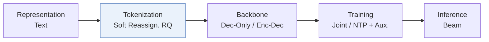
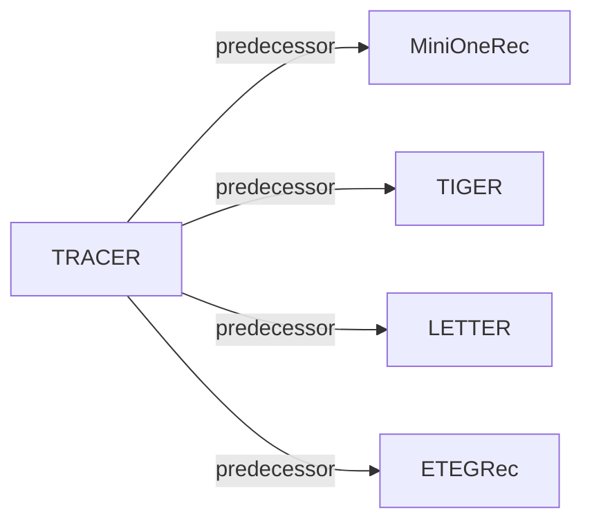

# TRACER

| **题目** | *Token ReAssignment for Concept ERasure in Generative Recommendation* |
| :-- | :-- |
| **作者** | Chen et al. |
| **会议** | NeurIPS’26 |
| **问题与阶段** | `IV. 实用目标` · `Tokenization` |
| **链接** | [论文](https://arxiv.org/abs/2606.07688) · [矩阵](../../../README.zh.md#iv--tokenization) · [English](../../papers/tracer.md) |
| **阅读级别** | 概览（第 1 级） |

本页目录：[TL;DR](#tldr) · [速览](#速览) · [3. 实验发现](#3-实验发现) · [5. 相关工作](#5-相关工作)

- `Soft Reassign. RQ`: Residual quantization with differentiable soft code reassignment.
- `Dec-Only / Enc-Dec`: Decoder-only and encoder–decoder backbone variants.
- `Joint`: The generator loss updates the tokenizer directly.
- `NTP + Aux.`: NTP plus another auxiliary loss.

### TL;DR

> [!NOTE]
> TRACER 通过带连贯性正则的重分配机制将敏感概念相关物品映射到替代 SID token，实现概念级遗忘，避免直接压制与保留物品共享的 token。

---

### 速览

| 维度 | 摘要 |
| :-- | :-- |
| 研究问题 | IV. 实用目标：Are training and search aimed at what users and the platform value, rather than at token likelihood? |
| 核心贡献 | TRACER 通过带连贯性正则的重分配机制将敏感概念相关物品映射到替代 SID token，实现概念级遗忘，避免直接压制与保留物品共享的 token。 |
| 主要改动阶段 | Tokenization |

---

### 3. 实验发现

实验设置

- **数据集**：Amazon Industrial & Scientific, Sports & Outdoors and Toys & Games; remove users/items with fewer than five interactions. Amazon release year: not reported. Randomly select 5% of brands for forgetting, covering approximately 10% of interactions.
  - 出处：Sec.4 datasets/preprocessing and concept setup: [S4.SS0.SSS0.Px1.p1](https://arxiv.org/html/2606.07688v1#S4.SS0.SSS0.Px1.p1) and [S4.SS0.SSS0.Px2.p1](https://arxiv.org/html/2606.07688v1#S4.SS0.SSS0.Px2.p1)
- **切分**：Chronological 80/10/10 train/validation/test. Per-user versus global allocation and history cap: not reported.
  - 出处：Sec.4 datasets/preprocessing: [S4.SS0.SSS0.Px1.p1](https://arxiv.org/html/2606.07688v1#S4.SS0.SSS0.Px1.p1)
- **候选集**：not reported; full-catalog versus sampled ranking and history-item exclusion are unspecified.
  - 出处：Evaluation metrics and Appendix D.1 do not specify catalog/sampling protocol: [S4.SS0.SSS0.Px6.p1](https://arxiv.org/html/2606.07688v1#S4.SS0.SSS0.Px6.p1) and [A4.SS1.p1](https://arxiv.org/html/2606.07688v1#A4.SS1.p1)
- **可见性**：warm; no unseen-item protocol is defined. Forgetting targets training-data influence; tokenizer exposure to held-out items/interactions: not reported.
  - 出处：Forget set comprises previously trained interactions, not an unseen-item evaluation: [S2.SS2.p1](https://arxiv.org/html/2606.07688v1#S2.SS2.p1) and [S4.SS0.SSS0.Px2.p1](https://arxiv.org/html/2606.07688v1#S4.SS0.SSS0.Px2.p1)
- **SID 规格**：All backbones use three RQ-VAE levels x 256 codes, embedding dimension 64. TRACER learns soft-assignment perturbations for target-concept items while preserving other items' original SIDs. Collision handling: not reported.
  - 出处：Appendix D.1 and Sec.3.1: [A4.SS1.p1](https://arxiv.org/html/2606.07688v1#A4.SS1.p1) and [S3.SS1.p2](https://arxiv.org/html/2606.07688v1#S3.SS1.p2)
- **推理预算**：Beam search width 10; retain/forget HR and NDCG@5/10, MRR, and description-based semantic similarity. Experiments use 4x A100 GPUs. Inference batch, latency and throughput: not reported. Batch128 and 19-27 minutes concern unlearning training, not inference.
  - 出处：Appendix D.1-D.3: [A4.SS1.p1](https://arxiv.org/html/2606.07688v1#A4.SS1.p1) and [A4.SS2.p1](https://arxiv.org/html/2606.07688v1#A4.SS2.p1) and [A4.SS3.p1](https://arxiv.org/html/2606.07688v1#A4.SS3.p1)
- **结果来源**：This paper's unlearning comparisons: main MOR/MiniOneRec and LETTER results on Scientific/Sports; Appendix D Tables1-3 cover five backbones x three datasets, Table4 unlearning time, Table5 item-level forgetting. ELM/RMU/RepNoise/FLAT/BLUR/PISCES baselines start from the same SFT checkpoint with tuned learning rates; five-run averages. No borrowed baseline-score source is identified.
  - 出处：Sec.4 models/baselines and Appendix D.1/D.2/D.4: [S4.SS0.SSS0.Px3.p1](https://arxiv.org/html/2606.07688v1#S4.SS0.SSS0.Px3.p1) and [S4.SS0.SSS0.Px5.p1](https://arxiv.org/html/2606.07688v1#S4.SS0.SSS0.Px5.p1) and [A4.SS1.p1](https://arxiv.org/html/2606.07688v1#A4.SS1.p1) and [A4.SS2.p1](https://arxiv.org/html/2606.07688v1#A4.SS2.p1) and [A4.SS4.p1](https://arxiv.org/html/2606.07688v1#A4.SS4.p1)

---

### 5. 相关工作

- **前序工作** · [MiniOneRec](minionerec.md): MiniOneRec supplies the Qwen2.5-7B backbone for unlearning.
  - 出处：TRACER v1, Sec.4 Models/Backbones: https://arxiv.org/html/2606.07688v1#S4.SS0.SSS0.Px3.p1; https://arxiv.org/html/2606.07688v1#S4.SS0.SSS0.Px4.p1.
- **前序工作** · [TIGER](tiger.md): TIGER is a tested separate-training backbone.
  - 出处：TRACER v1, Sec.4 Models and Appendix D.2: https://arxiv.org/html/2606.07688v1#S4.SS0.SSS0.Px3.p1; https://arxiv.org/html/2606.07688v1#A4.SS2.p1.
- **前序工作** · [LETTER](letter.md): LETTER supplies a tested joint-training backbone and the motivating retraining analysis.
  - 出处：TRACER v1, Sec.3 motivation and Sec.4 Models: https://arxiv.org/html/2606.07688v1#S3.SS0.SSS0.Px1.p1; https://arxiv.org/html/2606.07688v1#S4.SS0.SSS0.Px3.p1.
- **前序工作** · [ETEGRec](etegrec.md): ETEGRec is a tested joint-training backbone.
  - 出处：TRACER v1, Sec.4 Models and Appendix D.2: https://arxiv.org/html/2606.07688v1#S4.SS0.SSS0.Px3.p1; https://arxiv.org/html/2606.07688v1#A4.SS2.p1.

[查看同格全部论文](../../../README.zh.md#iv--tokenization)
