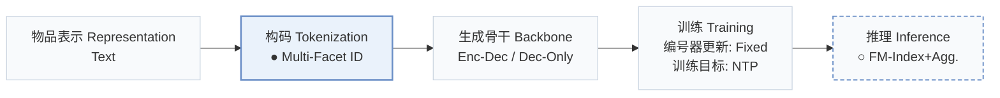
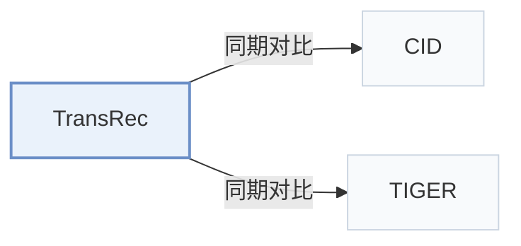

# TransRec

[← 问题 × 阶段矩阵](../../../README.zh.md#ii--tokenization) · [按阶段索引](../index/stages.md) · [按模态找论文](../index/modality.md) · [按领域找论文](../index/domain.md) · [English](../../papers/transrec.md) | 中文

| **题目** | *Bridging Items and Language: A Transition Paradigm for Large Language Model-Based Recommendation* |
| :-- | :-- |
| **作者** | Lin et al. |
| **发表** | KDD’24 |
| **问题与阶段** | `II. 唯一性与合法性` · `构码（Tokenization）` |
| **改动** | ● 构码 · ○ 推理 |
| **构码输入** | id: – · title: `Text` · attribute: `Text` |
| **领域** | `电商` · `本地生活与 POI` |
| **链接** | [论文](https://arxiv.org/abs/2310.06491) · [代码](https://github.com/Linxyhaha/TransRec/) |
| **阅读级别** | 概览（第 1 级） |

**本页目录**：[TL;DR](#tldr) · [3. 实验发现](#3-实验发现) · [5. 相关工作](#5-相关工作)

- `Text`：物品文本元数据（标题、描述、类目或提示词）。
- `Multi-Facet ID`：同时刻画物品多个语义切面的多维标识符。
- `Enc-Dec / Dec-Only`：同时在编码器-解码器与仅解码器两种骨干上验证。
- `Fixed`：先独立训练并冻结编号器，生成器训练期间 SID 保持不变。
- `NTP`：标准下一 token 预测（Next-Token Prediction）交叉熵损失；基于预训练 LLM 的指令微调（SFT）亦归入此类。
- `FM-Index+Agg.`：基于 FM-index 约束生成并聚合指向同一物品的多标识符得分。

### TL;DR

> [!NOTE]
> TransRec 用结合 ID、标题与属性的多面标识索引物品，通过 FM-index 子串索引约束生成，并聚合生成的标识为物品库打分排序。

---

### 3. 实验发现

实验设置

- **数据集**：Amazon Beauty and Toys, plus Yelp. Release year and filtering thresholds: not reported. Items use random unique numeric IDs, titles and categories.
  - 出处：Sec.4.1 Datasets and Appendix Table9: [S4.SS1.SSS1.p1](https://arxiv.org/html/2310.06491v2#S4.SS1.SSS1.p1) and [A1.T9](https://arxiv.org/html/2310.06491v2#A1.T9)
- **切分**：Per-user leave-one-out: last item test, penultimate validation, remainder training. Full training uses all training users; few-shot selects 1024/2048 users. Discard oldest history items until input fits 1024 tokens (BART) or 512 (LLaMA).
  - 出处：Sec.4.1 Datasets/Implementation and Sec.4.3.1: [S4.SS1.SSS1.p1](https://arxiv.org/html/2310.06491v2#S4.SS1.SSS1.p1) and [S4.SS1.SSS3.p1](https://arxiv.org/html/2310.06491v2#S4.SS1.SSS3.p1) and [S4.SS3.SSS1.p1](https://arxiv.org/html/2310.06491v2#S4.SS3.SSS1.p1)
- **候选集**：not reported: full-catalog versus sampled evaluation and history-item exclusion are unspecified. Generated facet identifiers are aggregated into scores for in-corpus items.
  - 出处：Sec.3.2 aggregated grounding and Sec.4.1 evaluation: [S3.SS2.SSS2.p1](https://arxiv.org/html/2310.06491v2#S3.SS2.SSS2.p1) and [S3.SS2.SSS2.p3](https://arxiv.org/html/2310.06491v2#S3.SS2.SSS2.p3) and [S4.SS1.SSS2.p2](https://arxiv.org/html/2310.06491v2#S4.SS1.SSS2.p2)
- **可见性**：Full-training item-level visibility: not reported. Few-shot tests the N training users plus N unseen users; warm requires both user and item warm, otherwise cold. Cold items are unseen by generator training, but the cold subset also includes unseen-user cases. Identifier construction reportedly uses only warm items; learned SID tokenizer n/a for manual facets. Cold-item exposure through the FM-index is not reported.
  - 出处：Sec.4.2 and Sec.4.3.1 explicitly distinguish warm/cold users and items: [S4.SS2.p1](https://arxiv.org/html/2310.06491v2#S4.SS2.p1) and [S4.SS3.SSS1.p1](https://arxiv.org/html/2310.06491v2#S4.SS3.SSS1.p1) and [S4.SS3.SSS1.p2](https://arxiv.org/html/2310.06491v2#S4.SS3.SSS1.p2)
- **SID 规格**：Three separate facets: unique random numeric ID, title and categories. Variable text-token lengths; codebook size n/a. Numeric IDs provide uniqueness while titles/attributes can be shared. Training samples five title substrings per sequence and uses each category separately; this is not a quantized SID.
  - 出处：Sec.3.1.1-3.1.2 and Appendix A.2: [S3.SS1.SSS1.p2](https://arxiv.org/html/2310.06491v2#S3.SS1.SSS1.p2) and [S3.SS1.SSS1.p5](https://arxiv.org/html/2310.06491v2#S3.SS1.SSS1.p5) and [S3.SS1.SSS2.p2](https://arxiv.org/html/2310.06491v2#S3.SS1.SSS2.p2) and [A1.SS2.p1](https://arxiv.org/html/2310.06491v2#A1.SS2.p1)
- **推理预算**：FM-index-constrained beam20 for TransRec and LLM baselines; generate each facet, then aggregate grounding scores. Recall/NDCG@5/10. Table3 reports 218.43s grounding per 5000 Beauty users, not end-to-end request latency. Inference batch, hardware and generated-length cap: not reported; four RTX A5000 GPUs are explicitly the training setup.
  - 出处：Sec.3.2 generation, Sec.4.1 implementation/evaluation and Table3: [S3.SS2.SSS1.p3](https://arxiv.org/html/2310.06491v2#S3.SS2.SSS1.p3) and [S4.SS1.SSS3.p1](https://arxiv.org/html/2310.06491v2#S4.SS1.SSS3.p1) and [S4.SS1.SSS2.p2](https://arxiv.org/html/2310.06491v2#S4.SS1.SSS2.p2) and [S4.T3](https://arxiv.org/html/2310.06491v2#S4.T3)
- **结果来源**：This paper's Table1 full-training BART comparison, Table2 Beauty few-shot warm/cold comparison, Table3 grounding ablation, and appendix analyses. P5 is explicitly trained on sequential tasks with randomized IDs; Appendix A.3 implements indexing baselines and TransRec with the same T5-small backbone/single prompt. Borrowed-score attribution and run/seed counts: not reported.
  - 出处：Tables1-3 and Appendix A.3/A.6: [S4.T1](https://arxiv.org/html/2310.06491v2#S4.T1) and [S4.T2](https://arxiv.org/html/2310.06491v2#S4.T2) and [S4.T3](https://arxiv.org/html/2310.06491v2#S4.T3) and [S4.SS1.SSS2.p1](https://arxiv.org/html/2310.06491v2#S4.SS1.SSS2.p1) and [A1.SS3.p1](https://arxiv.org/html/2310.06491v2#A1.SS3.p1) and [A1.SS6.p1](https://arxiv.org/html/2310.06491v2#A1.SS6.p1)

---

### 5. 相关工作

- **同期对比** · [CID](cid.md): CID+IID and the other Hua et al. indexing variants are compared baselines.
  - 出处：TransRec v2, Sec.4.1 Baselines and Appendix A.3: [S4.SS1.SSS2.p1](https://arxiv.org/html/2310.06491v2#S4.SS1.SSS2.p1); [A1.SS3.p1](https://arxiv.org/html/2310.06491v2#A1.SS3.p1).
- **同期对比** · [TIGER](tiger.md): TIGER is compared as a quantized semantic-identifier baseline.
  - 出处：TransRec v2, Sec.4.1 Baselines and Sec.4.2: [S4.SS1.SSS2.p1](https://arxiv.org/html/2310.06491v2#S4.SS1.SSS2.p1); [S4.SS2.p1](https://arxiv.org/html/2310.06491v2#S4.SS2.p1).

[查看同格全部论文](../../../README.zh.md#ii--tokenization)
