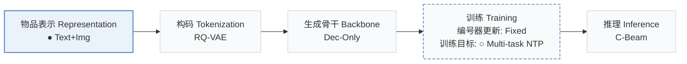
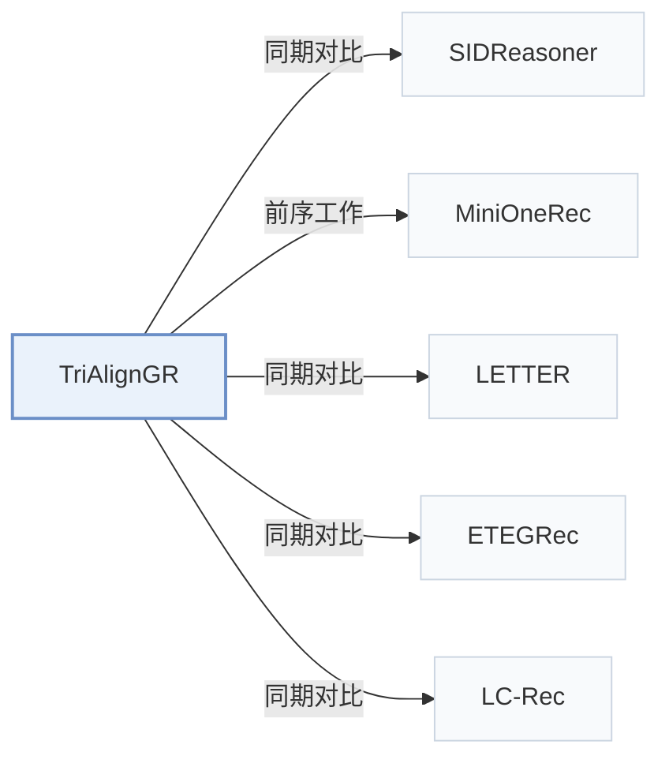

# TriAlignGR

[← 问题 × 阶段矩阵](../../../README.zh.md#i--representation) · [按阶段索引](../index/stages.md) · [按模态找论文](../index/modality.md) · [按领域找论文](../index/domain.md) · [English](../../papers/trialigngr.md) | 中文

| **题目** | *Triangular Multitask Alignment with Multimodal Deep Interest Mining for Generative Recommendation* |
| :-- | :-- |
| **作者** | Zeng et al. |
| **发表** | arXiv’26 |
| **问题与阶段** | `I. 信息量` · `物品表示（Representation）` |
| **改动** | ● 物品表示 · ○ 训练目标 |
| **构码输入** | `Text` + `Img` |
| **领域** | `电商` |
| **应用场景** | `一般物品推荐`；`公开数据` |
| **链接** | [论文](https://arxiv.org/abs/2605.05249) |
| **阅读级别** | 概览（第 1 级） |

**本页目录**：[TL;DR](#tldr) · [3. 实验发现](#3-实验发现) · [5. 相关工作](#5-相关工作)

- `Text+Img`：文本与视觉图像表征。
- `RQ-VAE`：残差量化变分自编码器（Residual-Quantized VAE）。
- `Dec-Only`：仅解码器（Decoder-only）自回归架构。
- `Fixed`：先独立训练并冻结编号器，生成器训练期间 SID 保持不变。
- `Multi-task NTP`：在多个对齐或推荐子任务上联合优化下一 token 预测损失。
- `C-Beam`：受合法物品集合约束的束搜索（Constrained beam search）。

### TL;DR

> [!NOTE]
> TriAlignGR 在 SID 构建中引入视觉内容与 LLM 挖掘的用户意图，并在统一自回归损失下训练连接 SID、文本与图像的多项生成任务。

---

### 3. 实验发现

实验设置

- **数据集**：Amazon Beauty, Sports and Outdoors, Musical Instruments with 5-core filtering (22K-36K users, 10K-18K items, 198K-296K interactions in total ranges; per-dataset counts not separated in the text).
  - 出处：Datasets and protocol: [A1.p1](https://arxiv.org/html/2605.05249v3#A1.p1).
- **切分**：Leave-last-out protocol (allocation not restated beyond the label); results averaged over three seeds.
  - 出处：Leave-last-out: [A1.p1](https://arxiv.org/html/2605.05249v3#A1.p1); three seeds: [S4.SS1.p1](https://arxiv.org/html/2605.05249v3#S4.SS1.p1).
- **候选集**：not reported (full catalog versus sampled evaluation candidates); top-K from beam search with beam size 20.
  - 出处：Metrics and beam: [A1.p2](https://arxiv.org/html/2605.05249v3#A1.p2).
- **可见性**：warm; no unseen-item protocol is defined.
  - 出处：Standard split with no unseen-item protocol: [A1.p1](https://arxiv.org/html/2605.05249v3#A1.p1).
- **SID 规格**：3-level RQ-VAE with codebook sizes 4,096, 2,048, and 1,024 over gme-Qwen2-VL multimodal embeddings enriched with image captions (CMSA) and mined user interests (MDIM). Collision rates are reported: 3.1% of Beauty items share a full SID (5.1% for text-only RQ-VAE); a resolution rule is not reported.
  - 出处：3-level RQ-VAE with 4096/2048/1024 over gme-Qwen2-VL embeddings: [A1.p3](https://arxiv.org/html/2605.05249v3#A1.p3); collision diagnostics: [A3.T6](https://arxiv.org/html/2605.05249v3#A3.T6).
- **推理预算**：Beam size 20; Qwen2.5-7B-Instruct backbone; experiments on NVIDIA A100 GPUs; inference batch size and latency: not reported.
  - 出处：Beam 20, backbone, GPUs: [A1.p2](https://arxiv.org/html/2605.05249v3#A1.p2) and [A1.p3](https://arxiv.org/html/2605.05249v3#A1.p3).
- **结果来源**：Table 2 (Beauty, Sports, Instruments versus sequential, generative, LLM, and reasoning baselines; three seeds); Tables 3-5 (component, SID-versus-task, and task-combination ablations); Appendix Tables 6-8 (SID diagnostics, semantic probing, SID construction versus MiniOneRec).
  - 出处：Main: [S4.T2](https://arxiv.org/html/2605.05249v3#S4.T2); ablations: [S4.T3](https://arxiv.org/html/2605.05249v3#S4.T3), [S4.T4](https://arxiv.org/html/2605.05249v3#S4.T4), [S4.T5](https://arxiv.org/html/2605.05249v3#S4.T5); SID diagnostics: [A3.T6](https://arxiv.org/html/2605.05249v3#A3.T6); probing: [A4.T7](https://arxiv.org/html/2605.05249v3#A4.T7); vs MiniOneRec: [A5.T8](https://arxiv.org/html/2605.05249v3#A5.T8).

---

### 5. 相关工作

- **同期对比** · [SIDReasoner](sidreasoner.md): SIDReasoner is the strongest baseline, aligning SIDs and language through enriched corpora and RL; TriAlignGR adds visual captions and mined interests before quantization and eight alignment tasks.
  - 出处：TriAlignGR v3, Section 4.1: [S4.SS1.p1](https://arxiv.org/html/2605.05249v3#S4.SS1.p1); Table 2: [S4.T2](https://arxiv.org/html/2605.05249v3#S4.T2).
- **前序工作** · [MiniOneRec](minionerec.md): TriAlignGR shares MiniOneRec's backbone, training protocol, and RQ-VAE configuration and isolates the effect of its SID enrichment against it.
  - 出处：TriAlignGR v3, Section 4.1 comparison: [S4.SS1.p3](https://arxiv.org/html/2605.05249v3#S4.SS1.p3); Appendix Table 8: [A5.T8](https://arxiv.org/html/2605.05249v3#A5.T8).
- **同期对比** · [LETTER](letter.md): LETTER regularizes a text tokenizer; TriAlignGR changes the tokenizer input to multimodal, interest-enriched embeddings.
  - 出处：TriAlignGR v3, Table 2 baseline: [S4.T2](https://arxiv.org/html/2605.05249v3#S4.T2).
- **同期对比** · [ETEGRec](etegrec.md): ETEGRec trains tokenizer and generator jointly; TriAlignGR keeps a fixed tokenizer and adds multitask alignment.
  - 出处：TriAlignGR v3, Table 2 baseline: [S4.T2](https://arxiv.org/html/2605.05249v3#S4.T2).
- **同期对比** · [LC-Rec](lc-rec.md): LC-Rec uses text-only SIDs with alignment tasks; TriAlignGR extends the task set with visual-semantic tasks.
  - 出处：TriAlignGR v3, Table 2 baseline: [S4.T2](https://arxiv.org/html/2605.05249v3#S4.T2).

[查看同格全部论文](../../../README.zh.md#i--representation)
