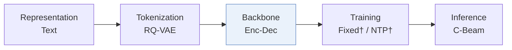
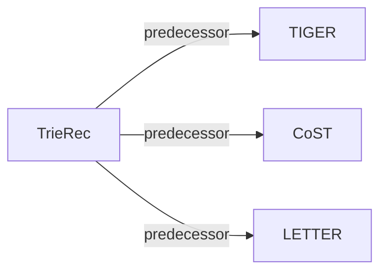

# TrieRec

| **题目** | *Trie-Aware Transformers for Generative Recommendation* |
| :-- | :-- |
| **作者** | Xu et al. |
| **会议** | NeurIPS’26 |
| **问题与阶段** | `III. SID 与模型对齐` · `Backbone` |
| **链接** | [论文](https://arxiv.org/abs/2602.21677) · [矩阵](../../../README.zh.md#iii--backbone) · [English](../../papers/trierec.md) |
| **阅读级别** | 概览（第 1 级） |

本页目录：[TL;DR](#tldr) · [速览](#速览) · [3. 实验发现](#3-实验发现) · [5. 相关工作](#5-相关工作)

- `Enc-Dec`: Encoder-decoder.
- `C-Beam`: Constrained beam search.

### TL;DR

> [!NOTE]
> TrieRec 为 Transformer 生成器加入前缀树感知绝对位置编码与拓扑感知相对位置编码，使注意力反映 SID 前缀树结构而非扁平 token 流。

---

### 速览

| 维度 | 摘要 |
| :-- | :-- |
| 研究问题 | III. SID 与模型对齐：Can the generator read, write, and reason over SIDs, and do the tokenizer and generator work toward the same goal? |
| 核心贡献 | TrieRec 为 Transformer 生成器加入前缀树感知绝对位置编码与拓扑感知相对位置编码，使注意力反映 SID 前缀树结构而非扁平 token 流。 |
| 主要改动阶段 | Backbone |

---

### 3. 实验发现

实验设置

- **数据集**：Amazon Beauty, Toys, Food; MovieLens-1M. Standard 5-core filtering, histories retain the most recent 20 interactions.
  - 出处：Section 4.1.1: [S4.SS1.SSS1.p1](https://arxiv.org/html/2602.21677v1#S4.SS1.SSS1.p1)
- **切分**：Per-user most recent interaction test, penultimate validation, earlier interactions training.
  - 出处：Section 4.1.1: [S4.SS1.SSS1.p1](https://arxiv.org/html/2602.21677v1#S4.SS1.SSS1.p1)
- **候选集**：Traditional models: full catalog; generative candidate universe not explicitly reported beyond a valid-item trie.
  - 出处：Section 4.1.2: [S4.SS1.SSS2.p1](https://arxiv.org/html/2602.21677v1#S4.SS1.SSS2.p1)
- **可见性**：warm; no unseen-item protocol is defined. Tokenizer/collaborative encoder exposure to test items not reported.
  - 出处：Section 4.1 defines no unseen-item holdout: [S4.SS1](https://arxiv.org/html/2602.21677v1#S4.SS1)
- **SID 规格**：Sentence-T5-base text features; RQ-VAE: 3 semantic levels x 256 codes, dimension 32, plus a fourth collision token. Select lowest-collision tokenizer checkpoint before appending the uniqueness digit; collision-token vocabulary size not reported.
  - 出处：Section 4.1.4 and Appendix A: [S4.SS1.SSS4.p1](https://arxiv.org/html/2602.21677v1#S4.SS1.SSS4.p1) and [A1.p1](https://arxiv.org/html/2602.21677v1#A1.p1)
- **推理预算**：Constrained beam 10; Recall/NDCG@5/10. Hardware and inference batch size not reported. Figure 3 plots inference time on Beauty/Toy, but the inference panel lacks explicit units and numeric bar labels.
  - 出处：Sections 4.1.2/4.4 and Figure 3: [S4.SS1.SSS2.p1](https://arxiv.org/html/2602.21677v1#S4.SS1.SSS2.p1) and [S4.F3](https://arxiv.org/html/2602.21677v1#S4.F3)
- **结果来源**：Original Tables 2/4: TrieRec on TIGER, CoST, LETTER and competing positional/structure encodings. Table 3: LETTER-based ablations.
  - 出处：Section 4.2, Tables 2/4: [S4.SS2.p1](https://arxiv.org/html/2602.21677v1#S4.SS2.p1) and [S4.T2](https://arxiv.org/html/2602.21677v1#S4.T2) and [S4.T4](https://arxiv.org/html/2602.21677v1#S4.T4) and [S4.T3](https://arxiv.org/html/2602.21677v1#S4.T3)

---

### 5. 相关工作

- **前序工作** · [TIGER](tiger.md): TrieRec adds trie-aware positional encodings to TIGER.
  - 出处：TrieRec v1, Sections 1/4.1: https://arxiv.org/html/2602.21677v1#S1.p5; https://arxiv.org/html/2602.21677v1#S4.SS1.SSS4.p1.
- **前序工作** · [CoST](cost.md): CoST is the contrastive-tokenization backbone augmented by TrieRec.
  - 出处：TrieRec v1, Section 4.2 and Related Work: https://arxiv.org/html/2602.21677v1#S4.SS2.p2; https://arxiv.org/html/2602.21677v1#S5.p3.
- **前序工作** · [LETTER](letter.md): LETTER supplies the backbone for TrieRec's main ablations and efficiency comparison.
  - 出处：TrieRec v1, Table 3 and Section 4.4: https://arxiv.org/html/2602.21677v1#S4.T3; https://arxiv.org/html/2602.21677v1#S4.SS4.p1.

[查看同格全部论文](../../../README.zh.md#iii--backbone)
