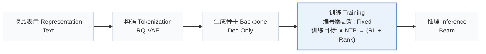
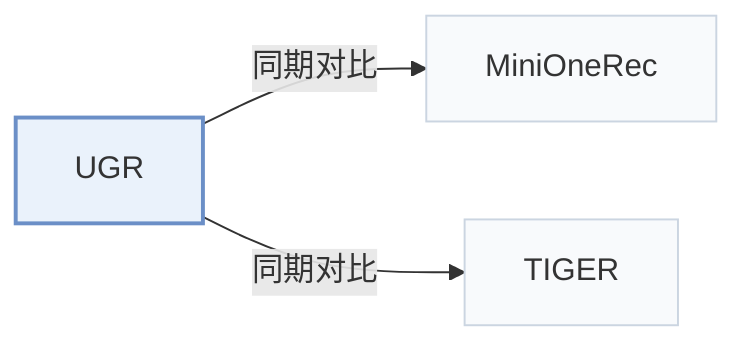

# UGR

[← 问题 × 阶段矩阵](../../../README.zh.md#iv--training) · [按阶段索引](../index/stages.md) · [按模态找论文](../index/modality.md) · [按领域找论文](../index/domain.md) · [English](../../papers/ugr.md) | 中文

| **题目** | *Uncertainty-aware Generative Recommendation* |
| :-- | :-- |
| **作者** | Fan et al. |
| **发表** | KDD’26 |
| **问题与阶段** | `IV. 实用目标` · `训练（Training）` |
| **改动** | ● 训练目标 |
| **构码输入** | `Text` |
| **领域** | `电商` · `本地生活与 POI` |
| **链接** | [论文](https://arxiv.org/abs/2602.11719) · [代码](https://github.com/cxfann/UGR) |
| **阅读级别** | 概览（第 1 级） |

**本页目录**：[TL;DR](#tldr) · [3. 实验发现](#3-实验发现) · [5. 相关工作](#5-相关工作)

- `Text`：物品文本元数据（标题、描述、类目或提示词）。
- `RQ-VAE`：残差量化变分自编码器（Residual-Quantized VAE）。
- `Dec-Only`：仅解码器（Decoder-only）自回归架构。
- `Fixed`：先独立训练并冻结编号器，生成器训练期间 SID 保持不变。
- `NTP → (RL + Rank)`：先进行下一 token 预测微调，再联合优化强化学习与排序目标。
- `Beam`：在 SID token 上执行自回归束搜索（Beam search）。

### TL;DR

> [!NOTE]
> UGR 通过不确定性加权奖励、难度感知优化与显式置信度对齐将不确定性引入偏好优化，替代仅依赖二元结果正误的奖励设计。

---

### 3. 实验发现

实验设置

- **数据集**：Amazon Office (2016.10-2018.11), Industrial and Scientific (1996.10-2018.11), Yelp (2018.05-2018.11); user/item 5-core filtering, histories capped at 10.
  - 出处：Appendix A/Table 5: [A1.p2](https://arxiv.org/html/2602.11719v2#A1.p2) and [A1.T5](https://arxiv.org/html/2602.11719v2#A1.T5)
- **切分**：Chronological 8:1:1 train/validation/test split; finer per-user allocation details not reported.
  - 出处：Section 4.1.1/Appendix A: [S4.SS1.SSS1.p1](https://arxiv.org/html/2602.11719v2#S4.SS1.SSS1.p1) and [A1.p2](https://arxiv.org/html/2602.11719v2#A1.p2)
- **候选集**：not reported; training rollout group size 16 is not an evaluation negative count.
  - 出处：Section 4.1.2/Appendix C describes beam lists without full-catalog/sampled-negative evaluation specification: [S4.SS1.SSS2.p1](https://arxiv.org/html/2602.11719v2#S4.SS1.SSS2.p1) and [A3.p3](https://arxiv.org/html/2602.11719v2#A3.p3)
- **可见性**：warm; no unseen-item protocol is defined. Tokenizer exposure to test items not reported.
  - 出处：Section 4.1/Appendix A defines no unseen-item holdout: [S4.SS1](https://arxiv.org/html/2602.11719v2#S4.SS1) and [A1](https://arxiv.org/html/2602.11719v2#A1)
- **SID 规格**：RQ-VAE on Qwen3-Embedding-4B item embeddings; 4 layers. Codebook sizes and collision handling not reported.
  - 出处：Appendix C: [A3.p1](https://arxiv.org/html/2602.11719v2#A3.p1)
- **推理预算**：Qwen3-8B; beam 10; confidence computed post-generation. Experiments use 8 A100 GPUs; inference device allocation/batch size not reported. Office: 37.0 ms/query versus SFT/GRPO 32.9 ms; training rollout beam/group 16 is separate.
  - 出处：Section 4.1.4/Appendix C/Table 6: [S4.SS1.SSS4.p1](https://arxiv.org/html/2602.11719v2#S4.SS1.SSS4.p1) and [A3.p3](https://arxiv.org/html/2602.11719v2#A3.p3) and [A3.T6](https://arxiv.org/html/2602.11719v2#A3.T6)
- **结果来源**：Original Table 1: main comparisons, baselines reproduced from official repositories using best validation checkpoints; Table 2: staged ablations. Table 3: optional confidence reranking on Office, separate from main comparison.
  - 出处：Table 1/Appendix B/Table 3: [S3.T1](https://arxiv.org/html/2602.11719v2#S3.T1) and [A2.p1](https://arxiv.org/html/2602.11719v2#A2.p1) and [S4.T3](https://arxiv.org/html/2602.11719v2#S4.T3) and [S3.T2](https://arxiv.org/html/2602.11719v2#S3.T2)

---

### 5. 相关工作

- **同期对比** · [MiniOneRec](minionerec.md): UGR and MiniOneRec share the backbone; UGR adds uncertainty-aware optimization.
  - 出处：UGR v2, Section 4.2: [S4.SS2.p2](https://arxiv.org/html/2602.11719v2#S4.SS2.p2).
- **同期对比** · [TIGER](tiger.md): TIGER supplies the standard SID-based baseline for UGR's uncertainty-aware alignment.
  - 出处：UGR v2, Section 4.1.3 and Table 1: [S4.SS1.SSS3.p1](https://arxiv.org/html/2602.11719v2#S4.SS1.SSS3.p1); [S3.T1](https://arxiv.org/html/2602.11719v2#S3.T1).

[查看同格全部论文](../../../README.zh.md#iv--training)
