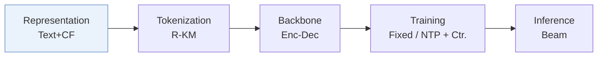
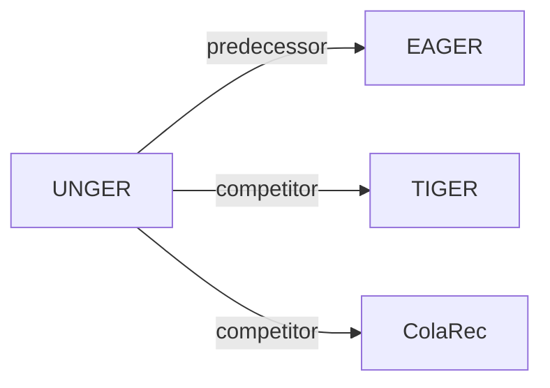

# UNGER

*Generative Recommendation with A Unified Code via Semantic and Collaborative Integration* — Xiao et al. · TOIS’25

`I. 信息量` · `Representation` · [论文](https://arxiv.org/abs/2502.06269) · [矩阵](../../../README.zh.md#i--representation) · [English](../../papers/unger.md)

阅读级别：概览（第 1 级） · 本页目录：[TL;DR](#tldr) · [速览](#速览) · [3. 实验发现](#3-实验发现) · [5. 相关工作](#5-相关工作)

- `R-KM`: Residual k-means.
- `Enc-Dec`: Encoder-decoder.
- `Fixed`: SIDs are built first and not changed while the generator trains.
- `NTP + Ctr.`: NTP plus a contrastive loss.

### TL;DR

> [!NOTE]
> UNGER 通过跨模态对齐与下一物品预测学习统一的语义-协同嵌入并量化为单一码，同时加入模态内蒸馏，替代各模态分别编码的做法。

### 速览

| 维度 | 摘要 |
| :-- | :-- |
| 研究问题 | I. 信息量：Do the SIDs, or the model reading them, carry the collaborative and multimodal signals recommendation needs? |
| 核心贡献 | UNGER 通过跨模态对齐与下一物品预测学习统一的语义-协同嵌入并量化为单一码，同时加入模态内蒸馏，替代各模态分别编码的做法。 |
| 主要改动阶段 | Representation |

### 3. 实验发现

实验设置

- **数据集**：Amazon Reviews 2014: Beauty, Sports and Outdoors, Toys and Games; user/item 5-core.
  - 出处：[S4.SS1.SSS1.p1](https://arxiv.org/html/2502.06269v3#S4.SS1.SSS1.p1) ; Table 2.
- **切分**：Per-user chronological leave-one-out: last item test, penultimate validation, earlier items training; training history capped at 20 items.
  - 出处：[S4.SS1.SSS2.p3](https://arxiv.org/html/2502.06269v3#S4.SS1.SSS2.p3)
- **候选集**：not reported; full-catalog versus sampled evaluation and history exclusion are unspecified.
  - 出处：[S4.SS1.SSS2](https://arxiv.org/html/2502.06269v3#S4.SS1.SSS2) ; evaluation reports Recall/NDCG@10/20 but no candidate-pool protocol.
- **可见性**：warm; no unseen-item protocol is defined.
  - 出处：[S4.SS1.SSS2.p3](https://arxiv.org/html/2502.06269v3#S4.SS1.SSS2.p3)
- **SID 规格**：DIN collaborative and Llama2-7b textual representations are integrated before fixed hierarchical k-means residual quantization; 4 levels, 256 clusters per level; item-code lookup table; main-tokenizer collision handling not reported.
  - 出处：[S3.SS3.SSS5](https://arxiv.org/html/2502.06269v3#S3.SS3.SSS5) ; Algorithm 1; [S4.T4](https://arxiv.org/html/2502.06269v3#S4.T4)
- **推理预算**：Autoregressive beam search, width 100; lookup and confidence ranking for top-k. Beauty speed comparison separately uses top-5 and beam 100; inference hardware and batch size not reported.
  - 出处：[S3.SS5.SSS2.p1](https://arxiv.org/html/2502.06269v3#S3.SS5.SSS2.p1) ; [S4.T4](https://arxiv.org/html/2502.06269v3#S4.T4) ; [S1.F4.fig1](https://arxiv.org/html/2502.06269v3#S1.F4.fig1)
- **结果来源**：UNGER experiments averaged over 5 runs (seeds 2020–2024), with standard errors in Table 3; unstarred baseline scores copied from Zhou et al. (2020) and Wang et al. (2024c), starred TIGER and ColaRec scores reimplemented for missing statistics.
  - 出处：[S4.SS2.SSS2.p1](https://arxiv.org/html/2502.06269v3#S4.SS2.SSS2.p1) ; [S4.T3](https://arxiv.org/html/2502.06269v3#S4.T3)

### 5. 相关工作

- **前序工作** · [EAGER](eager.md): Its dual-code design motivates UNGER's unified code.
  - 出处：https://arxiv.org/html/2502.06269v3#S1.p3 ; §3.3.5 follows its quantization approach; §4.2 baseline.
- **同期对比** · [TIGER](tiger.md): Semantic-only generative baseline reimplemented in Table 3.
  - 出处：https://arxiv.org/html/2502.06269v3#S4.SS2.SSS1.p3 ; https://arxiv.org/html/2502.06269v3#S4.T3
- **同期对比** · [ColaRec](colarec.md): Collaborative/content baseline reimplemented in Table 3.
  - 出处：https://arxiv.org/html/2502.06269v3#S4.SS2.SSS1.p3 ; https://arxiv.org/html/2502.06269v3#S4.T3

[查看同格全部论文](../../../README.zh.md#i--representation)
