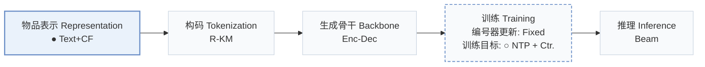
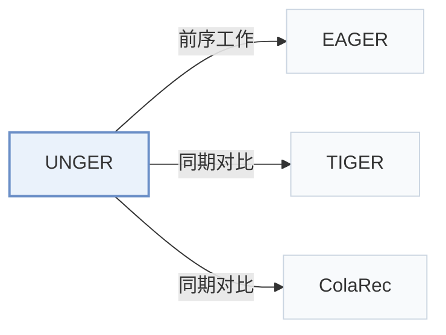

# UNGER

[← 问题 × 阶段矩阵](../../../README.zh.md#i--representation) · [按阶段索引](../index/stages.md) · [按模态找论文](../index/modality.md) · [按领域找论文](../index/domain.md) · [English](../../papers/unger.md) | 中文

| **题目** | *Generative Recommendation with A Unified Code via Semantic and Collaborative Integration* |
| :-- | :-- |
| **作者** | Xiao et al. |
| **发表** | TOIS’25 |
| **问题与阶段** | `I. 信息量` · `物品表示（Representation）` |
| **改动** | ● 物品表示 · ○ 训练目标 |
| **构码输入** | `Text` + `CF` |
| **领域** | `电商` |
| **应用场景** | `一般物品推荐`；`公开数据` |
| **链接** | [论文](https://arxiv.org/abs/2502.06269) |
| **阅读级别** | 概览（第 1 级） |

**本页目录**：[TL;DR](#tldr) · [3. 实验发现](#3-实验发现) · [5. 相关工作](#5-相关工作)

- `Text+CF`：文本表征结合协同过滤信号。
- `R-KM`：残差 k-means 量化（Residual k-means）。
- `Enc-Dec`：编码器-解码器（Encoder-decoder）架构。
- `Fixed`：先独立训练并冻结编号器，生成器训练期间 SID 保持不变。
- `NTP + Ctr.`：下一 token 预测结合对比学习损失。
- `Beam`：在 SID token 上执行自回归束搜索（Beam search）。

### TL;DR

> [!NOTE]
> UNGER 通过跨模态对齐与下一物品预测学习统一的语义-协同嵌入并量化为单一码，同时加入模态内蒸馏，替代各模态分别编码的做法。

---

### 3. 实验发现

实验设置

- **数据集**：Amazon Reviews 2014: Beauty, Sports and Outdoors, Toys and Games; user/item 5-core.
  - 出处：[S4.SS1.SSS1.p1](https://arxiv.org/html/2502.06269v3#S4.SS1.SSS1.p1) ; Table 2.
- **切分**：Per-user chronological leave-one-out: last item test, penultimate validation, earlier items training; training history capped at 20 items.
  - 出处：[S4.SS1.SSS2.p3](https://arxiv.org/html/2502.06269v3#S4.SS1.SSS2.p3)
- **候选集**：not reported; full-catalog versus sampled evaluation and history exclusion are unspecified.
  - 出处：[S4.SS1.SSS2](https://arxiv.org/html/2502.06269v3#S4.SS1.SSS2) ; evaluation reports Recall/NDCG@10/20 but no candidate-pool protocol.
- **可见性**：warm; no unseen-item protocol is defined.
  - 出处：[S4.SS1.SSS2.p3](https://arxiv.org/html/2502.06269v3#S4.SS1.SSS2.p3)
- **SID 规格**：DIN collaborative and Llama2-7b textual representations are integrated before fixed hierarchical k-means residual quantization; 4 levels, 256 clusters per level; item-code lookup table; main-tokenizer collision handling not reported.
  - 出处：[S3.SS3.SSS5](https://arxiv.org/html/2502.06269v3#S3.SS3.SSS5) ; Algorithm 1; [S4.T4](https://arxiv.org/html/2502.06269v3#S4.T4)
- **推理预算**：Autoregressive beam search, width 100; lookup and confidence ranking for top-k. Beauty speed comparison separately uses top-5 and beam 100; inference hardware and batch size not reported.
  - 出处：[S3.SS5.SSS2.p1](https://arxiv.org/html/2502.06269v3#S3.SS5.SSS2.p1) ; [S4.T4](https://arxiv.org/html/2502.06269v3#S4.T4) ; [S1.F4.fig1](https://arxiv.org/html/2502.06269v3#S1.F4.fig1)
- **结果来源**：UNGER experiments averaged over 5 runs (seeds 2020–2024), with standard errors in Table 3; unstarred baseline scores copied from Zhou et al. (2020) and Wang et al. (2024c), starred TIGER and ColaRec scores reimplemented for missing statistics.
  - 出处：[S4.SS2.SSS2.p1](https://arxiv.org/html/2502.06269v3#S4.SS2.SSS2.p1) ; [S4.T3](https://arxiv.org/html/2502.06269v3#S4.T3)

---

### 5. 相关工作

- **前序工作** · [EAGER](eager.md): Its dual-code design motivates UNGER's unified code.
  - 出处：[S1.p3](https://arxiv.org/html/2502.06269v3#S1.p3) ; §3.3.5 follows its quantization approach; §4.2 baseline.
- **同期对比** · [TIGER](tiger.md): Semantic-only generative baseline reimplemented in Table 3.
  - 出处：[S4.SS2.SSS1.p3](https://arxiv.org/html/2502.06269v3#S4.SS2.SSS1.p3) ; [S4.T3](https://arxiv.org/html/2502.06269v3#S4.T3)
- **同期对比** · [ColaRec](colarec.md): Collaborative/content baseline reimplemented in Table 3.
  - 出处：[S4.SS2.SSS1.p3](https://arxiv.org/html/2502.06269v3#S4.SS2.SSS1.p3) ; [S4.T3](https://arxiv.org/html/2502.06269v3#S4.T3)

[查看同格全部论文](../../../README.zh.md#i--representation)
