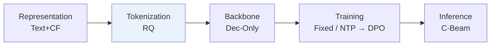
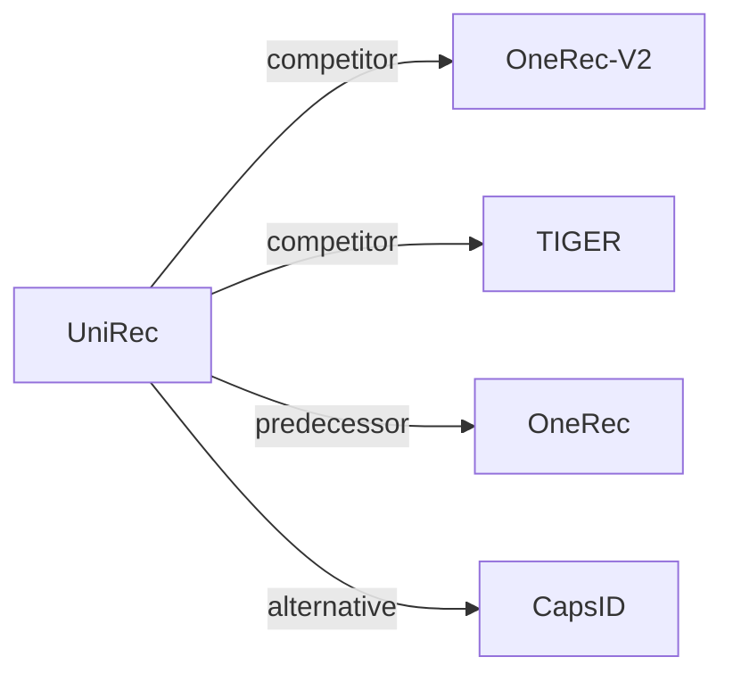

# UniRec

*Bridging the Expressive Gap between Generative and Discriminative Recommendation via Chain-of-Attribute* — Wang et al. · arXiv’26

`I. 信息量` · `Tokenization` · [论文](https://arxiv.org/abs/2604.12234) · [矩阵](../../../README.zh.md#i--tokenization) · [English](../../papers/unirec.md)

阅读级别：概览（第 1 级） · 本页目录：[TL;DR](#tldr) · [速览](#速览) · [3. 实验发现](#3-实验发现) · [5. 相关工作](#5-相关工作)

- `RQ`: Residual quantization.
- `Dec-Only`: Decoder-only.
- `Fixed`: SIDs are built first and not changed while the generator trains.
- `NTP → DPO`: NTP, then preference optimization.
- `C-Beam`: Constrained beam search.

### TL;DR

> [!NOTE]
> UniRec 通过属性链在每个 SID 前添加类目、卖家与品牌 token，恢复判别式模型的物品侧特征交叉能力，并加入容量受限量化。

### 速览

| 维度 | 摘要 |
| :-- | :-- |
| 研究问题 | I. 信息量：Do the SIDs, or the model reading them, carry the collaborative and multimodal signals recommendation needs? |
| 核心贡献 | UniRec 通过属性链在每个 SID 前添加类目、卖家与品牌 token，恢复判别式模型的物品侧特征交叉能力，并加入容量受限量化。 |
| 主要改动阶段 | Tokenization |

### 3. 实验发现

实验设置

- **数据集**：Shopee main-feed production logs over 9 consecutive days, billions of interactions (impressions, clicks, add-to-cart, purchases). Filtering and catalog size: not reported.
  - 出处：Shopee production logs: [S4.SS1.SSS1.Px1.p1](https://arxiv.org/html/2604.12234v5#S4.SS1.SSS1.Px1.p1).
- **切分**：not reported (the 9-day window is described, but not how training and test are divided). Online A/B test in feed and landing scenarios (Table 5); duration and traffic: not reported.
  - 出处：No train/test division stated; online A/B: [S4.T5](https://arxiv.org/html/2604.12234v5#S4.T5).
- **候选集**：not reported (full catalog versus sampled); Hit Ratio at 50, 100, 200 on all samples and on purchase samples.
  - 出处：Hit Ratio on all and order samples: [S4.T1](https://arxiv.org/html/2604.12234v5#S4.T1).
- **可见性**：warm; no unseen-item protocol is defined.
  - 出处：No unseen-item protocol: [S4.SS1.SSS1.Px1.p1](https://arxiv.org/html/2604.12234v5#S4.SS1.SSS1.Px1.p1).
- **SID 规格**：Capacity-constrained residual K-means SIDs with 3 layers x 4,000 codes, using exposure-weighted capacity penalties (tolerance 1.05) instead of equal item counts; Chain-of-Attribute prefixes each SID with category tokens (L2, L3) decoded first. Collision handling: not reported.
  - 出处：Capacity-constrained SIDs, 3 layers x 4000, tau=1.05; CoA attribute prefix: [S4.SS1.SSS1.Px3.p1](https://arxiv.org/html/2604.12234v5#S4.SS1.SSS1.Px3.p1) and [S3.SS3.SSS0.Px2.p2](https://arxiv.org/html/2604.12234v5#S3.SS3.SSS0.Px2.p2).
- **推理预算**：Autoregressive decoding of attribute tokens then SID tokens; beam width not reported. Online end-to-end latency 110 ms versus 266 ms for the traditional pipeline; hardware and batch size: not reported. Decoder-only model with cross-attention (d_model 256, 3 layers).
  - 出处：End-to-end latency: [S4.SS2.SSS0.Px3.p1](https://arxiv.org/html/2604.12234v5#S4.SS2.SSS0.Px3.p1); model size: [S4.SS1.SSS1.Px3.p1](https://arxiv.org/html/2604.12234v5#S4.SS1.SSS1.Px3.p1).
- **结果来源**：Table 1 (HR on all and order samples versus SASRec, TIGER, OneRec-V2); Table 2 (CoA configurations); Table 3 (SID construction, ablation, scaling); Table 4 (multi-scene task-conditioned BOS); Table 5 (online A/B: orders +4.76%, GMV +5.60%).
  - 出处：Results: [S4.T1](https://arxiv.org/html/2604.12234v5#S4.T1), [S4.T2](https://arxiv.org/html/2604.12234v5#S4.T2), [S4.T3](https://arxiv.org/html/2604.12234v5#S4.T3), [S4.T4](https://arxiv.org/html/2604.12234v5#S4.T4), [S4.T5](https://arxiv.org/html/2604.12234v5#S4.T5).

### 5. 相关工作

- **同期对比** · [OneRec-V2](onerec-v2.md): OneRec-V2 decodes SIDs with a decoder-only model over user context; UniRec first decodes coarse item attributes, uses exposure-capacity-constrained SIDs, and aligns to GMV with RFT and DPO.
  - 出处：UniRec v5, baselines: https://arxiv.org/html/2604.12234v5#S4.I2.i3.p1; Table 1: https://arxiv.org/html/2604.12234v5#S4.T1.
- **同期对比** · [TIGER](tiger.md): TIGER generates RQ-VAE IDs without any item-side attribute conditioning, which UniRec adds through Chain-of-Attribute.
  - 出处：UniRec v5, baselines: https://arxiv.org/html/2604.12234v5#S4.I2.i2.p1; Table 1: https://arxiv.org/html/2604.12234v5#S4.T1.
- **前序工作** · [OneRec](onerec.md): UniRec starts from OneRec's balanced quantization and replaces equal item counts with exposure-weighted capacity limits.
  - 出处：UniRec v5, Section 3.2: https://arxiv.org/html/2604.12234v5#S3.SS2.p1; RQ-KMeans ablation in Table 3: https://arxiv.org/html/2604.12234v5#S4.SS1.SSS3.Px1.p1.
- **替代方案** · [CapsID](capsid.md): CapsID later compares against a UniRec-style Chain-of-Attribute patch and argues that a variable-length SID can avoid extra attribute decoding.
  - 出处：Evidence is from the later CapsID paper: baselines and Table 3: https://arxiv.org/html/2605.05096v1#S4.SS1.SSS0.Px2.p1 and https://arxiv.org/html/2605.05096v1#S4.T3.

[查看同格全部论文](../../../README.zh.md#i--tokenization)
