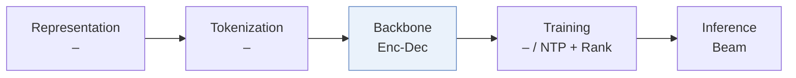
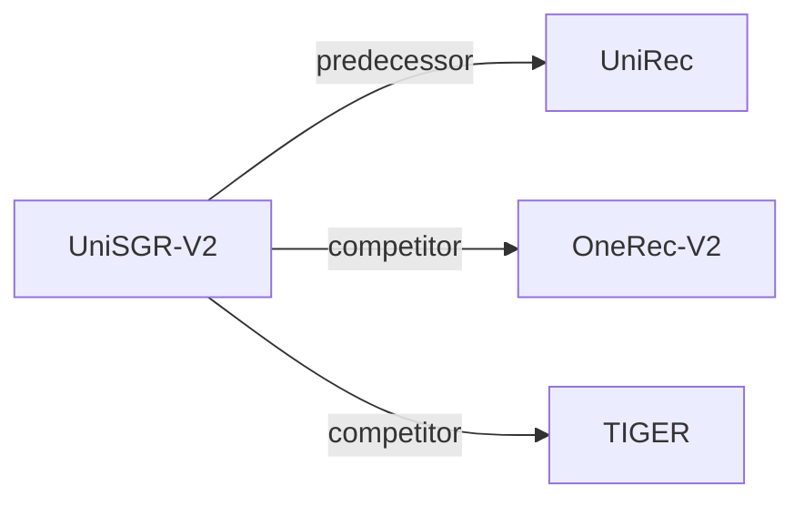

# UniSGR-V2

| **题目** | *Stepwise Target-Side Feature Anticipation and Crossing for Generative Recommendation* |
| :-- | :-- |
| **作者** | Yang et al. |
| **会议** | arXiv’26 |
| **问题与阶段** | `I. 信息量` · `Backbone` |
| **链接** | [论文](https://arxiv.org/abs/2610.16132) · [矩阵](../../../README.zh.md#i--backbone) · [English](../../papers/unisgr-v2.md) |
| **阅读级别** | 概览（第 1 级） |

本页目录：[TL;DR](#tldr) · [速览](#速览) · [3. 实验发现](#3-实验发现) · [5. 相关工作](#5-相关工作)

- `–`: Not reported in the paper.
- `Enc-Dec`: Encoder-decoder.
- `NTP + Rank`: NTP plus a ranking loss.

### TL;DR

> [!NOTE]
> UniSGR-V2 在每个码字前预测连续目标侧特征向量，并在解码器内将它与语义前缀和用户行为交叉，同时用于生成与排序。

---

### 速览

| 维度 | 摘要 |
| :-- | :-- |
| 研究问题 | I. 信息量：Do the SIDs, or the model reading them, carry the collaborative and multimodal signals recommendation needs? |
| 核心贡献 | UniSGR-V2 在每个码字前预测连续目标侧特征向量，并在解码器内将它与语义前缀和用户行为交叉，同时用于生成与排序。 |
| 主要改动阶段 | Backbone |

---

### 3. 实验发现

实验设置

- **数据集**：Lazada recommendation logs with impression, click, add-to-cart and pay behaviors; training: 2.42 billion samples, 6.46 million users, 7.53 million items.
  - 出处：[S4.SS1.p1](https://arxiv.org/html/2610.16132v2#S4.SS1.p1)
- **切分**：Chronological: first 30 days training, following day testing; validation split not reported.
  - 出处：[S4.SS1.p1](https://arxiv.org/html/2610.16132v2#S4.SS1.p1)
- **候选集**：not reported; full-catalog versus sampled retrieval evaluation and history exclusion are unspecified; ranking sample construction not reported.
  - 出处：[S4.SS1.p3](https://arxiv.org/html/2610.16132v2#S4.SS1.p3) ; HR@100/500 are output cutoffs, not a stated evaluation pool.
- **可见性**：warm; no unseen-item protocol is defined.
  - 出处：[S4.SS1.p1](https://arxiv.org/html/2610.16132v2#S4.SS1.p1) ; Appendix A's cold-start prediction refers to the initial anticipation slot.
- **SID 规格**：3-level semantic IDs with 2,048 codewords per level; tokenizer inputs, quantization algorithm, training visibility and collision handling not reported.
  - 出处：[S4.SS1.p4](https://arxiv.org/html/2610.16132v2#S4.SS1.p4)
- **推理预算**：Beam search width not reported; paired prediction/code execution uses 3 sequential decoder calls; maximum history 1,024. Full TacGR: 701 QPS, mean latency 75.6 ms, P99 83.8 ms under matched production hardware/load; hardware specification, batch size and numerical memory-funnel schedule not reported; anchoring tower is training-only.
  - 出处：[S3.SS5.SSS4.p1](https://arxiv.org/html/2610.16132v2#S3.SS5.SSS4.p1) ; [S4.SS1.p4](https://arxiv.org/html/2610.16132v2#S4.SS1.p4) ; [A2.T5](https://arxiv.org/html/2610.16132v2#A2.T5) ; [S3.SS4.SSS2.p3](https://arxiv.org/html/2610.16132v2#S3.SS4.SSS2.p3) ; [S3.SS7.SSS2](https://arxiv.org/html/2610.16132v2#S3.SS7.SSS2)
- **结果来源**：Own Lazada offline comparison, ablations and serving benchmarks; Table 1 averages 5 seeds. UniRec CoA reproduced on the same backbone; other baseline implementation provenance not reported. Own 40-day online A/B test on 10% traffic replaces UniSGR in one retrieval channel: IPV +0.79%, Order +5.55%, GMV +3.09%; other channels and downstream ranking retained.
  - 出处：[S4.SS1.p2](https://arxiv.org/html/2610.16132v2#S4.SS1.p2) ; [S4.T1](https://arxiv.org/html/2610.16132v2#S4.T1) ; [S4.SS5.p1](https://arxiv.org/html/2610.16132v2#S4.SS5.p1) ; [A2.p1](https://arxiv.org/html/2610.16132v2#A2.p1)

---

### 5. 相关工作

- **前序工作** · [UniRec](unirec.md): Its discrete attribute chain is the closest motivation and a same-backbone baseline.
  - 出处：https://arxiv.org/html/2610.16132v2#S1.p5 ; https://arxiv.org/html/2610.16132v2#S4.SS1.p2
- **同期对比** · [OneRec-V2](onerec-v2.md): Industrial generative retrieval baseline in Table 1.
  - 出处：https://arxiv.org/html/2610.16132v2#S4.SS1.p2 ; bibliography identifies Zhou et al. (2025) as arXiv:2508.20900.
- **同期对比** · [TIGER](tiger.md): Semantic-ID generative retrieval baseline in Table 1.
  - 出处：https://arxiv.org/html/2610.16132v2#S4.SS1.p2 ; https://arxiv.org/html/2610.16132v2#S4.T1

[查看同格全部论文](../../../README.zh.md#i--backbone)
