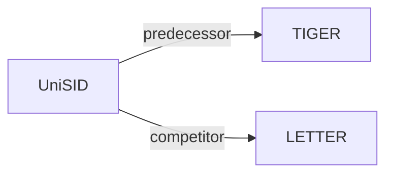

# UniSID

| **题目** | *End-to-End Semantic ID Generation for Generative Advertisement Recommendation* |
| :-- | :-- |
| **作者** | Jiang et al. |
| **会议** | arXiv’26 |
| **问题与阶段** | `I. 信息量` · `Tokenization` |
| **链接** | [论文](https://arxiv.org/abs/2602.10445) · [矩阵](../../../README.zh.md#i--tokenization) · [English](../../papers/unisid.md) |
| **阅读级别** | 概览（第 1 级） |

本页目录：[TL;DR](#tldr) · [速览](#速览) · [3. 实验发现](#3-实验发现) · [5. 相关工作](#5-相关工作)

- `Text+Img+Attr`: Text, images, and structured item attributes.
- `Direct SID Heads`: Prediction heads that directly assign semantic-ID codes.
- `–`: Not reported in the paper.

### TL;DR

> [!NOTE]
> UniSID 通过多粒度对比学习与基于摘要的重构，从原始广告数据端到端联合优化嵌入与 SID，替代先提取嵌入再后验量化的两步做法。

---

### 速览

| 维度 | 摘要 |
| :-- | :-- |
| 研究问题 | I. 信息量：Do the SIDs, or the model reading them, carry the collaborative and multimodal signals recommendation needs? |
| 核心贡献 | UniSID 通过多粒度对比学习与基于摘要的重构，从原始广告数据端到端联合优化嵌入与 SID，替代先提取嵌入再后验量化的两步做法。 |
| 主要改动阶段 | Tokenization |

---

### 3. 实验发现

实验设置

- **数据集**：Tencent Ad-60W and Ad-100W multimodal advertising datasets, plus Amazon Beauty. Filtering rules not reported; public preprocessing is described only as standard practice.
  - 出处：[S4.SS1.p1](https://arxiv.org/html/2602.10445v3#S4.SS1.p1) ; #S4.T1
- **切分**：Table 1 train/test counts: Ad-60W 500K/100K, Ad-100W 1M/1M, Beauty 12101/12101. Split procedure, count granularity and validation allocation not reported.
  - 出处：[S4.T1](https://arxiv.org/html/2602.10445v3#S4.T1) ; #S4.SS1.p1
- **候选集**：Embedding retrieval sampled: 1000 total (one positive plus 999 negatives); negative sampling distribution and history exclusion not reported. Next-ad and Beauty recommendation candidate protocols not reported.
  - 出处：[S4.SS1.p3](https://arxiv.org/html/2602.10445v3#S4.SS1.p3)
- **可见性**：warm; no unseen-item protocol is defined. SID-model fitting exposure to test items not reported.
  - 出处：[S4.SS1.p1](https://arxiv.org/html/2602.10445v3#S4.SS1.p1) ; #S4.SS1.p3 ; #A1.SS3.p1
- **SID 规格**：Three direct categorical SID heads x 2048 entries, using per-layer argmax on Qwen2.5-VL-3B outputs rather than residual quantization. Collision handling not reported.
  - 出处：[S3.SS2.p3](https://arxiv.org/html/2602.10445v3#S3.SS2.p3) ; #A1.SS3.p1
- **推理预算**：Beauty replaces the TIGER tokenizer with UniSID; industrial next-ad predictor details not reported. Metrics at K=1/5/10/20. Downstream decoding/beam, inference hardware, batch size and latency not reported; tokenizer training batch 512 is not an inference setting.
  - 出处：[S4.SS1.p3](https://arxiv.org/html/2602.10445v3#S4.SS1.p3) ; #S4.SS2.p5 ; #A1.SS3.p1
- **结果来源**：Original Table 2: SID quality/next-ad prediction; Table 3: embedding retrieval; Table 5: ablations. Table 4: UniSID in TIGER on Beauty, with baseline results explicitly taken from LETTER.
  - 出处：[S4.T2](https://arxiv.org/html/2602.10445v3#S4.T2) ; #S4.T3 ; #S4.T4 ; #S4.T5 ; #S4.SS2.p5

---

### 5. 相关工作

- **前序工作** · [TIGER](tiger.md): On Beauty, UniSID replaces TIGER RQ-VAE tokenization with direct multimodal SID heads while retaining the TIGER training and evaluation framework.
  - 出处：UniSID v3, Section 4.2 and Table 4: https://arxiv.org/html/2602.10445v3#S4.SS2.p5; https://arxiv.org/html/2602.10445v3#S4.T4.
- **同期对比** · [LETTER](letter.md): LETTER supplies the published Beauty baseline results, including TIGER-LETTER; UniSID jointly learns embeddings and direct SIDs from raw features.
  - 出处：UniSID v3, Sections 3/4.2 and Table 4; baseline numbers are reused: https://arxiv.org/html/2602.10445v3#S3.p1; https://arxiv.org/html/2602.10445v3#S4.SS2.p5; https://arxiv.org/html/2602.10445v3#S4.T4.

[查看同格全部论文](../../../README.zh.md#i--tokenization)
