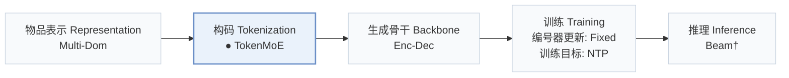
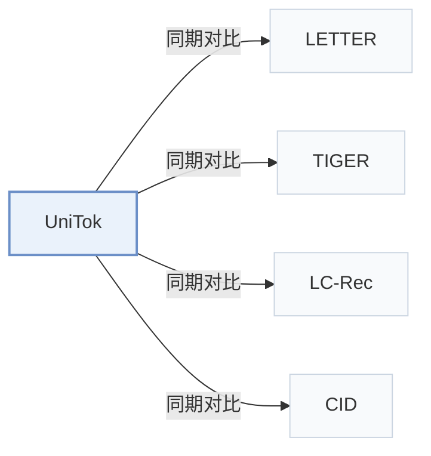

# UniTok

[← 问题 × 阶段矩阵](../../../README.zh.md#vi--tokenization) · [按阶段索引](../index/stages.md) · [按模态找论文](../index/modality.md) · [按领域找论文](../index/domain.md) · [English](../../papers/unitok.md) | 中文

| **题目** | *Tokenize Once, Recommend Anywhere: Unified Item Tokenization for Multi-domain LLM-based Recommendation* |
| :-- | :-- |
| **作者** | Hou and Shin |
| **发表** | AAAI’26 |
| **问题与阶段** | `VI. 泛化` · `构码（Tokenization）` |
| **改动** | ● 构码 |
| **构码输入** | `Text` |
| **领域** | `电商` · `本地生活与 POI` |
| **特殊设置** | `跨域迁移` |
| **应用场景** | `一般物品推荐`；`公开数据` |
| **链接** | [论文](https://arxiv.org/abs/2511.12922) · [代码](https://github.com/jackfrost168/UniTok) |
| **阅读级别** | 概览（第 1 级） |

**本页目录**：[TL;DR](#tldr) · [3. 实验发现](#3-实验发现) · [5. 相关工作](#5-相关工作)

- `Multi-Dom`：面向多领域联合构建的统一物品表征。
- `TokenMoE`：包含共享专家与领域专家的混合专家编号器。
- `Enc-Dec`：编码器-解码器（Encoder-decoder）架构。
- `Fixed`：先独立训练并冻结编号器，生成器训练期间 SID 保持不变。
- `NTP`：标准下一 token 预测（Next-Token Prediction）交叉熵损失；基于预训练 LLM 的指令微调（SFT）亦归入此类。
- `Beam†`：自回归束搜索（由配置推断）。

### TL;DR

> [!NOTE]
> UniTok 用共享编码器、域特定与共享专家以及码本对多域物品编号，并校准域间互信息，替代每个域单独训练编号器的做法。

---

### 3. 实验发现

实验设置

- **数据集**：Ten domains: Amazon Beauty, Cellphones, Grocery, Instruments, Office, Pet Supplies, Tools, Toys, Games, and Yelp, with title, category, and feature metadata; zero-shot targets Clothing, Health, and Sports. Sizes are in Appendix Table 6 (e.g. Beauty 22,363 users / 12,101 items; Yelp 30,431 / 20,033); filtering rules: not reported.
  - 出处：Ten domains: [Sx4.SSx1.SSSx1.p1](https://arxiv.org/html/2511.12922v1#Sx4.SSx1.SSSx1.p1); zero-shot targets: [Sx4.SSx4.p1](https://arxiv.org/html/2511.12922v1#Sx4.SSx4.p1); statistics: [A4.SSx1.p1](https://arxiv.org/html/2511.12922v1#A4.SSx1.p1) and [A4.T6](https://arxiv.org/html/2511.12922v1#A4.T6).
- **切分**：not reported in the main text (full-ranking evaluation per dataset; the train/test division is not restated). Zero-shot study: the tokenizer is trained on the ten source datasets and tested on three unseen domains.
  - 出处：Split not restated in the extracted text.
- **候选集**：full catalog (all non-interacted items are ranked for each user, so user history items are excluded).
  - 出处：Full ranking over all non-interacted items: [Sx4.SSx1.SSSx3.p1](https://arxiv.org/html/2511.12922v1#Sx4.SSx1.SSSx3.p1).
- **可见性**：Main: warm; no unseen-item protocol is defined. Zero-shot: items of the three target domains are unseen by the UniTok tokenizer; whether the T5 recommender saw them: not reported.
  - 出处：Zero-shot domains unseen by the tokenizer: [Sx4.SSx4.p1](https://arxiv.org/html/2511.12922v1#Sx4.SSx4.p1).
- **SID 规格**：4-level residual quantization x 256 codes (dimension 32) inside each expert of a TokenMoE: one shared expert plus 10 domain experts (top-N routing, N = 1 or 2) over 2,048-dimensional language-model embeddings, with mutual-information calibration. Collision handling: not reported.
  - 出处：4 levels x 256 x 32 per expert, TokenMoE with shared and domain experts: [Sx4.SSx1.SSSx4.p1](https://arxiv.org/html/2511.12922v1#Sx4.SSx1.SSSx4.p1), [A4.SSx4.p3](https://arxiv.org/html/2511.12922v1#A4.SSx4.p3), [Sx3.SSx3.SSSx2.p3](https://arxiv.org/html/2511.12922v1#Sx3.SSx3.SSSx2.p3).
- **推理预算**：Recommendation uses TIGER's T5 generator; beam width not reported. Experiments on two NVIDIA RTX 3090 GPUs; inference batch size and latency: not reported. Table 2 compares trainable parameters (9.11M versus 87.78M accumulated for per-dataset tokenizers).
  - 出处：TIGER T5 recommender and hardware: [A4.SSx4.p1](https://arxiv.org/html/2511.12922v1#A4.SSx4.p1) and [Sx4.SSx1.SSSx4.p1](https://arxiv.org/html/2511.12922v1#Sx4.SSx1.SSSx4.p1).
- **结果来源**：Table 1 (ten datasets versus CF and tokenization-aided baselines); Table 2 (trainable parameters); Table 3 (competitors trained jointly across domains); Table 4 (zero-shot on unseen domains); Table 5 and later (ablations).
  - 出处：Main: [Sx3.T1](https://arxiv.org/html/2511.12922v1#Sx3.T1); parameters: [Sx4.T2](https://arxiv.org/html/2511.12922v1#Sx4.T2); unified training: [Sx4.T3](https://arxiv.org/html/2511.12922v1#Sx4.T3); zero-shot and ablation in later tables.

---

### 5. 相关工作

- **同期对比** · [LETTER](letter.md): LETTER trains one regularized RQ-VAE tokenizer per dataset; UniTok shares one tokenizer across ten domains with a mixture of quantization experts.
  - 出处：UniTok v1, baselines: [Sx4.SSx1.SSSx2.p1](https://arxiv.org/html/2511.12922v1#Sx4.SSx1.SSSx2.p1); Tables 1-3: [Sx3.T1](https://arxiv.org/html/2511.12922v1#Sx3.T1), [Sx4.T2](https://arxiv.org/html/2511.12922v1#Sx4.T2), [Sx4.T3](https://arxiv.org/html/2511.12922v1#Sx4.T3).
- **同期对比** · [TIGER](tiger.md): TIGER is both a tokenizer baseline and the downstream T5 recommender; UniTok replaces per-domain RQ codebooks with routed experts.
  - 出处：UniTok v1, baselines and backbone: [Sx4.SSx1.SSSx2.p1](https://arxiv.org/html/2511.12922v1#Sx4.SSx1.SSSx2.p1) and [A4.SSx4.p1](https://arxiv.org/html/2511.12922v1#A4.SSx4.p1); Table 1: [Sx3.T1](https://arxiv.org/html/2511.12922v1#Sx3.T1).
- **同期对比** · [LC-Rec](lc-rec.md): LC-Rec aligns an LLM to per-domain indices; UniTok targets one tokenizer for many domains.
  - 出处：UniTok v1, baselines: [Sx4.SSx1.SSSx2.p1](https://arxiv.org/html/2511.12922v1#Sx4.SSx1.SSSx2.p1); Tables 1 and 3: [Sx3.T1](https://arxiv.org/html/2511.12922v1#Sx3.T1) and [Sx4.T3](https://arxiv.org/html/2511.12922v1#Sx4.T3).
- **同期对比** · [CID](cid.md): P5-TID and P5-SemID (Hua et al., 2023) use titles or categories as IDs; UniTok learns codebook IDs.
  - 出处：UniTok v1, baselines: [Sx4.SSx1.SSSx2.p1](https://arxiv.org/html/2511.12922v1#Sx4.SSx1.SSSx2.p1); Table 1: [Sx3.T1](https://arxiv.org/html/2511.12922v1#Sx3.T1).

[查看同格全部论文](../../../README.zh.md#vi--tokenization)
