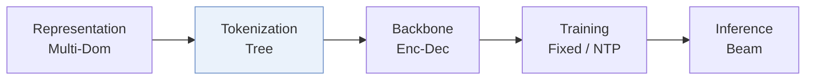
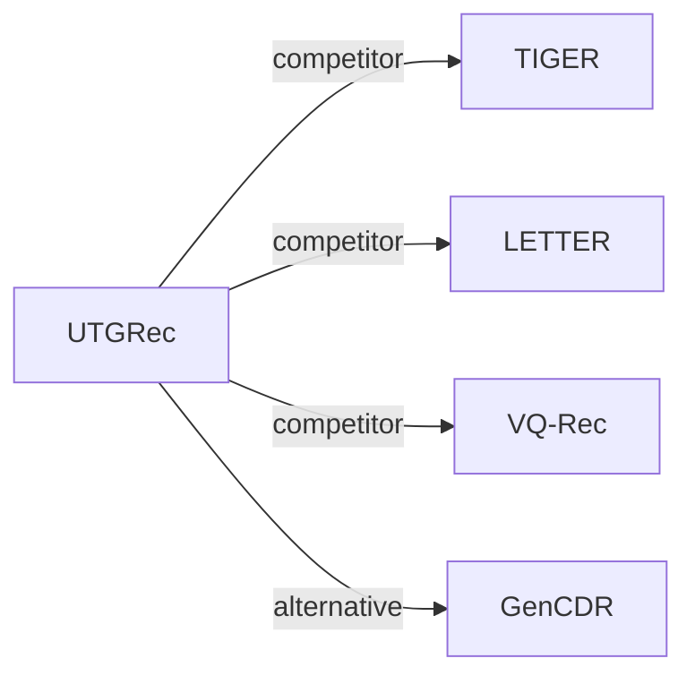

# UTGRec

| **题目** | *Universal Item Tokenization for Transferable Generative Recommendation* |
| :-- | :-- |
| **作者** | Zheng et al. |
| **会议** | arXiv’25 |
| **问题与阶段** | `VI. 泛化` · `Tokenization` |
| **链接** | [论文](https://arxiv.org/abs/2504.04405) · [代码](https://github.com/RUCAIBox/UTGRec) · [矩阵](../../../README.zh.md#vi--tokenization) · [English](../../papers/utgrec.md) |
| **阅读级别** | 概览（第 1 级） |

本页目录：[TL;DR](#tldr) · [速览](#速览) · [3. 实验发现](#3-实验发现) · [5. 相关工作](#5-相关工作)

- `Enc-Dec`: Encoder-decoder.
- `Fixed`: SIDs are built first and not changed while the generator trains.
- `NTP`: Next-token prediction loss only; continuing from a pretrained LLM (SFT) also counts as NTP.

### TL;DR

> [!NOTE]
> UTGRec 基于多模态 LLM 结合树结构码本、图文重构与共现对齐构建通用物品编号器，并预训练可跨域迁移的生成器。

---

### 速览

| 维度 | 摘要 |
| :-- | :-- |
| 研究问题 | VI. 泛化：Does it still work for new items, new domains, and shifting interests? |
| 核心贡献 | UTGRec 基于多模态 LLM 结合树结构码本、图文重构与共现对齐构建通用物品编号器，并预训练可跨域迁移的生成器。 |
| 主要改动阶段 | Tokenization |

---

### 3. 实验发现

实验设置

- **数据集**：Amazon Reviews 2023 with 5-core filtering. Pre-training on five domains (Arts Crafts and Sewing, Baby Products, CDs and Vinyl, Cell Phones and Accessories, Software; 999,334 users / 344,412 items in total); downstream on Musical Instruments (57,439 / 24,587), Industrial and Scientific (50,985 / 25,848), Video Games (94,762 / 25,612), Office Products (223,308 / 77,551).
  - 出处：Pre-training and downstream domains, 5-core: [S3.SS1.SSS1.p1](https://arxiv.org/html/2504.04405v3#S3.SS1.SSS1.p1); statistics: [S3.T1](https://arxiv.org/html/2504.04405v3#S3.T1).
- **切分**：Per-user leave-one-out: latest item for test, second most recent for validation, the rest for training; the tokenizer and recommender are pre-trained on the five source domains and fine-tuned on each downstream domain.
  - 出处：Leave-one-out allocation: [S3.SS1.SSS3.p1](https://arxiv.org/html/2504.04405v3#S3.SS1.SSS3.p1).
- **候选集**：full catalog (full-ranking evaluation over the entire item set).
  - 出处：Full ranking and beam 50: [S3.SS1.SSS3.p1](https://arxiv.org/html/2504.04405v3#S3.SS1.SSS3.p1).
- **可见性**：warm; no unseen-item protocol is defined (downstream items are seen during fine-tuning of both tokenizer and recommender).
  - 出处：Downstream domains are fine-tuned on, no unseen-item protocol: [S3.SS1.SSS1.p1](https://arxiv.org/html/2504.04405v3#S3.SS1.SSS1.p1) and [S3.SS1.SSS4.p1](https://arxiv.org/html/2504.04405v3#S3.SS1.SSS4.p1).
- **SID 规格**：Universal item tokenizer on Qwen2-VL-2B (LoRA) with tree-structured codebooks: root codebook 256 and leaf codebook 512, identifier length 3, shared across domains. Conflicts are resolved by reassigning the last-level code to the second-nearest or a farther code instead of appending an extra code.
  - 出处：Tree-structured codebooks (root 256, leaf 512), L=3, last-level reassignment for conflicts: [S3.SS1.SSS4.p1](https://arxiv.org/html/2504.04405v3#S3.SS1.SSS4.p1) and [S2.SS4.SSS1.p2](https://arxiv.org/html/2504.04405v3#S2.SS4.SSS1.p2); MLLM tokenizer: [S3.SS1.SSS4.p1](https://arxiv.org/html/2504.04405v3#S3.SS1.SSS4.p1).
- **推理预算**：Beam size 50 for all generative recommenders; tokenizer pre-training on 16 GPUs (batch 16 per GPU). Inference hardware, batch size, and latency: not reported.
  - 出处：Beam size 50: [S3.SS1.SSS3.p1](https://arxiv.org/html/2504.04405v3#S3.SS1.SSS3.p1); GPUs for tokenizer pre-training: [S3.SS1.SSS4.p1](https://arxiv.org/html/2504.04405v3#S3.SS1.SSS4.p1).
- **结果来源**：Table 2 (four downstream domains versus traditional, content-based, and generative baselines including TIGER, LETTER, TIGER-M); Table 3 (ablations); later figures (analyses).
  - 出处：Main: [S3.T2](https://arxiv.org/html/2504.04405v3#S3.T2); ablation: [S3.T3](https://arxiv.org/html/2504.04405v3#S3.T3).

---

### 5. 相关工作

- **同期对比** · [TIGER](tiger.md): TIGER trains a domain-specific RQ-VAE on text embeddings and appends an extra code for conflicts; UTGRec learns one MLLM-based tree tokenizer across domains and reassigns conflicting last-level codes.
  - 出处：UTGRec v3, baselines TIGER and TIGER-M: https://arxiv.org/html/2504.04405v3#S3.SS1.SSS2.p14 and https://arxiv.org/html/2504.04405v3#S3.SS1.SSS2.p16; conflict handling: https://arxiv.org/html/2504.04405v3#S2.SS4.SSS1.p2; Table 2: https://arxiv.org/html/2504.04405v3#S3.T2.
- **同期对比** · [LETTER](letter.md): LETTER regularizes RQ-VAE with collaborative and diversity terms per domain; UTGRec injects collaborative knowledge through co-occurring item alignment in a universal tokenizer.
  - 出处：UTGRec v3, baselines: https://arxiv.org/html/2504.04405v3#S3.SS1.SSS2.p15; Table 2: https://arxiv.org/html/2504.04405v3#S3.T2.
- **同期对比** · [VQ-Rec](vq-rec.md): VQ-Rec transfers text codes across domains for discriminative sequence modeling; UTGRec transfers a generative tokenizer and recommender across domains.
  - 出处：UTGRec v3, content-based baselines: https://arxiv.org/html/2504.04405v3#S3.SS1.SSS2.p11; Table 2: https://arxiv.org/html/2504.04405v3#S3.T2.
- **替代方案** · [GenCDR](gencdr.md): GenCDR later cites UTGRec as single-domain-oriented tokenization and adds domain-specific adapters and routing for cross-domain generation.
  - 出处：Evidence is from the later GenCDR paper, Related Work: https://arxiv.org/html/2511.08006v2#Sx2.p2.

[查看同格全部论文](../../../README.zh.md#vi--tokenization)
