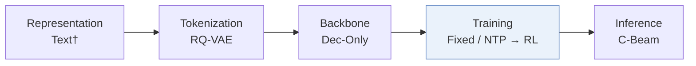
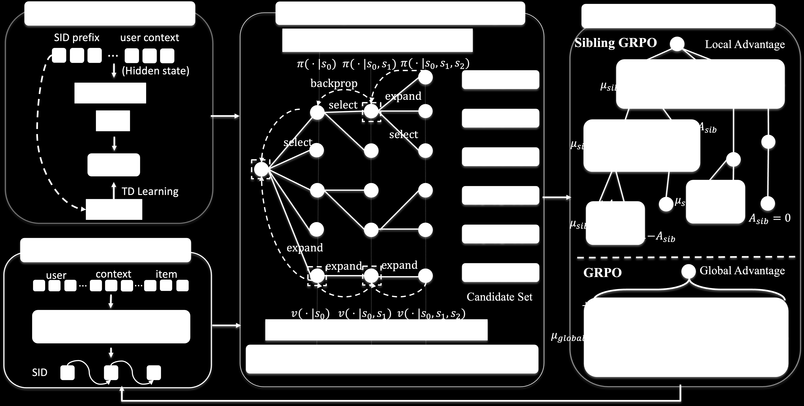
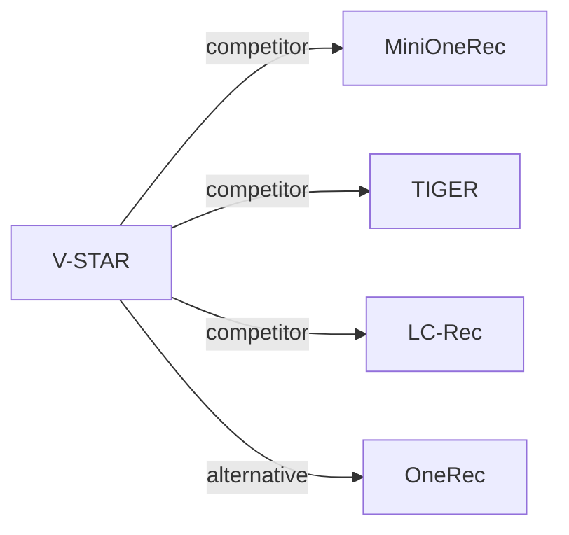

# V-STAR

*Spend Search Where It Pays: Value-Guided Structured Sampling and Optimization for Generative Recommendation* — Jiang et al. · KDD’26

`IV. 实用目标` · `Training` · [论文](https://arxiv.org/abs/2602.10699) · [矩阵](../../../README.zh.md#iv--training) · [English](../../papers/v-star.md)

阅读级别：概览（第 1 级） · 本页目录：[TL;DR](#tldr) · [速览](#速览) · [2. 方法](#2-方法) · [3. 实验发现](#3-实验发现) · [5. 相关工作](#5-相关工作)

- `Dec-Only`: Decoder-only.
- `Fixed`: SIDs are built first and not changed while the generator trains.
- `NTP → RL`: NTP, then reinforcement learning (GRPO, GBPO, etc.).
- `C-Beam`: Constrained beam search.

### TL;DR

> [!NOTE]
> V-STAR 在强化学习采样期间用价值引导解码加深高价值前缀的搜索，并用 Sibling-GRPO 计算兄弟分支相对优势，替代似然驱动的束搜索。

### 速览

| 维度 | 摘要 |
| :-- | :-- |
| 研究问题 | IV. 实用目标：Are training and search aimed at what users and the platform value, rather than at token likelihood? |
| 核心贡献 | V-STAR 在强化学习采样期间用价值引导解码加深高价值前缀的搜索，并用 Sibling-GRPO 计算兄弟分支相对优势，替代似然驱动的束搜索。 |
| 主要改动阶段 | Training |

### 2. 方法

### 3. 实验发现

实验设置

- **数据集**：Amazon Reviews 2023 Industrial and Scientific and Office Products, preprocessed following MiniOneRec (Kong et al., 2025b); online: WeChat Channels advertising traffic. Filtering and sizes: not restated.
  - 出处：Datasets and MiniOneRec preprocessing: [S5.SS1.p1](https://arxiv.org/html/2602.10699v2#S5.SS1.p1).
- **切分**：Chronological next-item prediction following MiniOneRec's preprocessing (allocation not restated). Online: 5-day A/B test on 5% of live requests, against beam search plus GRPO.
  - 出处：Chronological next-item protocol: [S5.SS1.p1](https://arxiv.org/html/2602.10699v2#S5.SS1.p1); online A/B: [S5.SS3.p1](https://arxiv.org/html/2602.10699v2#S5.SS3.p1).
- **候选集**：not reported (full catalog versus sampled); generation is restricted to valid catalog SIDs, with HR and NDCG at 3, 5, 10.
  - 出处：Valid-SID constraint and metrics: [S5.SS1.p1](https://arxiv.org/html/2602.10699v2#S5.SS1.p1).
- **可见性**：warm; no unseen-item protocol is defined.
  - 出处：No unseen-item protocol: [S5.SS1.p1](https://arxiv.org/html/2602.10699v2#S5.SS1.p1).
- **SID 规格**：3-level RQ-VAE semantic IDs (citing TIGER); the paper states each item is represented by a unique fixed-length SID. Codebook size and the mechanism that ensures uniqueness: not reported.
  - 出处：3-level RQ-VAE SIDs: [S5.SS1.p1](https://arxiv.org/html/2602.10699v2#S5.SS1.p1); each item has a unique fixed-length SID: [S3.SS1.p1](https://arxiv.org/html/2602.10699v2#S3.SS1.p1).
- **推理预算**：Training rollouts use value-guided decoding (VED) with 16 candidates per query and an 8-wide beam to initialize the prefix tree; at inference, standard beam search is the default decoder (width not reported). Qwen2.5-1.5B on 8 GPUs; inference batch size and latency: not reported.
  - 出处：VED budget, beam settings, inference decoder: [S5.SS1.p2](https://arxiv.org/html/2602.10699v2#S5.SS1.p2).
- **结果来源**：Table 1 (Industrial and Office versus sequential, generative, and RL baselines including MiniOneRec); Tables 2-4 (decoding, expansion rules, training objective); Table 6 (candidate diversity and max reward); Section 5.3 (online GMV +1.23%).
  - 出处：Main: [S4.T1](https://arxiv.org/html/2602.10699v2#S4.T1); ablations: [S5.T2](https://arxiv.org/html/2602.10699v2#S5.T2), [S5.T3](https://arxiv.org/html/2602.10699v2#S5.T3), [S5.T4](https://arxiv.org/html/2602.10699v2#S5.T4); diversity: [S5.T6](https://arxiv.org/html/2602.10699v2#S5.T6); online: [S5.SS3.p1](https://arxiv.org/html/2602.10699v2#S5.SS3.p1).

### 5. 相关工作

- **同期对比** · [MiniOneRec](minionerec.md): MiniOneRec samples RL candidates by beam search and applies GRPO; V-STAR replaces candidate construction with value-guided prefix expansion and uses sibling-group advantages, while keeping MiniOneRec's preprocessing.
  - 出处：V-STAR v2, preprocessing follows Kong et al. (2025b): https://arxiv.org/html/2602.10699v2#S5.SS1.p1; strongest RL baseline: https://arxiv.org/html/2602.10699v2#S5.SS2.p1; Table 1: https://arxiv.org/html/2602.10699v2#S4.T1.
- **同期对比** · [TIGER](tiger.md): TIGER's SIDs and beam search are the base; V-STAR targets the pruning of high-reward low-probability prefixes during RL sampling.
  - 出处：V-STAR v2, SID-based baselines: https://arxiv.org/html/2602.10699v2#S5.SS2.p1; Table 1: https://arxiv.org/html/2602.10699v2#S4.T1.
- **同期对比** · [LC-Rec](lc-rec.md): LC-Rec is an SID-based LLM recommender without RL; V-STAR adds value-guided RL on top of SFT.
  - 出处：V-STAR v2, baselines: https://arxiv.org/html/2602.10699v2#S5.SS2.p1; Table 1: https://arxiv.org/html/2602.10699v2#S4.T1.
- **替代方案** · [OneRec](onerec.md): OneRec applies preference alignment with beam-sampled responses; V-STAR argues that probability-based beam sampling under-explores high-reward items.
  - 出处：V-STAR v2, Sections 1 and 2.3 cite OneRec: https://arxiv.org/html/2602.10699v2#S1.p1 and https://arxiv.org/html/2602.10699v2#S2.SS3.p1.

[查看同格全部论文](../../../README.zh.md#iv--training)
