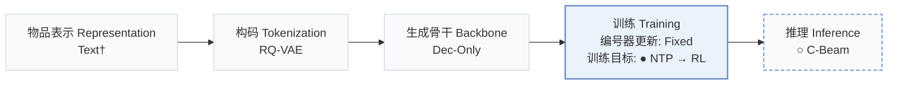
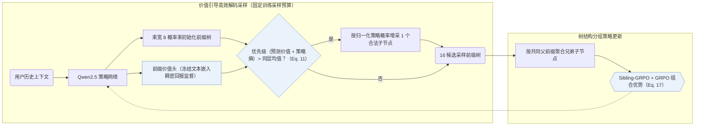
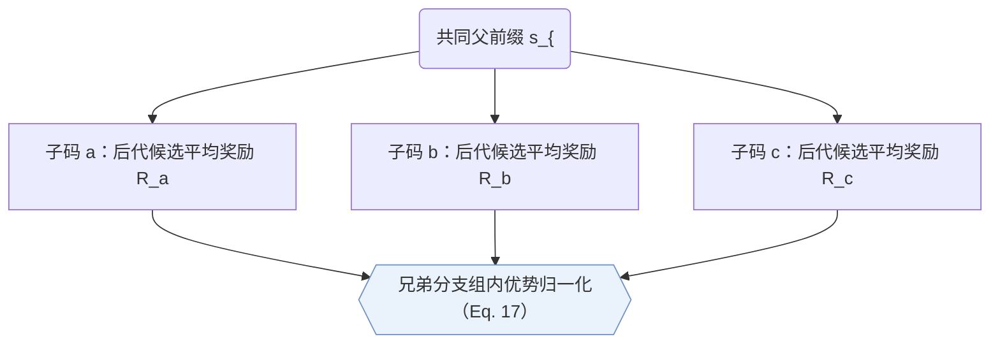
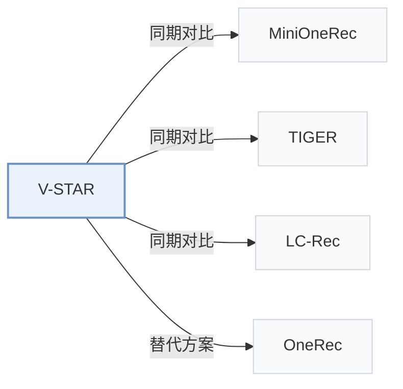

# V-STAR

[← 问题 × 阶段矩阵](../../../README.zh.md#iv--training) · [按阶段索引](../index/stages.md) · [按模态找论文](../index/modality.md) · [按领域找论文](../index/domain.md) · [English](../../papers/v-star.md) | 中文

| **题目** | *Spend Search Where It Pays: Value-Guided Structured Sampling and Optimization for Generative Recommendation* |
| :-- | :-- |
| **作者** | Jiang et al. |
| **发表** | KDD’26 |
| **问题与阶段** | `IV. 实用目标` · `训练（Training）` |
| **改动** | ● 训练目标 · ○ 推理 |
| **构码输入** | `其他`（RQ-VAE编号，输入未写） |
| **领域** | `电商` · `广告` |
| **应用场景** | `一般物品推荐`；`线上实验或部署` |
| **链接** | [论文](https://arxiv.org/abs/2602.10699) |
| **阅读级别** | 阅读笔记（第 2 级） |

**本页目录**：[TL;DR](#tldr) · [速览](#速览) · [1. 为什么重要](#1-为什么重要) · [2. 方法](#2-方法) · [3. 实验发现](#3-实验发现) · [4. 局限与分析](#4-局限与分析) · [5. 相关工作](#5-相关工作)

- `Text†`：物品文本表征（由配置推断）。
- `RQ-VAE`：残差量化变分自编码器（Residual-Quantized VAE）。
- `Dec-Only`：仅解码器（Decoder-only）自回归架构。
- `Fixed`：先独立训练并冻结编号器，生成器训练期间 SID 保持不变。
- `NTP → RL`：先进行下一 token 预测微调，再执行强化学习（如 GRPO、GBPO 等）。
- `C-Beam`：受合法物品集合约束的束搜索（Constrained beam search）。

### TL;DR

> [!NOTE]
> V-STAR 在强化学习采样期间用价值引导解码加深高价值前缀的搜索，并用 Sibling-GRPO 计算兄弟分支相对优势，替代似然驱动的束搜索。

---

### 速览

| 维度 | 摘要 |
| :-- | :-- |
| 主要发现 | 在相同训练期 token 计算预算下，V-STAR 在 Amazon Industrial 与 Office 上超越包括 MiniOneRec 在内的束搜索强化学习基线，并在微信视频号广告线上 A/B 测试中带来 +1.23% 的 GMV 提升（Sec. 5.3–5.5，Tables 1 and 4，Fig. 4）。 |
| 局限 | 价值引导的前缀树扩展仅用于训练期强化学习候选采样，线上实时推理仍回退为常规似然束搜索（Sec. 4.4）。 |

---

### 1. 为什么重要

强化学习微调若用似然驱动的束搜索采样候选，既会在前几层过早剪掉低先验概率分支中的高回报物品，又会让大量候选挤在同一高概率前缀下导致奖励高度相关、优势信号被压缩（Abstract）；单纯拉大束宽只会把额外算力浪费在重复的头部路径上（Sec. 1）。V-STAR 在固定算力预算下向高价值、高熵前缀节点倾斜扩展，并在同一父前缀的兄弟分支间归一化优势。

> "Our V-STAR primarily focuses on training-time improvement."（Sec. 4.4）

---

### 2. 方法

#### 价值头

前缀价值头读取策略网络在每个语义 ID（Semantic ID，SID）前缀位置上的隐藏状态并预测期望回报，其稠密监督信号由冻结文本编码器计算的物品语义相似度给出（Sec. 4.1）。

#### 价值引导的高效解码

价值引导高效解码（VED）在固定 token 评估预算下构建候选前缀树（Sec. 4.2）：先用概率引导束搭起初始树骨架，再综合预测价值与策略熵计算各节点优先级；凡优先级高于同层均值的节点，从尚未展开的合法子节点中按归一化策略概率额外采样一个子节点（Eq. 11）。

> "We develop Value-Guided Efficient Decoding (VED) for budgeted candidate construction by allocating decoding compute to high-value and high-ambiguity nodes."（Sec. 1）

#### Sibling-GRPO

Sibling-GRPO 将同一父前缀下的直接子节点归为一个兄弟组，以各子节点后代候选的平均奖励作为分支得分，并在兄弟节点内部做优势归一化（Sec. 4.3，Eq. 17）。

> "We introduce Sibling-GRPO, a tree-structured objective that uses sibling groups to mitigate advantage compression under correlated candidates."（Sec. 1）

---

### 3. 实验发现

实验设置

- **数据集**：Amazon Reviews 2023 Industrial and Scientific and Office Products, preprocessed following MiniOneRec (Kong et al., 2025b); online: WeChat Channels advertising traffic. Filtering and sizes: not restated.
  - 出处：Datasets and MiniOneRec preprocessing: [S5.SS1.p1](https://arxiv.org/html/2602.10699v2#S5.SS1.p1).
- **切分**：Chronological next-item prediction following MiniOneRec's preprocessing (allocation not restated). Online: 5-day A/B test on 5% of live requests, against beam search plus GRPO.
  - 出处：Chronological next-item protocol: [S5.SS1.p1](https://arxiv.org/html/2602.10699v2#S5.SS1.p1); online A/B: [S5.SS3.p1](https://arxiv.org/html/2602.10699v2#S5.SS3.p1).
- **候选集**：not reported (full catalog versus sampled); generation is restricted to valid catalog SIDs, with HR and NDCG at 3, 5, 10.
  - 出处：Valid-SID constraint and metrics: [S5.SS1.p1](https://arxiv.org/html/2602.10699v2#S5.SS1.p1).
- **可见性**：warm; no unseen-item protocol is defined.
  - 出处：No unseen-item protocol: [S5.SS1.p1](https://arxiv.org/html/2602.10699v2#S5.SS1.p1).
- **SID 规格**：3-level RQ-VAE semantic IDs (citing TIGER); the paper states each item is represented by a unique fixed-length SID. Codebook size and the mechanism that ensures uniqueness: not reported.
  - 出处：3-level RQ-VAE SIDs: [S5.SS1.p1](https://arxiv.org/html/2602.10699v2#S5.SS1.p1); each item has a unique fixed-length SID: [S3.SS1.p1](https://arxiv.org/html/2602.10699v2#S3.SS1.p1).
- **推理预算**：Training rollouts use value-guided decoding (VED) with 16 candidates per query and an 8-wide beam to initialize the prefix tree; at inference, standard beam search is the default decoder (width not reported). Qwen2.5-1.5B on 8 GPUs; inference batch size and latency: not reported.
  - 出处：VED budget, beam settings, inference decoder: [S5.SS1.p2](https://arxiv.org/html/2602.10699v2#S5.SS1.p2).
- **结果来源**：Table 1 (Industrial and Office versus sequential, generative, and RL baselines including MiniOneRec); Tables 2-4 (decoding, expansion rules, training objective); Table 6 (candidate diversity and max reward); Section 5.3 (online GMV +1.23%).
  - 出处：Main: [S4.T1](https://arxiv.org/html/2602.10699v2#S4.T1); ablations: [S5.T2](https://arxiv.org/html/2602.10699v2#S5.T2), [S5.T3](https://arxiv.org/html/2602.10699v2#S5.T3), [S5.T4](https://arxiv.org/html/2602.10699v2#S5.T4); diversity: [S5.T6](https://arxiv.org/html/2602.10699v2#S5.T6); online: [S5.SS3.p1](https://arxiv.org/html/2602.10699v2#S5.SS3.p1).

- 采样预算效率：在候选构建阶段消耗相同模型评估 token 数的条件下，VED 在 HR 与 NDCG 上稳定优于常规束搜索采样（Sec. 5.5，Fig. 4）。
- 目标消融与线上测试：将序列级 GRPO 与树结构 Sibling-GRPO 结合在 Industrial 与 Office 上取得全部对比目标中的最高精度（Sec. 5.4，Table 4），并在微信视频号广告 5 天线上 A/B 测试中实现 GMV +1.23% 增长（Sec. 5.3）。

---

### 4. 局限与分析

**Our analysis.**

- MiniOneRec 采用同类的 3 层 `RQ-VAE` SID、Qwen2.5 `Dec-Only` 骨干与 `NTP → RL` 约束束采样；V-STAR 保持推理结构不变，专门改造了 RL 阶段的树扩展算力分配与兄弟组相对优势估计。

---

### 5. 相关工作

- **同期对比** · [MiniOneRec](minionerec.md): MiniOneRec samples RL candidates by beam search and applies GRPO; V-STAR replaces candidate construction with value-guided prefix expansion and uses sibling-group advantages, while keeping MiniOneRec's preprocessing.
  - 出处：V-STAR v2, preprocessing follows Kong et al. (2025b): [S5.SS1.p1](https://arxiv.org/html/2602.10699v2#S5.SS1.p1); strongest RL baseline: [S5.SS2.p1](https://arxiv.org/html/2602.10699v2#S5.SS2.p1); Table 1: [S4.T1](https://arxiv.org/html/2602.10699v2#S4.T1).
- **同期对比** · [TIGER](tiger.md): TIGER's SIDs and beam search are the base; V-STAR targets the pruning of high-reward low-probability prefixes during RL sampling.
  - 出处：V-STAR v2, SID-based baselines: [S5.SS2.p1](https://arxiv.org/html/2602.10699v2#S5.SS2.p1); Table 1: [S4.T1](https://arxiv.org/html/2602.10699v2#S4.T1).
- **同期对比** · [LC-Rec](lc-rec.md): LC-Rec is an SID-based LLM recommender without RL; V-STAR adds value-guided RL on top of SFT.
  - 出处：V-STAR v2, baselines: [S5.SS2.p1](https://arxiv.org/html/2602.10699v2#S5.SS2.p1); Table 1: [S4.T1](https://arxiv.org/html/2602.10699v2#S4.T1).
- **替代方案** · [OneRec](onerec.md): OneRec applies preference alignment with beam-sampled responses; V-STAR argues that probability-based beam sampling under-explores high-reward items.
  - 出处：V-STAR v2, Sections 1 and 2.3 cite OneRec: [S1.p1](https://arxiv.org/html/2602.10699v2#S1.p1) and [S2.SS3.p1](https://arxiv.org/html/2602.10699v2#S2.SS3.p1).

[查看同格全部论文](../../../README.zh.md#iv--training)
