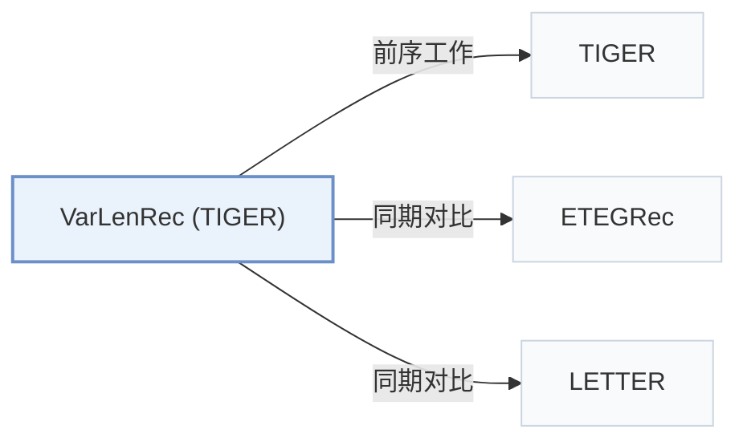

# VarLenRec (TIGER)

[← 问题 × 阶段矩阵](../../../README.zh.md#i--tokenization) · [按阶段索引](../index/stages.md) · [按模态索引](../index/modality.md) · [English](../../papers/varlenrec-tiger.md) | 中文

| **题目** | *Learning Variable-Length Tokenization for Generative Recommendation* |
| :-- | :-- |
| **作者** | Wang et al. |
| **发表** | arXiv’26 |
| **问题与阶段** | `I. 信息量` · `编号（Tokenization）` |
| **链接** | [论文](https://arxiv.org/abs/2605.17779) |
| **阅读级别** | 概览（第 1 级） |

**本页目录**：[TL;DR](#tldr) · [速览](#速览) · [3. 实验发现](#3-实验发现) · [5. 相关工作](#5-相关工作)

- `Text`：物品文本元数据（标题、描述、类目或提示词）。
- `HARQ`：双曲空间自适应残差量化（Hyperbolic Adaptive RQ）。
- `Enc-Dec`：编码器-解码器（Encoder-decoder）架构。
- `Fixed`：先独立训练并冻结编号器，生成器训练期间 SID 保持不变。
- `NTP + Aux.`：下一 token 预测结合辅助正则或对齐损失。
- `C-Beam`：受合法物品集合约束的束搜索（Constrained beam search）。

### TL;DR

> [!NOTE]
> VarLenRec (TIGER) 通过双曲残差量化与软长度控制器为热门物品分配较短 SID、为长尾物品分配较长 SID，替代固定长度编号。

---

### 速览

| 维度 | 摘要 |
| :-- | :-- |
| 研究问题 | I. 信息量：SID 或读取它的模型是否充分携带了推荐所需的协同、多模态与时空信号？ |
| 核心贡献 | VarLenRec (TIGER) 通过双曲残差量化与软长度控制器为热门物品分配较短 SID、为长尾物品分配较长 SID，替代固定长度编号。 |
| 主要改动阶段 | 编号（Tokenization） |

---

### 3. 实验发现

实验设置

- **数据集**：Amazon Beauty, Sports and Outdoors, Toys and Games, and Yelp; exclude users/items with fewer than five interactions. Maximum history length not reported.
  - 出处：[S4.SS1.SSS1.p1](https://arxiv.org/html/2605.17779v2#S4.SS1.SSS1.p1)
- **切分**：Per-user leave-one-out: most recent item test, second most recent validation, all remaining items training.
  - 出处：[S4.SS1.SSS4.p1](https://arxiv.org/html/2605.17779v2#S4.SS1.SSS4.p1)
- **候选集**：full catalog; full ranking without negative sampling.
  - 出处：[S4.SS1.SSS3.p1](https://arxiv.org/html/2605.17779v2#S4.SS1.SSS3.p1)
- **可见性**：warm; no unseen-item protocol is defined. Cold-start maximum-length assignment is discussed for deployment, not evaluated as a held-out-item protocol; tokenizer exposure to test items not reported.
  - 出处：[S4.SS1.SSS4.p1](https://arxiv.org/html/2605.17779v2#S4.SS1.SSS4.p1) ; #S3.SS4.p6
- **SID 规格**：HARQ on Sentence-T5 embeddings: variable semantic length up to 10 levels x 256 codes, in hyperbolic space with curvature 1. Colliding IDs receive unique appended tokens from a disjoint 256-entry auxiliary vocabulary.
  - 出处：[S4.SS1.SSS4.p1](https://arxiv.org/html/2605.17779v2#S4.SS1.SSS4.p1) ; #S3.SS4.p2
- **推理预算**：VarLenRec-TIGER uses T5, a user-side target-length predictor and trie-constrained beam 30, decoding exactly the predicted length; Recall/NDCG@5/10. Table III test seconds/epoch on Beauty/Sports/Toys/Yelp: 63.7/81.2/70.0/83.3. Experiments use A800 GPUs; count, inference batch size and per-request latency not reported.
  - 出处：[S3.SS4.p4](https://arxiv.org/html/2605.17779v2#S3.SS4.p4) ; #S3.SS4.p5 ; #S4.SS1.SSS4.p1 ; #S4.T3
- **结果来源**：Original v2 Table I: VarLenRec-TIGER and VarLenRec-LCRec comparisons; Table II: VarLenRec-TIGER ablations; Table III: timing. Baseline-result reuse not stated. This record covers the TIGER generative branch; SASRec is only a baseline in v2.
  - 出处：[S4.SS2.p1](https://arxiv.org/html/2605.17779v2#S4.SS2.p1) ; #S4.T2 ; #S4.T3 ; #S4.SS1.SSS2.p1

---

### 5. 相关工作

- **前序工作** · [TIGER](tiger.md): VarLenRec-TIGER replaces uniform-length RQ tokenization with hyperbolic variable-length IDs and adds user-conditioned length prediction before constrained generation.
  - 出处：VarLenRec v2, Sections III-D/IV-B: [S3.SS4.p3](https://arxiv.org/html/2605.17779v2#S3.SS4.p3); [S4.SS2.p1](https://arxiv.org/html/2605.17779v2#S4.SS2.p1).
- **同期对比** · [ETEGRec](etegrec.md): ETEGRec is a fixed-length generative baseline with joint-training optimization; VarLenRec changes the per-item encoding budget and target decoding length.
  - 出处：VarLenRec v2, Sections IV-A/IV-B: [S4.SS1.SSS2.p1](https://arxiv.org/html/2605.17779v2#S4.SS1.SSS2.p1); [S4.SS2.p2](https://arxiv.org/html/2605.17779v2#S4.SS2.p2).
- **同期对比** · [LETTER](letter.md): LETTER improves codebook learning on TIGER/LCRec backbones; VarLenRec instead allocates variable ID lengths and compares against LETTER-TIGER.
  - 出处：VarLenRec v2, Sections IV-A/IV-B: [S4.SS1.SSS2.p1](https://arxiv.org/html/2605.17779v2#S4.SS1.SSS2.p1); [S4.SS2.p2](https://arxiv.org/html/2605.17779v2#S4.SS2.p2).

[查看同格全部论文](../../../README.zh.md#i--tokenization)
