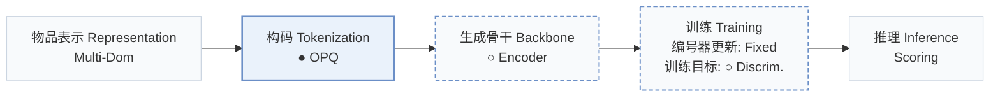
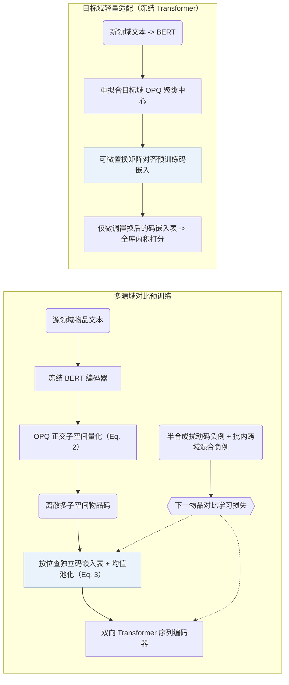
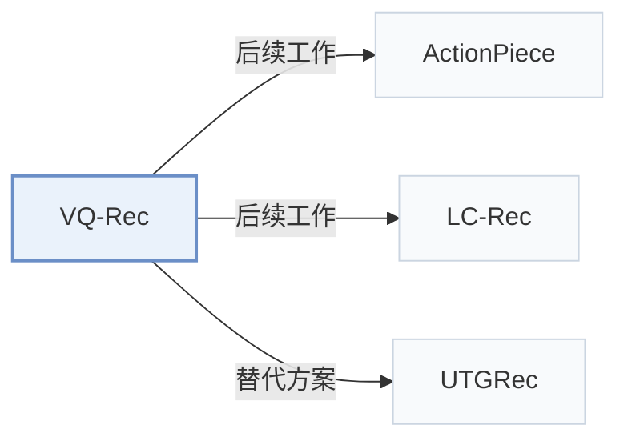

# VQ-Rec

[← 问题 × 阶段矩阵](../../../README.zh.md#vi--tokenization) · [按阶段索引](../index/stages.md) · [按模态找论文](../index/modality.md) · [按领域找论文](../index/domain.md) · [English](../../papers/vq-rec.md) | 中文

| **题目** | *Learning Vector-Quantized Item Representation for Transferable Sequential Recommenders* |
| :-- | :-- |
| **作者** | Hou et al. |
| **发表** | WWW’23 |
| **问题与阶段** | `VI. 泛化` · `构码（Tokenization）` |
| **改动** | ● 构码 · ○ 生成骨干 · ○ 训练目标 |
| **构码输入** | `Text` |
| **领域** | `电商` |
| **特殊设置** | `跨域迁移` |
| **链接** | [论文](https://arxiv.org/abs/2210.12316) · [代码](https://github.com/RUCAIBox/VQ-Rec) |
| **阅读级别** | 阅读笔记（第 2 级） |

**本页目录**：[TL;DR](#tldr) · [速览](#速览) · [1. 为什么重要](#1-为什么重要) · [2. 方法](#2-方法) · [3. 实验发现](#3-实验发现) · [4. 局限与分析](#4-局限与分析) · [5. 相关工作](#5-相关工作)

- `Multi-Dom`：面向多领域联合构建的统一物品表征。
- `OPQ`：优化乘积量化（Optimized Product Quantization）。
- `Encoder`：双向编码器骨干，不进行逐位自回归解码。
- `Fixed`：先独立训练并冻结编号器，生成器训练期间 SID 保持不变。
- `Discrim.`：判别式候选物品打分损失，不直接生成 SID。
- `Scoring`：直接计算候选物品得分，不逐位生成 SID。

### TL;DR

> [!NOTE]
> VQ-Rec 将物品文本映射为离散码并查表组合码嵌入作为物品表示，配合对比预训练与跨域微调，解除文本与物品表示之间的强绑定。

---

### 速览

| 维度 | 摘要 |
| :-- | :-- |
| 主要发现 | 在五个 Amazon 源领域预训练后，VQ-Rec 在六个跨领域与跨平台下游基准上均位列第一或第二，并在所有热度分组（尤其是冷启动长尾组）上全面优于 SASRec（Sec. 3.4.3，Table 2，Fig. 4）。 |
| 局限 | 若跳过目标领域的码嵌入表微调而直接零样本评估预训练编码器，下游推荐精度会大幅下滑（Sec. 3.3，Table 3）。 |

---

### 1. 为什么重要

直接将预训练语言模型（PLM）的连续文本向量送入可迁移序列推荐器，会使表征过度耦合表面文本风格并放大跨领域分布差异（Abstract，Sec. 4）。VQ-Rec 在文本编码与序列编码器之间插入优化乘积量化（`OPQ`）离散物品码，通过查表池化配合双向编码器完成全库判别打分（`Scoring`），其并行子空间离散编码机制被后续众多语义 ID（Semantic ID，SID）生成模型沿用（Sec. 2.1）。

---

### 2. 方法

#### 文本到码

冻结的 BERT 提取物品文本向量后，优化乘积量化（OPQ）将向量切分为多个正交子空间，在每个子空间内独立分配聚类中心索引（Sec. 2.2.1，Eq. 2），初始中心在全部源域文本上联合学得。

#### 码到表示

每个码位维护一张与 OPQ 聚类中心解耦的可学习码嵌入表，查出各子空间码嵌入后取均值即得物品表征（Sec. 2.2.2，Eq. 3）。

#### 对比预训练

Transformer 序列编码器编码历史物品表征序列，以真实下一物品为正例，结合随机替换部分码位的半合成负例与同批跨领域负例做对比预训练（Sec. 2.3，Sec. 2.3.1）；预训练期间 BERT 与 OPQ 索引固定，联合更新码嵌入表与 Transformer（Sec. 2.4）。

#### 跨域微调

迁移至新领域时，VQ-Rec 重新拟合目标域 OPQ 中心，用可微置换网络将其与已有码嵌入表对齐，随后冻结跨领域共享的 Transformer 编码器、仅微调置换后的码嵌入表（Sec. 2.4，Sec. 2.4.1）。同一领域内新上架物品只需编码文本并查表即可获得表征，无需重新训练（Sec. 2.4.2）。

> "During fine-tuning, we fix the Transformer sequence encoder (transferred across different domains), and only optimize the parameters involved in item representations, enabling parameter-efficient fine-tuning."（Sec. 2.4）

> "When a new item emerges, one can encode its item text into discrete indices, and then obtain the corresponding item representations by embedding lookup."（Sec. 2.4.2）

---

### 3. 实验发现

实验设置

- **数据集**：Pre-training on five Amazon domains (Food, Home, CDs, Kindle, Movies; 1,361,408 users / 446,975 items); downstream on Amazon Scientific, Pantry, Instruments, Arts, Office and the cross-platform Online Retail dataset. Users and items with fewer than 5 interactions are filtered (following UniSRec); item text truncated to 512 tokens.
  - 出处：Pre-training and downstream domains: [S3.SS1.SSS1.p1](https://arxiv.org/html/2210.12316v2#S3.SS1.SSS1.p1); filtering: [S3.SS1.SSS1.p2](https://arxiv.org/html/2210.12316v2#S3.SS1.SSS1.p2); statistics: [S2.T1](https://arxiv.org/html/2210.12316v2#S2.T1).
- **切分**：Leave-one-out: latest item for test, the one before for validation, the rest for training; pre-train on source domains, then fine-tune per downstream dataset.
  - 出处：Leave-one-out allocation: [S3.SS1.SSS3.p1](https://arxiv.org/html/2210.12316v2#S3.SS1.SSS3.p1).
- **候选集**：full catalog (the ground-truth item is ranked among all other items).
  - 出处：Ranked among all other items: [S3.SS1.SSS3.p1](https://arxiv.org/html/2210.12316v2#S3.SS1.SSS3.p1).
- **可见性**：warm; no unseen-item protocol is defined. Figure 4 groups test items by popularity (e.g. [0, 5) interactions on Office), which are low-frequency rather than strictly unseen; the inductive no-retraining claim is not separately tested.
  - 出处：Cold-start groups by popularity, inductive capability without a dedicated unseen-item test: [S3.SS4.SSS3.p1](https://arxiv.org/html/2210.12316v2#S3.SS4.SSS3.p1) and [S3.SS2.p3](https://arxiv.org/html/2210.12316v2#S3.SS2.p3).
- **SID 规格**：OPQ codes over item text embeddings, written as (M=32) x (D=256) PQ indices in the implementation; the method section uses D for the number of code sets and M for the centroids per set, so the two notations do not state the same split unambiguously. The paper argues that K-means-trained OPQ tends to give near-uniform code distributions, which keeps collisions low; a rule for items sharing a code: not reported. Downstream domains re-train PQ centroids with a permutation-based code-embedding alignment.
  - 出处：(M=32) x (D=256) PQ indices: [S3.SS1.SSS4.p1](https://arxiv.org/html/2210.12316v2#S3.SS1.SSS4.p1); D sets of M centroids in the method: [S2.SS2.SSS1.p3](https://arxiv.org/html/2210.12316v2#S2.SS2.SSS1.p3); uniform code distribution argument: [S2.SS2.SSS3.p1](https://arxiv.org/html/2210.12316v2#S2.SS2.SSS3.p1); domain re-training of centroids: [S2.SS4.SSS1.p2](https://arxiv.org/html/2210.12316v2#S2.SS4.SSS1.p2).
- **推理预算**：n/a for generation (a Transformer sequence encoder scores items through pooled code embeddings; implemented with Faiss and RecBole). Hardware, inference batch size, and latency: not reported.
  - 出处：Discriminative ranking with Faiss and RecBole: [S3.SS1.SSS4.p1](https://arxiv.org/html/2210.12316v2#S3.SS1.SSS4.p1).
- **结果来源**：Table 2 (cross-domain and cross-platform comparison with ID, text, and transferable baselines); Table 3 (ablations); Figure 4 (popularity groups).
  - 出处：Main: [S3.T2](https://arxiv.org/html/2210.12316v2#S3.T2); ablation: [S3.T3](https://arxiv.org/html/2210.12316v2#S3.T3); cold-start groups: [S3.F4](https://arxiv.org/html/2210.12316v2#S3.F4).

- 跨域与跨平台迁移：在六个 Amazon 与 Online Retail 下游数据集上，VQ-Rec 相比基于 ID、基于文本及既有可迁移序列推荐基线全部取得最优或次优表现（Table 2）。
- 预训练与微调消融：省去下游码表微调会导致性能骤降；去掉多源域预训练在全部六个测试集上同样造成一致退化（Sec. 3.3，Table 3）。
- 热度分组分析：在按交互频次划分的所有物品热度组中，VQ-Rec 均优于 SASRec，在低频冷启动组优势最大（Sec. 3.4.3，Fig. 4）。

  > "VQ-Rec has better performance than SASRec in all groups, especially in cold-start groups."（Sec. 3.4.3）

---

### 4. 局限与分析

**Our analysis.**

- ActionPiece 与 RPG 同样建立在无序 `OPQ` 子空间码之上：ActionPiece 合并共现码片做 `Enc-Dec` 生成，RPG 在合法物品图上并行解码长 `OPQ` 码；VQ-Rec 则用 `Encoder` 对池化码嵌入做全库判别打分（`Scoring`）。
- UTGRec 同样面向多领域迁移（`Multi-Dom`），但以树结构码本（`Tree`）与自回归 `Beam` 解码替代了 OPQ 查表打分。

---

### 5. 相关工作

- **后续工作** · [ActionPiece](actionpiece.md): ActionPiece later follows VQ-Rec in quantizing sentence embeddings with OPQ into unordered codes and merges them into context-dependent tokens for generation.
  - 出处：Evidence is from the later ActionPiece paper, Appendix F: [A6.I1.i3.p1](https://arxiv.org/html/2502.13581v3#A6.I1.i3.p1); VQ-Rec is a Table 4 baseline: [S3.T4](https://arxiv.org/html/2502.13581v3#S3.T4).
- **后续工作** · [LC-Rec](lc-rec.md): LC-Rec later borrows VQ-Rec's idea of learned discrete indices for items and builds RQ indices for LLM tuning.
  - 出处：Evidence is from the later LC-Rec paper, Section 3.2.1: [S3.SS2.SSS1.p1](https://arxiv.org/html/2311.09049v4#S3.SS2.SSS1.p1) and [S3.SS2.SSS1.p4](https://arxiv.org/html/2311.09049v4#S3.SS2.SSS1.p4).
- **替代方案** · [UTGRec](utgrec.md): UTGRec later compares against VQ-Rec for cross-domain transfer and replaces PQ codes with a universal tree tokenizer for generative recommendation.
  - 出处：Evidence is from the later UTGRec paper: content-based baselines and Table 2: [S3.SS1.SSS2.p11](https://arxiv.org/html/2504.04405v3#S3.SS1.SSS2.p11) and [S3.T2](https://arxiv.org/html/2504.04405v3#S3.T2).

[查看同格全部论文](../../../README.zh.md#vi--tokenization)
