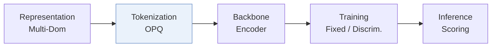
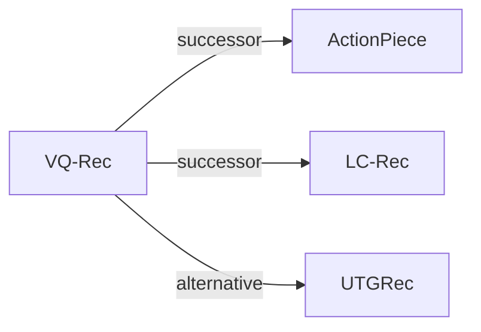

# VQ-Rec

*Learning Vector-Quantized Item Representation for Transferable Sequential Recommenders* — Hou et al. · WWW’23

`VI. 泛化` · `Tokenization` · [论文](https://arxiv.org/abs/2210.12316) · [代码](https://github.com/RUCAIBox/VQ-Rec) · [矩阵](../../../README.zh.md#vi--tokenization) · [English](../../papers/vq-rec.md)

阅读级别：概览（第 1 级） · 本页目录：[TL;DR](#tldr) · [速览](#速览) · [2. 方法](#2-方法) · [3. 实验发现](#3-实验发现) · [5. 相关工作](#5-相关工作)

- `OPQ`: Optimized product quantization.
- `Fixed`: SIDs are built first and not changed while the generator trains.
- `Discrim.`: Scores items; does not generate SIDs.

### TL;DR

> [!NOTE]
> VQ-Rec 将物品文本映射为离散码并查表组合码嵌入作为物品表示，配合对比预训练与跨域微调，解除文本与物品表示之间的强绑定。

### 速览

| 维度 | 摘要 |
| :-- | :-- |
| 研究问题 | VI. 泛化：Does it still work for new items, new domains, and shifting interests? |
| 核心贡献 | VQ-Rec 将物品文本映射为离散码并查表组合码嵌入作为物品表示，配合对比预训练与跨域微调，解除文本与物品表示之间的强绑定。 |
| 主要改动阶段 | Tokenization |

### 2. 方法

### 3. 实验发现

实验设置

- **数据集**：Pre-training on five Amazon domains (Food, Home, CDs, Kindle, Movies; 1,361,408 users / 446,975 items); downstream on Amazon Scientific, Pantry, Instruments, Arts, Office and the cross-platform Online Retail dataset. Users and items with fewer than 5 interactions are filtered (following UniSRec); item text truncated to 512 tokens.
  - 出处：Pre-training and downstream domains: [S3.SS1.SSS1.p1](https://arxiv.org/html/2210.12316v2#S3.SS1.SSS1.p1); filtering: [S3.SS1.SSS1.p2](https://arxiv.org/html/2210.12316v2#S3.SS1.SSS1.p2); statistics: [S2.T1](https://arxiv.org/html/2210.12316v2#S2.T1).
- **切分**：Leave-one-out: latest item for test, the one before for validation, the rest for training; pre-train on source domains, then fine-tune per downstream dataset.
  - 出处：Leave-one-out allocation: [S3.SS1.SSS3.p1](https://arxiv.org/html/2210.12316v2#S3.SS1.SSS3.p1).
- **候选集**：full catalog (the ground-truth item is ranked among all other items).
  - 出处：Ranked among all other items: [S3.SS1.SSS3.p1](https://arxiv.org/html/2210.12316v2#S3.SS1.SSS3.p1).
- **可见性**：warm; no unseen-item protocol is defined. Figure 4 groups test items by popularity (e.g. [0, 5) interactions on Office), which are low-frequency rather than strictly unseen; the inductive no-retraining claim is not separately tested.
  - 出处：Cold-start groups by popularity, inductive capability without a dedicated unseen-item test: [S3.SS4.SSS3.p1](https://arxiv.org/html/2210.12316v2#S3.SS4.SSS3.p1) and [S3.SS2.p3](https://arxiv.org/html/2210.12316v2#S3.SS2.p3).
- **SID 规格**：OPQ codes over item text embeddings, written as (M=32) x (D=256) PQ indices in the implementation; the method section uses D for the number of code sets and M for the centroids per set, so the two notations do not state the same split unambiguously. The paper argues that K-means-trained OPQ tends to give near-uniform code distributions, which keeps collisions low; a rule for items sharing a code: not reported. Downstream domains re-train PQ centroids with a permutation-based code-embedding alignment.
  - 出处：(M=32) x (D=256) PQ indices: [S3.SS1.SSS4.p1](https://arxiv.org/html/2210.12316v2#S3.SS1.SSS4.p1); D sets of M centroids in the method: [S2.SS2.SSS1.p3](https://arxiv.org/html/2210.12316v2#S2.SS2.SSS1.p3); uniform code distribution argument: [S2.SS2.SSS3.p1](https://arxiv.org/html/2210.12316v2#S2.SS2.SSS3.p1); domain re-training of centroids: [S2.SS4.SSS1.p2](https://arxiv.org/html/2210.12316v2#S2.SS4.SSS1.p2).
- **推理预算**：n/a for generation (a Transformer sequence encoder scores items through pooled code embeddings; implemented with Faiss and RecBole). Hardware, inference batch size, and latency: not reported.
  - 出处：Discriminative ranking with Faiss and RecBole: [S3.SS1.SSS4.p1](https://arxiv.org/html/2210.12316v2#S3.SS1.SSS4.p1).
- **结果来源**：Table 2 (cross-domain and cross-platform comparison with ID, text, and transferable baselines); Table 3 (ablations); Figure 4 (popularity groups).
  - 出处：Main: [S3.T2](https://arxiv.org/html/2210.12316v2#S3.T2); ablation: [S3.T3](https://arxiv.org/html/2210.12316v2#S3.T3); cold-start groups: [S3.F4](https://arxiv.org/html/2210.12316v2#S3.F4).

### 5. 相关工作

- **后续工作** · [ActionPiece](actionpiece.md): ActionPiece later follows VQ-Rec in quantizing sentence embeddings with OPQ into unordered codes and merges them into context-dependent tokens for generation.
  - 出处：Evidence is from the later ActionPiece paper, Appendix F: https://arxiv.org/html/2502.13581v3#A6.I1.i3.p1; VQ-Rec is a Table 4 baseline: https://arxiv.org/html/2502.13581v3#S3.T4.
- **后续工作** · [LC-Rec](lc-rec.md): LC-Rec later borrows VQ-Rec's idea of learned discrete indices for items and builds RQ indices for LLM tuning.
  - 出处：Evidence is from the later LC-Rec paper, Section 3.2.1: https://arxiv.org/html/2311.09049v4#S3.SS2.SSS1.p1 and https://arxiv.org/html/2311.09049v4#S3.SS2.SSS1.p4.
- **替代方案** · [UTGRec](utgrec.md): UTGRec later compares against VQ-Rec for cross-domain transfer and replaces PQ codes with a universal tree tokenizer for generative recommendation.
  - 出处：Evidence is from the later UTGRec paper: content-based baselines and Table 2: https://arxiv.org/html/2504.04405v3#S3.SS1.SSS2.p11 and https://arxiv.org/html/2504.04405v3#S3.T2.

[查看同格全部论文](../../../README.zh.md#vi--tokenization)
